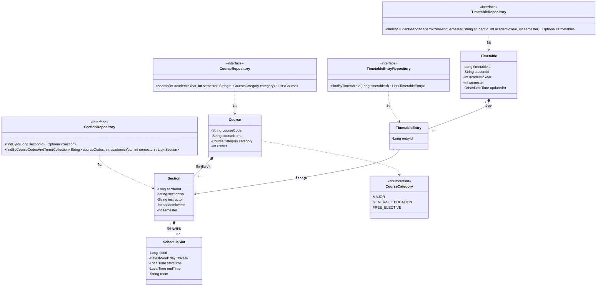

# US1-T06 — DAO Class Diagram

Entity และ repository (DAO) ที่ `TimetableService` และ `CourseService` ใช้ ดู flow การเรียกใช้ใน [Sequence Diagram](./US1-T06-Sequence-Diagram.md)

Entity ใช้ชื่อ `Course`, `Section`, `ScheduleSlot`, `TimetableEntry` ตามที่ DTO Class Diagram ตั้งไว้ชั่วคราว และเพิ่ม `Timetable` เพื่อเก็บตารางของนักศึกษาแต่ละภาคเรียน ยืนยันชื่อทั้งหมดในเอกสารนี้ วาดเฉพาะ method ที่ออกแบบเอง ไม่วาด method มาตรฐานของ repository เช่น `save`

| Repository | Method | ใช้โดย | ใช้ใน |
| --- | --- | --- | --- |
| `CourseRepository` | `search(...)` | `CourseService.search` | `GET /api/courses` |
| `SectionRepository` | `findById` | `TimetableService.addEntry` | `POST /api/timetable/entries` |
| `SectionRepository` | `findByCourseCodesAndTerm` | `CourseService.search` | `GET /api/courses` |

`CourseRepository.search` คืนแค่วิชา `CourseService.search` จึงส่งรหัสวิชาที่ได้ต่อให้ `findByCourseCodesAndTerm` เพื่อดึงกลุ่มเรียนของภาคนั้นพร้อมคาบเรียนมาประกอบ `CourseResponse.sections` ทั้งหมดใช้ 2 query ต่อ request ไม่ใส่ collection `sections` ใน `Course` เพราะต้องกรองตามภาคทุกครั้งอยู่แล้ว
| `TimetableRepository` | `findByStudentIdAndAcademicYearAndSemester` | `getTimetable`, `addEntry` | `GET /api/timetable`, `POST` |
| `TimetableEntryRepository` | `findByTimetableId` | `getTimetable`, `addEntry` | `GET /api/timetable`, `POST` |

## เอกสารที่เกี่ยวข้อง
- [Sequence Diagram](./US1-T06-Sequence-Diagram.md)
- [DAO Class Diagram](./US1-T06-DAO-Class-Diagram.md)
- [Extended API Class Diagram](./US1-T06-Extended-API-Class-Diagram.md)
- [ER Diagram (DB)](./US1-T06-ER-Diagram.md)
- [DTO & API Spec](./US1-DTO-API-Spec.md) (US1-T05)
