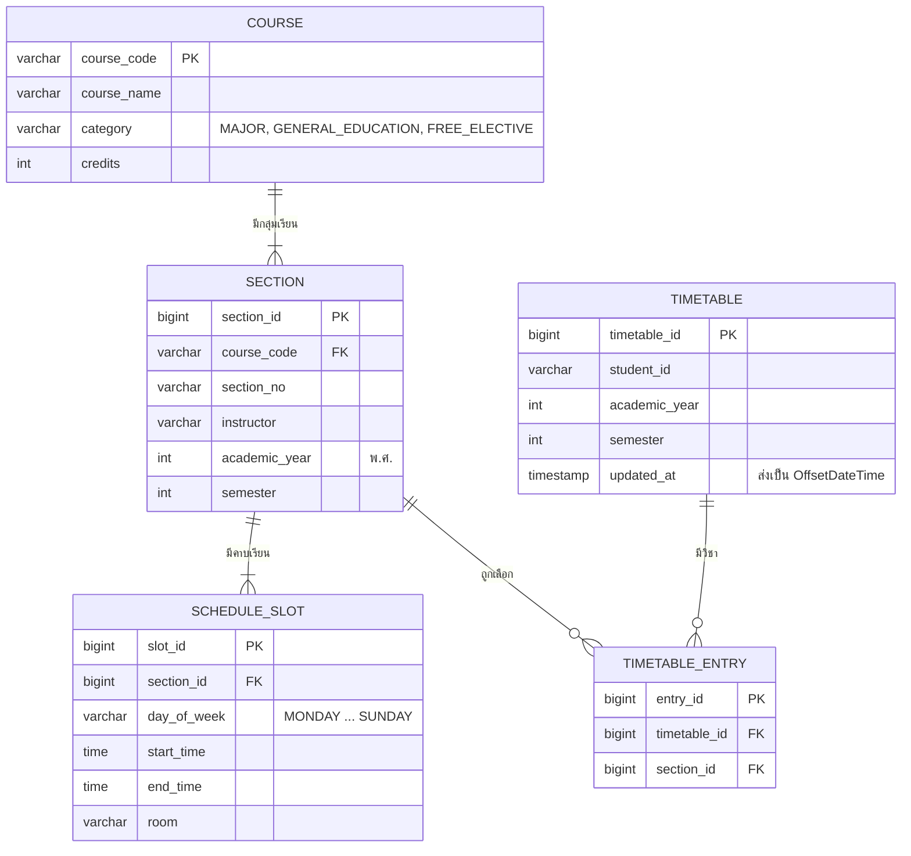

# US1-T06 — ER Diagram (DB)

โครงสร้างฐานข้อมูลของรายวิชา กลุ่มเรียน คาบเรียน และตารางเรียนจำลอง สอดคล้องกับ entity ใน [DAO Class Diagram](./US1-T06-DAO-Class-Diagram.md)

ข้อกำหนดของตาราง

| ตาราง | Constraint | เหตุผล |
| --- | --- | --- |
| `timetable` | unique (`student_id`, `academic_year`, `semester`) | 1 นักศึกษามี 1 ตารางต่อภาคเรียน |
| `timetable_entry` | unique (`timetable_id`, `section_id`) | กันเพิ่มกลุ่มเดียวกันซ้ำ |
| `section` | `section_no` unique ภายใน (`course_code`, `academic_year`, `semester`) | รหัสกลุ่มซ้ำได้ข้ามภาคเรียน |

- **วิชาซ้ำคนละกลุ่ม** (TC8) ตรวจที่ `TimetableService.checkNotAlreadyAdded` เทียบ `course_code` ของ section ไม่ใช่ constraint ใน DB เพราะ `timetable_entry` ไม่เก็บ `course_code` ตรงๆ
- **ภาคเรียนของตาราง** อ่านจาก `section.academic_year` และ `section.semester` ตามที่ Spec ระบุว่าไม่ต้องส่งใน body
- **`student_id`** เก็บเป็นข้อความธรรมดา ยังไม่มีตารางนักศึกษาเพราะ US3 ยังไม่เสร็จ ค่าตอนนี้มาจาก `DemoStudentProvider`
- **US2 (ลบ)** ใช้ `DELETE /api/timetable/entries/{entryId}` จึงลบแถวใน `timetable_entry` ได้โดยไม่กระทบ schema นี้

## เอกสารที่เกี่ยวข้อง
- [Sequence Diagram](./US1-T06-Sequence-Diagram.md)
- [DAO Class Diagram](./US1-T06-DAO-Class-Diagram.md)
- [Extended API Class Diagram](./US1-T06-Extended-API-Class-Diagram.md)
- [ER Diagram (DB)](./US1-T06-ER-Diagram.md)
- [DTO & API Spec](./US1-DTO-API-Spec.md) (US1-T05)
