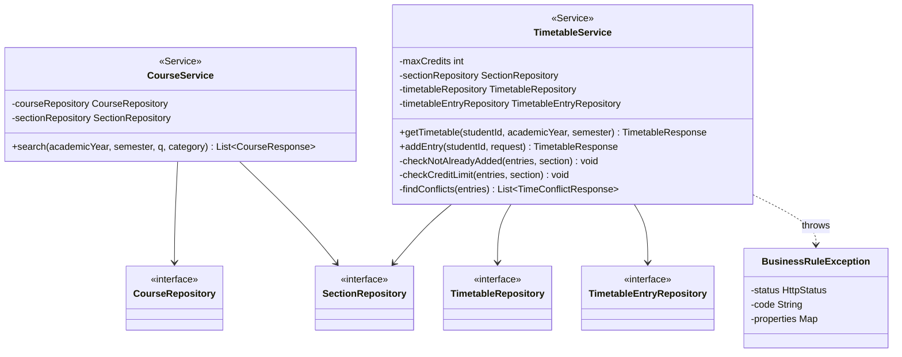

# US1-T06 — Extended API Class Diagram

ขยายจาก [API Class Diagram](../T05/US1-API-Class-Diagram.md) ของ US1-T05

ขยายจาก API Class Diagram ของ US1-T05 โดยเพิ่ม field `repository` ใน service (ที่เดิมเขียนว่า "ออกแบบใน US1-T06") controller, `CurrentStudentProvider`, `DemoStudentProvider` และ `GlobalExceptionHandler` ไม่เปลี่ยน จึงไม่วาดซ้ำ

- `maxCredits` อ่านจาก config `app.timetable.max-credits` (22)
- Method ของแต่ละ repository อยู่ใน [DAO Class Diagram](./US1-T06-DAO-Class-Diagram.md) ส่วน field ทุกตัวเป็น `private final` ฉีดผ่าน constructor ด้วย `@RequiredArgsConstructor` เหมือน `ItemController`

## เอกสารที่เกี่ยวข้อง
- [Sequence Diagram](./US1-T06-Sequence-Diagram.md)
- [DAO Class Diagram](./US1-T06-DAO-Class-Diagram.md)
- [Extended API Class Diagram](./US1-T06-Extended-API-Class-Diagram.md)
- [ER Diagram (DB)](./US1-T06-ER-Diagram.md)
- [DTO & API Spec](../T05/US1-DTO%20&%20API%20Spec.md) (US1-T05)
