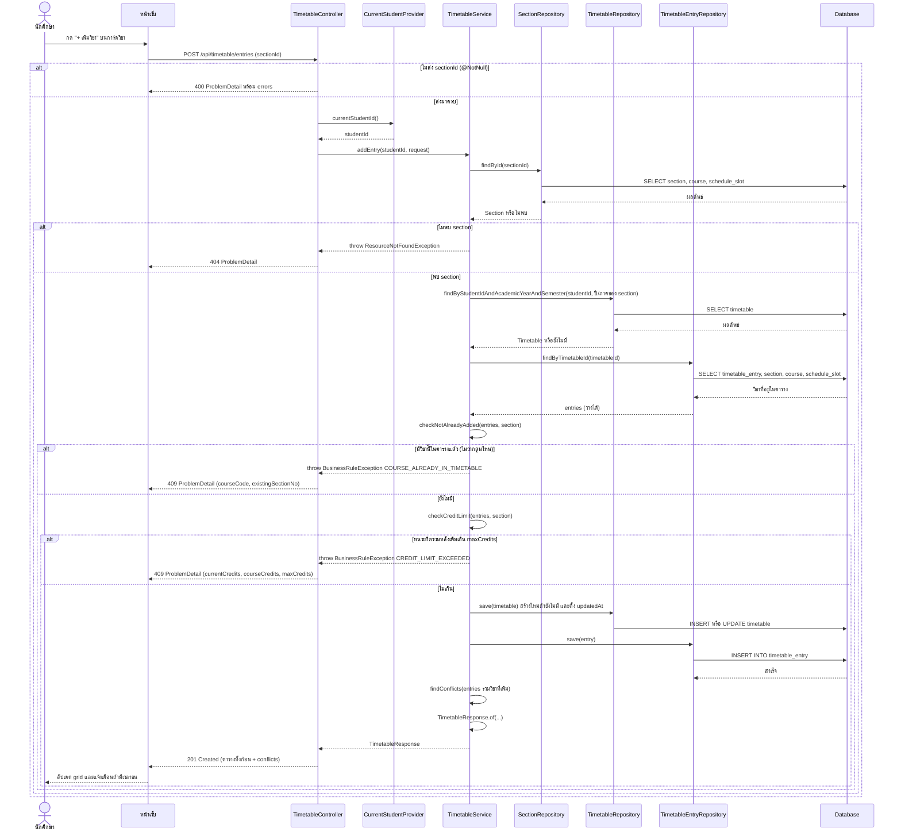

# US1-T06 — Sequence Diagram: เพิ่มวิชาลงตารางเรียนจำลอง

ลำดับการทำงานระหว่าง UI, API, repository (DAO) และ DB ของ `POST /api/timetable/entries` ต่อจาก US1-T05

ข้อกำหนดที่ใช้ตาม [DTO & API Spec](../T05/US1-DTO%20&%20API%20Spec.md):

- ลำดับตรวจใน `addEntry`: ตรวจ body (400) → หา section (404) → วิชาซ้ำ (409) → หน่วยกิต (409) → บันทึก แล้วคำนวณ `conflicts` ใหม่ (201) ซึ่ง Spec ระบุให้ใช้ลำดับนี้แทนลำดับในการ์ด US1-T06
- เวลาชนไม่ใช่ error ตอบ `201` พร้อม `conflicts` ที่ไม่ว่าง
- `findConflicts(entries)` เป็น private method ใน `TimetableService` คำนวณจากคาบเรียนในหน่วยความจำ ไม่ใช่ query ใน DB
- ชื่อ "DAO" ในการ์ดคือ repository ตามที่ API Class Diagram เขียนไว้ว่า "repository เป็นงาน US1-T06"

หมายเหตุ

- `BusinessRuleException` ถูกจับโดย `GlobalExceptionHandler.handleBusinessRule` แปลงเป็น ProblemDetail พร้อม `code` ตาม API Spec
- ถ้าตารางของภาคเรียนนั้นยังไม่เคยมี `Timetable` จะสร้างตอนบันทึกวิชาแรก ตารางว่างจึง `updatedAt: null` ตาม Spec

## เอกสารที่เกี่ยวข้อง
- [Sequence Diagram](./US1-T06-Sequence-Diagram.md)
- [DAO Class Diagram](./US1-T06-DAO-Class-Diagram.md)
- [Extended API Class Diagram](./US1-T06-Extended-API-Class-Diagram.md)
- [ER Diagram (DB)](./US1-T06-ER-Diagram.md)
- [DTO & API Spec](../T05/US1-DTO%20&%20API%20Spec.md) (US1-T05)
