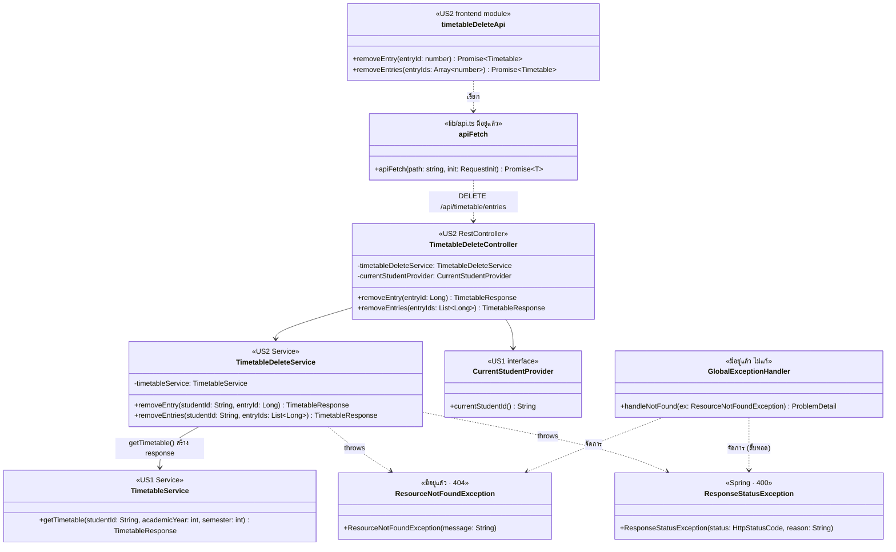

# US2 — API Class Diagram

US2 เพิ่ม **controller กับ service ใหม่ฝั่ง backend** ใน package `timetable` และโมดูลเรียก API ฝั่ง frontend แผนภาพวาด class ของ US2 (`<<US2>>`) กับจุดที่พึ่ง US1 และของที่มีอยู่แล้ว โดย**ไม่แก้** `TimetableController`, `TimetableService` และ `GlobalExceptionHandler`

| ส่วน | หน้าที่ |
| --- | --- |
| `TimetableDeleteController` | `@RestController @RequestMapping("/api/timetable/entries")` · `removeEntry` = `DELETE /{entryId}` · `removeEntries` = `DELETE ?entryIds=` ทั้งสองตอบ `200` ขอ `studentId` จาก `CurrentStudentProvider` แล้วส่งต่อให้ service |
| `TimetableDeleteService` | `@Transactional` ที่ระดับ class · `removeEntries` ตรวจตามลำดับใน API Spec: `entryIds` ว่าง (400) → ตัด id ซ้ำ → หา entry ของนักศึกษาคนนี้ (404) → อยู่ตารางเดียวกัน (400) → ลบ, `touch()` ตาราง แล้วคืน `getTimetable()` · `removeEntry` เรียก `removeEntries` ด้วย id ตัวเดียว |
| `TimetableService.getTimetable` (US1) | สร้าง `TimetableResponse` ของภาคที่ entry อยู่หลังลบ US2 ไม่เพิ่ม method ในนี้ ต้องรอ US1-T08 ทำเสร็จก่อน |
| `CurrentStudentProvider` (US1) | ให้ `studentId` ของผู้ใช้ปัจจุบัน ตอนนี้เป็น `DemoStudentProvider` จาก config หลัง US3 เปลี่ยนไปอ่านจาก session โดย controller ไม่ต้องแก้ |
| `ResourceNotFoundException` | ไม่พบ entry หรือเป็นของนักศึกษาคนอื่น → `404` ผ่าน `handleNotFound` เดิม |
| `ResponseStatusException` | `entryIds` ว่าง หรืออยู่คนละตาราง → `400` · `GlobalExceptionHandler` จัดการให้แล้วผ่าน `ResponseEntityExceptionHandler` ที่สืบทอดมา จึงไม่ต้องเพิ่ม handler หรือ `code` ใหม่ |
| `timetableDeleteApi` | `frontend/features/timetable-delete/api.ts` ต่อ `entryIds` เข้า URL ด้วย `join(",")` ไม่ส่ง body |
| `apiFetch` | ตัวเดิมใน `lib/api.ts` แปลง error เป็น `ApiError` ให้ UI ตัดสินจาก `status` |

ไม่ได้วาด `TimetableEntryRepository` (`findAllById`, `deleteAll`) และ entity `Timetable` / `TimetableEntry` เพราะเป็นงานของ Extended API class diagram ใน US2-T06 แบบเดียวกับที่ US1 แยกไว้ ส่วน component หน้าจอ (checkbox และปุ่มลบ) ออกแบบใน US2-T07 ตาม Figma frame 1:256 และ 1:1810

Spring ให้ `TimetableDeleteController` กับ `TimetableController` ของ US1 ใช้ path ขึ้นต้น `/api/timetable` ร่วมกันได้ เพราะ method กับ path ไม่ซ้ำกัน (US1 มี `GET /api/timetable` และ `POST /api/timetable/entries`)

สัญลักษณ์: `+` = public, `-` = private · field ทุกตัวเป็น `private final` ฉีดผ่าน constructor ด้วย `@RequiredArgsConstructor` ตามแบบ `ItemController` · ไม่มี `#` เพราะ class ใหม่ของ US2 ไม่มีการสืบทอด · เส้นทึบ = เรียกใช้ผ่าน field, เส้นประ = throws / จัดการ exception / เรียกผ่าน HTTP

## เอกสารที่เกี่ยวข้อง

- [DTO & API Spec](./US2-DTO-API-Spec.md)
- [DTO Class Diagram](./US2-DTO-Class-Diagram.md)
- [US1 — API Class Diagram](../../US1/T05/US1-API-Class-Diagram.md)
- [US1-T06 — Extended API Class Diagram](../../US1/T06/US1-T06-Extended-API-Class-Diagram.md)
