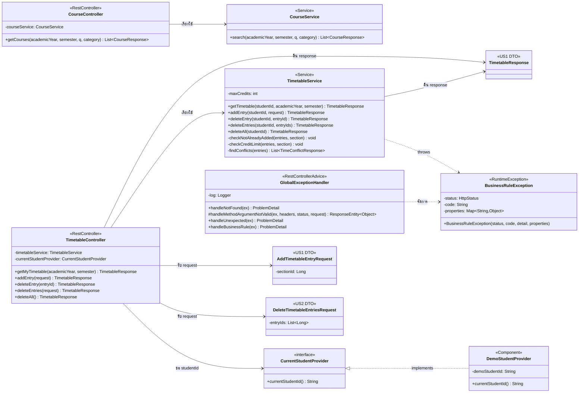

# US2 — API Class Diagram: ลบวิชาจากตารางเรียนจำลอง

Oct 14, 2026 · @Termtem

## API Class Diagram

แผนภาพนี้ต่อยอดจาก API Class Diagram ของ US1 โดยคงโครงสร้าง Controller, Service, Provider และ Exception เดิม แล้วเพิ่มเฉพาะส่วนที่ US2 ต้องใช้สำหรับการลบวิชา

Repository ไม่อยู่ในแผนภาพนี้ เพราะเป็นงาน US1-T06 ตามขอบเขตเดิมของ US1 และ getter ของ field ไม่แสดงใน diagram

### TimetableController

US1 มี `getMyTimetable(...)` และ `addEntry(...)` อยู่เดิม ส่วน US2 เพิ่ม endpoint สำหรับการลบ 3 รูปแบบ:

- `DELETE /api/timetable/entries/{entryId}` — ลบวิชา 1 รายการ
- `DELETE /api/timetable/entries` — ลบหลายรายการ
- `DELETE /api/timetable/entries/all` — ลบวิชาทั้งหมด

Controller ใช้ `CurrentStudentProvider` เพื่อขอ `studentId` เช่นเดียวกับ US1

### TimetableService

คง method เดิมของ US1 ได้แก่ `getTimetable(...)`, `addEntry(...)` และกฎภายใน `addEntry` แล้วเพิ่ม:

- `deleteEntry(studentId, entryId)` — ลบ 1 รายการ
- `deleteEntries(studentId, entryIds)` — ลบหลายรายการ
- `deleteAll(studentId)` — ลบทั้งหมด

ทุก method ลบคืน `TimetableResponse` เพื่อให้ frontend ใช้ข้อมูลตารางล่าสุดได้ทันที

### Error handling

ใช้ `GlobalExceptionHandler` เดิมของ US1 สำหรับการจัดการ exception โดยกรณี `entryId` ไม่พบให้ใช้กลไก `handleNotFound(...)` และแจ้งว่าไม่พบรายการดังกล่าว

สำหรับการลบหลายรายการ หากมี `entryId` ใดไม่พบ ระบบจะไม่ลบรายการใดและแจ้งว่าไม่พบรายการดังกล่าว

`BusinessRuleException` ยังคงเป็น exception สำหรับ business rule เดิมของ US1 ไม่ได้สร้าง exception ใหม่เฉพาะสำหรับการลบ