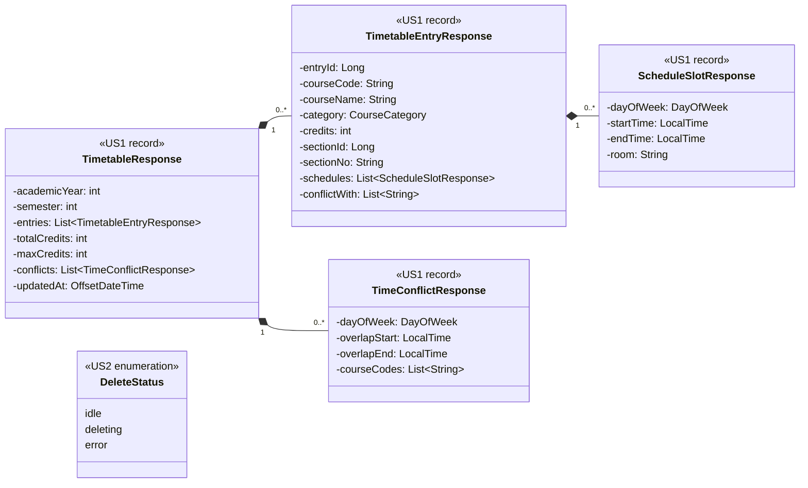

# US2 — DTO Class Diagram

US2 **ไม่มี DTO ใหม่** แผนภาพนี้แสดง DTO ของ US1 (`<<US1>>`) ที่ทั้งสอง endpoint ของ US2 คืนกลับ และ type ใหม่ฝั่ง frontend ของ US2 เอง (`<<US2>>`) ซึ่งไม่ได้ส่งผ่าน API

| Type | เจ้าของ | US2 ใช้อย่างไร |
| --- | --- | --- |
| `TimetableResponse` | US1 (`timetable.dto`) | สิ่งที่ทั้งสอง endpoint คืนหลังลบ เป็นตารางทั้งก้อนของภาคที่ entry อยู่ ลบจนหมดได้ `entries: []` และ `updatedAt` เป็นเวลาที่ลบ (ไม่ใช่ `null`) |
| `TimetableEntryResponse` | US1 | `entryId` คือค่าที่ checkbox ใช้และส่งไปใน `entryIds` ส่วน `courseCode`, `courseName`, `sectionNo` ใช้แสดงชื่อวิชาที่จะลบ |
| `ScheduleSlotResponse`, `TimeConflictResponse` | US1 | วาด grid และแถบเวลาชนใหม่หลังลบ ลบวิชาที่ชนแล้ว `conflicts` และ `conflictWith` ของอีกวิชาจะว่าง |
| `DeleteStatus` | US2 (`features/timetable-delete/types.ts`) | สถานะปุ่มลบ `idle` / `deleting` / `error` |

**ไม่มี request DTO** เพราะ DELETE ไม่มี body ค่าที่ส่งมารับตรงใน controller เป็น `entryId: Long` จาก path และ `entryIds: List<Long>` จาก query (ดู [API Class Diagram](./US2-API-Class-Diagram.md))

ฝั่ง frontend ใช้ type `Timetable`, `TimetableEntry`, `ScheduleSlot` และ `TimeConflict` ใน `frontend/features/timetable/types.ts` ของ US1 ซึ่งตรงกับ record ด้านบนทีละ field เวลาใน JSON เป็น `"HH:mm"` และ `updatedAt` เป็น ISO 8601 พร้อม offset ตาม US1 ส่วน `CourseCategory` และ static method `from()` / `of()` ของแต่ละ record ดูใน [DTO Class Diagram ของ US1](../../US1/T05/US1-DTO-Class-Diagram.md)

สัญลักษณ์: field ของ record เป็น `private final` (-) ส่วน accessor แบบ public ที่ record สร้างให้อัตโนมัติไม่ได้วาด ไม่มี `#` เพราะ record สืบทอดไม่ได้ `DeleteStatus` เป็น union type ของ TypeScript จึงวาดเป็น enumeration

## เอกสารที่เกี่ยวข้อง

- [DTO & API Spec](./US2-DTO-API-Spec.md)
- [API Class Diagram](./US2-API-Class-Diagram.md)
- [US1 — DTO Class Diagram](../../US1/T05/US1-DTO-Class-Diagram.md)
