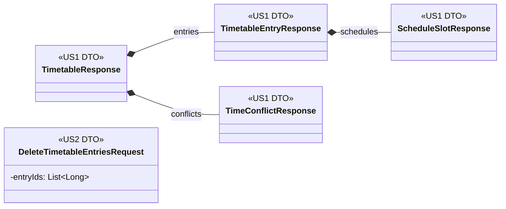

# DTO Class Diagram

## DTO Class Diagram

US2 ใช้ DTO ตารางเรียนจาก US1 ต่อ โดยไม่สร้าง `TimetableResponse` ใหม่

DTO ที่ใช้ร่วมกับ US1:
- `TimetableResponse`
- `TimetableEntryResponse`
- `TimeConflictResponse`
- `ScheduleSlotResponse`

DTO ที่เพิ่มใน US2:

### `DeleteTimetableEntriesRequest`

| Field | Type |
|---|---|
| entryIds | List<Long> |

ใช้รับรายการ `entryId` ของวิชาที่ผู้ใช้เลือกสำหรับการลบหลายรายการ
