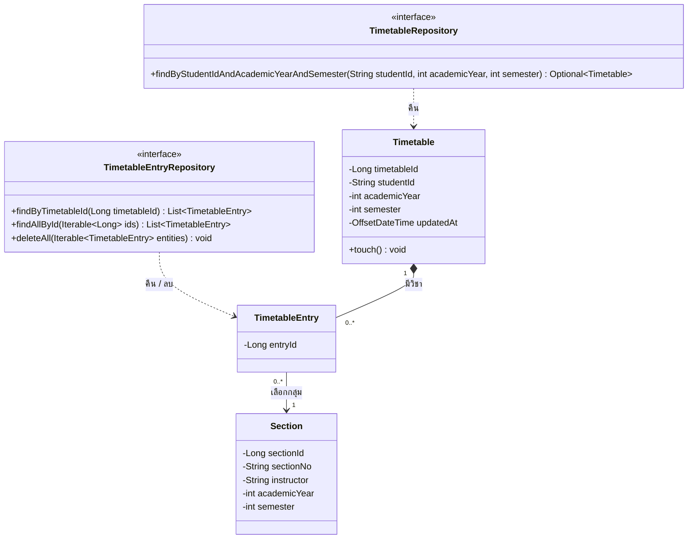

# US2-T06 — DAO Class Diagram

US2 **ไม่มี entity หรือ repository ใหม่ และไม่เพิ่ม method ใน repository** ใช้ของ [US1-T06](../../US1/T06/US1-T06-DAO-Class-Diagram.md) ทั้งหมด แผนภาพนี้วาดเฉพาะส่วนที่ US2 เรียกใช้ ดู flow การเรียกใช้ใน [Sequence Diagram](./US2-T06-Sequence-Diagram.md)

US1-T06 วาดเฉพาะ method ที่ออกแบบเอง แต่ US2 ใช้แค่ method มาตรฐานที่ `TimetableEntryRepository` สืบทอดจาก `JpaRepository` (`findAllById`, `deleteAll`) จึงวาด method เหล่านี้ไว้ด้วยให้เห็นว่าเรียกอะไร และวาด `touch()` ของ `Timetable` ที่มีอยู่ใน entity แล้ว

| Repository / Entity | Method | ที่มา | ใช้โดย | ใช้ใน |
| --- | --- | --- | --- | --- |
| `TimetableEntryRepository` | `findAllById(ids)` | สืบทอดจาก `JpaRepository` | `TimetableDeleteService.removeEntries` | `DELETE /api/timetable/entries` ทั้งสองแบบ |
| `TimetableEntryRepository` | `deleteAll(entries)` | สืบทอดจาก `JpaRepository` | `TimetableDeleteService.removeEntries` | `DELETE /api/timetable/entries` ทั้งสองแบบ |
| `Timetable` | `touch()` | entity ของ US1-T09 | `TimetableDeleteService.removeEntries` | ตั้ง `updatedAt` หลังลบ |
| `TimetableRepository` | `findByStudentIdAndAcademicYearAndSemester` | US1 | `TimetableService.getTimetable` ที่ US2 เรียก | สร้าง response หลังลบ |
| `TimetableEntryRepository` | `findByTimetableId` | US1 | `TimetableService.getTimetable` ที่ US2 เรียก | สร้าง response หลังลบ |

**ทำไมไม่เพิ่ม method ใหม่**

- ตารางหนึ่งมีไม่เกิน 22 entry และ entry ที่ลบพร้อมกันอยู่ตารางเดียวกันเกือบเสมอ `findAllById` แล้วโหลด `entry.timetable` แบบ LAZY จึงใช้แค่ 2 query คือ entry 1 ครั้ง และ timetable 1 ครั้ง
- ไม่ต้องแก้ไฟล์ `TimetableEntryRepository` ของ US1 ลด merge conflict ตาม CONTRIBUTING
- ถ้าภายหลังอยากรวมเป็น query เดียว ให้เพิ่ม `@Query` ที่ `join fetch e.timetable` แบบเดียวกับ `findByTimetableId` ได้โดยไม่กระทบ service

**ทำไมใช้ `deleteAll(entries)` ไม่ใช่ `deleteAllInBatch`**

`deleteAll` ลบผ่าน persistence context ทีละ entity (ไม่เกิน 22 คำสั่ง) Hibernate จึงรู้ว่า entry ไหนถูกลบ และ `getTimetable` ที่เรียกต่อใน transaction เดียวกันจะไม่เห็น entry เหล่านั้น ส่วน `deleteAllInBatch` ส่ง `DELETE` คำสั่งเดียวตรงไปที่ DB โดยไม่ผ่าน persistence context จึงเสี่ยงได้ entity ที่ค้างอยู่ใน memory

`Course`, `ScheduleSlot` และ `CourseCategory` ไม่ได้วาด เพราะ US2 ไม่ได้ใช้ตรงๆ `getTimetable` ของ US1 เป็นคนอ่านผ่าน `findByTimetableId` ดูได้ใน DAO Class Diagram ของ US1-T06

## เอกสารที่เกี่ยวข้อง

- [Sequence Diagram](./US2-T06-Sequence-Diagram.md)
- [DAO Class Diagram](./US2-T06-DAO-Class-Diagram.md)
- [Extended API Class Diagram](./US2-T06-Extended-API-Class-Diagram.md)
- [ER Diagram (DB)](./US2-T06-ER-Diagram.md)
- [US1-T06 — DAO Class Diagram](../../US1/T06/US1-T06-DAO-Class-Diagram.md)
