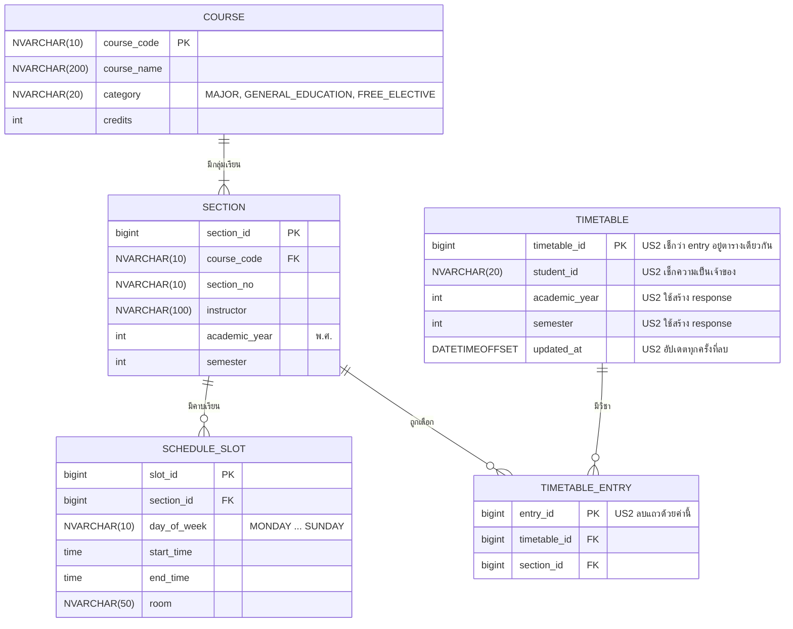

# US2-T06 — ER Diagram (DB)

US2 **ไม่เปลี่ยน schema และไม่มี migration ใหม่** ใช้ตารางตาม [ER Diagram ของ US1-T06](../../US1/T06/US1-T06-ER-Diagram.md) (`V20261014_1940__create_timetable_tables.sql`) แผนภาพนี้คือแผนภาพเดิมของ US1 ที่ใส่หมายเหตุว่า US2 ใช้คอลัมน์ไหน ตามที่ ER ของ US1 เขียนไว้ว่าการลบใน US2 "ไม่กระทบ schema นี้"

US2 ทำอะไรกับแต่ละตาราง

| ตาราง | US2 ทำอะไร | ผ่านอะไร |
| --- | --- | --- |
| `timetable_entry` | อ่านตาม `entry_id` แล้ว **ลบ** แถว | `findAllById`, `deleteAll` |
| `timetable` | อ่านเพื่อเช็ก `student_id` และ `timetable_id` แล้ว **อัปเดต** `updated_at` | `entry.getTimetable()`, `touch()` |
| `section`, `course`, `schedule_slot` | อ่านอย่างเดียว ตอนสร้าง response | `getTimetable` ของ US1 |

ผลของ constraint เดิมต่อการลบ

| Constraint | ผลต่อ US2 |
| --- | --- |
| `fk_timetable_entry_timetable` (`ON DELETE CASCADE`) | ทำงานเฉพาะตอนลบแถว `timetable` ซึ่ง US2 ไม่ลบ แถว `timetable` จึงยังอยู่แม้ลบวิชาจนหมด |
| `fk_timetable_entry_section` | ลบ entry ไม่กระทบ `section` เพราะ FK ชี้จาก entry ไป section ไม่มีตารางไหนชี้กลับมาที่ `timetable_entry` จึงลบได้ทันที |
| `uq_timetable_entry_section` (`timetable_id`, `section_id`) | พอลบ entry แล้ว คู่นี้ว่างลง เพิ่มกลุ่มเดิมกลับมาได้ แต่จะได้ `entry_id` ใหม่ เพราะ IDENTITY ไม่ใช้เลขเดิมซ้ำ |
| `uq_timetable_student_term` (`student_id`, `academic_year`, `semester`) | ทำให้ "ตารางเดียวกัน" เท่ากับ "ปีและภาคเดียวกัน" US2 จึงเช็กแค่ `timetable_id` ไม่ต้องเทียบปีกับภาคเอง |

- **ความเป็นเจ้าของ** เช็กจาก `timetable.student_id` ของ entry เทียบกับรหัสจาก `CurrentStudentProvider` ไม่มีคอลัมน์ `student_id` ใน `timetable_entry` และไม่ต้องเพิ่ม
- **ตารางที่ลบจนว่าง** ยังมีแถว `timetable` พร้อม `updated_at` ต่างจากภาคที่ไม่เคยเพิ่มวิชาซึ่งไม่มีแถว `timetable` เลย (`updatedAt: null` ตาม US1)

## เอกสารที่เกี่ยวข้อง

- [Sequence Diagram](./US2-T06-Sequence-Diagram.md)
- [DAO Class Diagram](./US2-T06-DAO-Class-Diagram.md)
- [Extended API Class Diagram](./US2-T06-Extended-API-Class-Diagram.md)
- [ER Diagram (DB)](./US2-T06-ER-Diagram.md)
- [US1-T06 — ER Diagram](../../US1/T06/US1-T06-ER-Diagram.md)
