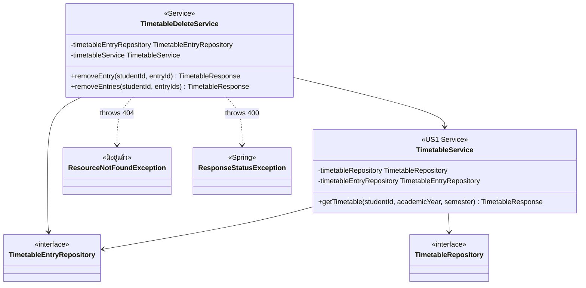

# US2-T06 — Extended API Class Diagram

ขยายจาก [API Class Diagram](../T05/US2-API-Class-Diagram.md) ของ US2-T05 โดยเพิ่ม field repository ใน `TimetableDeleteService` `TimetableDeleteController`, `CurrentStudentProvider`, `GlobalExceptionHandler` และโมดูลฝั่ง frontend ไม่เปลี่ยน จึงไม่วาดซ้ำ

- `TimetableDeleteService` ใช้ `TimetableEntryRepository` ตัวเดียวกับ US1 ไม่สร้าง repository ใหม่ method ที่เรียกอยู่ใน [DAO Class Diagram](./US2-T06-DAO-Class-Diagram.md)
- ไม่มี `TimetableRepository` ใน `TimetableDeleteService` เพราะได้ `Timetable` มาจาก `entry.getTimetable()` อยู่แล้ว การอ่านตารางเพื่อสร้าง response เป็นหน้าที่ของ `getTimetable` ใน US1
- `TimetableService` วาดเฉพาะส่วนที่เกี่ยวกับ US2 ส่วน `sectionRepository`, `maxCredits`, `addEntry` และ private method ดูได้ใน [Extended API Class Diagram ของ US1-T06](../../US1/T06/US1-T06-Extended-API-Class-Diagram.md)
- field ทุกตัวเป็น `private final` ฉีดผ่าน constructor ด้วย `@RequiredArgsConstructor` เหมือน `ItemController`
- `TimetableDeleteService` ใส่ `@Transactional` ที่ระดับ class เพราะ `removeEntry` เรียก `removeEntries` ภายใน class เดียวกัน ซึ่งไม่ผ่าน proxy ของ Spring และ `open-in-view: false` ทำให้การอ่าน `entry.getTimetable()` แบบ LAZY ต้องอยู่ใน transaction

## เอกสารที่เกี่ยวข้อง

- [Sequence Diagram](./US2-T06-Sequence-Diagram.md)
- [DAO Class Diagram](./US2-T06-DAO-Class-Diagram.md)
- [Extended API Class Diagram](./US2-T06-Extended-API-Class-Diagram.md)
- [ER Diagram (DB)](./US2-T06-ER-Diagram.md)
- [API Class Diagram](../T05/US2-API-Class-Diagram.md) (US2-T05)
