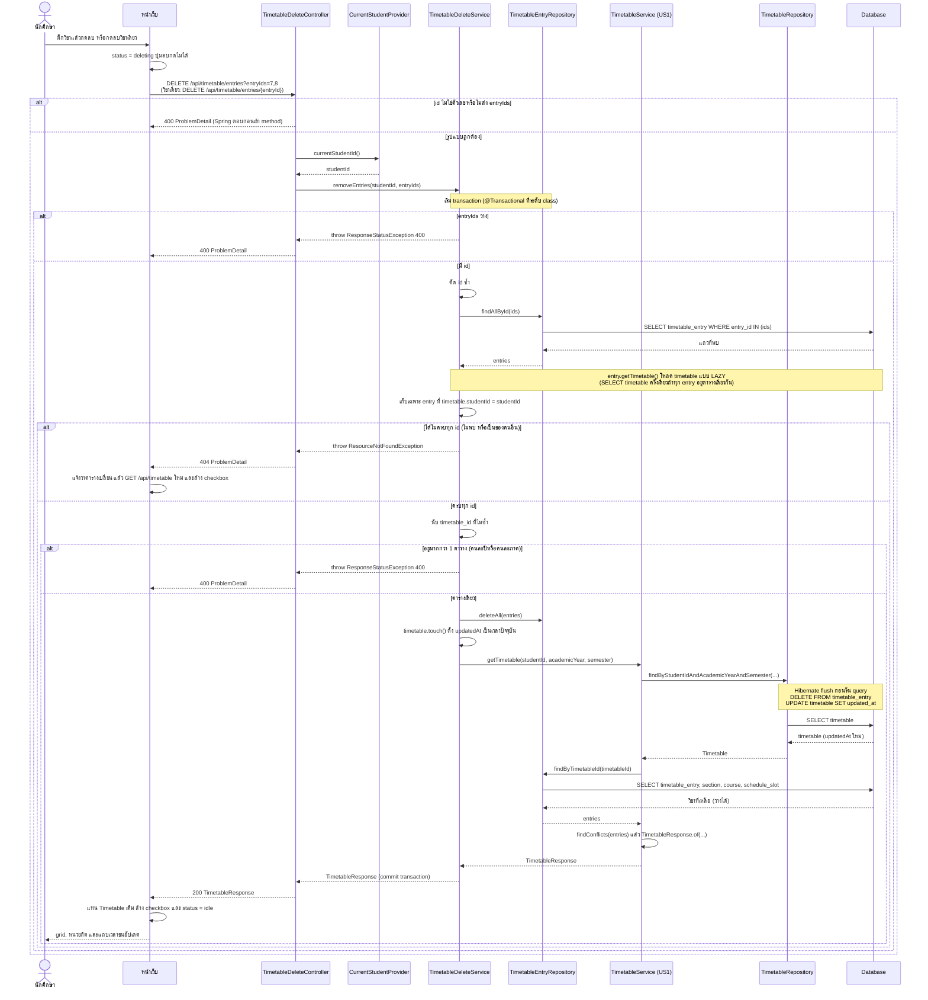

# US2-T06 — Sequence Diagram: ลบวิชาจากตารางเรียนจำลอง

ลำดับการทำงานระหว่าง UI, API, repository (DAO) และ DB ของ `DELETE /api/timetable/entries?entryIds=` และ `DELETE /api/timetable/entries/{entryId}` ต่อจาก US2-T05

ข้อกำหนดที่ใช้ตาม [DTO & API Spec](../T05/US2-DTO-API-Spec.md):

- ลำดับตรวจใน `removeEntries`: `entryIds` ว่าง (400) → ตัด id ซ้ำ → หา entry ของนักศึกษาคนนี้ (404) → อยู่ตารางเดียวกัน (400) → ลบ, `touch()` ตาราง แล้วคืนตาราง (200)
- `removeEntry(studentId, entryId)` เรียก `removeEntries(studentId, List.of(entryId))` ทั้งสอง endpoint จึงใช้ flow เดียวกันในแผนภาพนี้
- ไม่ต้องส่งปี/ภาค backend อ่านจาก `entry.timetable` ตาม [ER Diagram ของ US1-T06](../../US1/T06/US1-T06-ER-Diagram.md)
- response สร้างด้วย `TimetableService.getTimetable` ของ US1 ใน transaction เดียวกัน ไม่เขียนการประกอบ `TimetableResponse` ซ้ำ
- ชื่อ "DAO" ในการ์ดคือ repository เหมือน US1-T06

หมายเหตุ

- **ตรวจความเป็นเจ้าของก่อนตรวจคนละตาราง** ถ้าสลับกัน คนที่ส่ง id ของคนอื่นปนมาจะได้ `400` แทน `404` ซึ่งบอกเป็นนัยว่า id นั้นมีอยู่จริง entry ของคนอื่นจึงตอบ `404` ไม่ใช่ `403` ซึ่ง RFC 9110 อนุญาตไว้
- **all-or-nothing** ทุกการ throw เกิดก่อน `deleteAll` และอยู่ใน transaction เดียว ถ้า error จึงไม่มีแถวไหนถูกลบ
- **SQL ของการลบส่งตอน flush** `deleteAll` กับ `touch()` แค่เปลี่ยนสถานะใน persistence context Hibernate ส่ง `DELETE` และ `UPDATE` ก่อน query ถัดไปใน `getTimetable` วิชาที่ลบจึงไม่ติดมาใน response และ `updatedAt` เป็นเวลาใหม่
- **แถว `timetable` ไม่ถูกลบ** แม้ลบจนไม่เหลือวิชา response จึงได้ `entries: []` กับ `updatedAt` เป็นเวลาที่ลบ ต่างจากตารางที่ไม่เคยใช้ซึ่งได้ `updatedAt: null` ตาม US1
- **`ResponseStatusException` และ `ResourceNotFoundException`** ถูกแปลงเป็น ProblemDetail โดย `GlobalExceptionHandler` เดิม ไม่ต้องเพิ่ม handler
- **ไม่มีขั้นตอนตรวจตารางว่างฝั่ง backend** US2 TC4 (ตารางว่างกดลบไม่ได้) จัดการที่ UI จาก `entries.length === 0`

## เอกสารที่เกี่ยวข้อง

- [Sequence Diagram](./US2-T06-Sequence-Diagram.md)
- [DAO Class Diagram](./US2-T06-DAO-Class-Diagram.md)
- [Extended API Class Diagram](./US2-T06-Extended-API-Class-Diagram.md)
- [ER Diagram (DB)](./US2-T06-ER-Diagram.md)
- [DTO & API Spec](../T05/US2-DTO-API-Spec.md) (US2-T05)
- [US1-T06 — Sequence Diagram](../../US1/T06/US1-T06-Sequence-Diagram.md)
