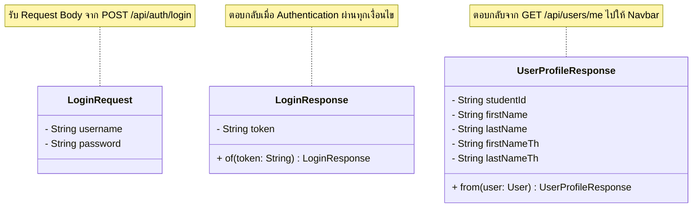

# US3 — DTO Class Diagram

ทุก DTO เป็น Java record ตามแบบ `ItemResponse` ที่มีอยู่ field เป็น `private final` (-) ส่วน accessor แบบ `public` (+) ของทุก field และ constructor ครบทุก field ถูกสร้างให้อัตโนมัติ แผนภาพจึงวาดเฉพาะ static method (ถ้ามี) ไม่มีสมาชิก `protected` (#) เพราะ record สืบทอดไม่ได้

    | Static method | หน้าที่ |
    | --- | ---|
    | UserProfileResponse.from(user) | แปลง entity User เป็น DTO เพื่อส่งข้อมูลกลับไปยัง Client |
    | LoginResponse.of(token) | ห่อ JWT Token เป็น DTO ก้อนเดียวเพื่อความเป็นระเบียบในการคืนค่า | 