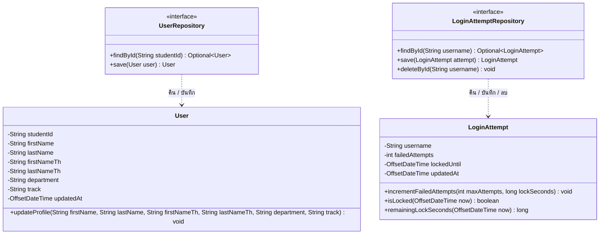

# US3-T06 — DAO Class Diagram

Entity และ Repository (DAO) ที่ `AuthService`, `UserService` และ `LoginAttemptService` ใช้ ดู flow การเรียกใช้ใน [Sequence Diagram](./US3-T06-Sequence-Diagram.md)

Entity ใช้ชื่อ `User` ตามที่ [DTO Class Diagram](../T05/US3-DTO-Class-Diagram.md) และ [API Class Diagram](../T05/US3-API-Class-Diagram.md) กำหนดไว้ (เก็บข้อมูลนักศึกษาและประวัติส่วนตัวที่ได้จาก TU Login API ในตาราง `users`) และเพิ่ม `LoginAttempt` พร้อม `LoginAttemptRepository` สำหรับเก็บจำนวนครั้งที่เข้าสู่ระบบผิดพลาดและเวลาที่ระงับบัญชีในตาราง `login_attempt` ตามข้อกำหนดในการ์ด US3-T06

## แผนภาพ DAO Class Diagram (Mermaid)

| Repository / Entity | Method | ที่มา | ใช้โดย | ใช้ใน |
| --- | --- | --- | --- | --- |
| `UserRepository` | `findById(studentId)` | สืบทอดจาก `JpaRepository<User, String>` | `AuthService.authenticate`, `UserService.getProfile` | `POST /api/auth/login`, `GET /api/users/me` |
| `UserRepository` | `save(user)` | สืบทอดจาก `JpaRepository<User, String>` | `AuthService.authenticate` | Upsert ข้อมูลนักศึกษาและประวัติส่วนตัวตอน login สำเร็จ |
| `User` | `updateProfile(...)` | entity ของ US3 | `AuthService.authenticate` | อัปเดตชื่อ-นามสกุล สาขา ภาค และ `updatedAt` จากข้อมูลล่าสุดของ TU API |
| `LoginAttemptRepository` | `findById(username)` | สืบทอดจาก `JpaRepository<LoginAttempt, String>` | `LoginAttemptService.isLocked`, `loginFailed`, `getWaitTime` | `POST /api/auth/login` |
| `LoginAttemptRepository` | `save(attempt)` | สืบทอดจาก `JpaRepository<LoginAttempt, String>` | `LoginAttemptService.loginFailed` | บันทึกจำนวนครั้งที่รหัสผิดและเวลา `lockedUntil` |
| `LoginAttemptRepository` | `deleteById(username)` | สืบทอดจาก `JpaRepository<LoginAttempt, String>` | `LoginAttemptService.loginSucceeded` | ล้างประวัติการใส่รหัสผิดเมื่อเข้าสู่ระบบสำเร็จ (ลบแถวออกจาก DB โดยตรง) |
| `LoginAttempt` | `incrementFailedAttempts`, `isLocked`, `remainingLockSeconds` | entity ของ US3 | `LoginAttemptService` | คำนวณสถานะการล็อก 15 นาทีเมื่อผิดครบ 5 ครั้ง และคำนวณวินาทีที่เหลือ (`retryAfterSeconds`) |

**เหตุผลการออกแบบ**

- **เลือกแนวทาง `deleteById(username)` แบบเดียวในการล้างจำนวนครั้งที่ผิด:** เมื่อเข้าสู่ระบบสำเร็จ (`TU Login API` ยืนยันว่ารหัสถูกต้อง) ระบบจะเรียก `loginAttemptRepository.deleteById(username)` เพื่อลบแถวออกจากตาราง `login_attempt` ทันที จึงไม่มีความจำเป็นต้องมี method `reset()` ใน Entity `LoginAttempt` ช่วยลดความซ้ำซ้อนและลดขนาดข้อมูลในฐานข้อมูล
- **การแยก Transaction ด้วย `@Transactional(propagation = Propagation.REQUIRES_NEW)`:** เนื่องจาก `AuthService` ถูกกำหนด `@Transactional` ในระดับ class (ตาม US3-T05) หาก `loginSucceeded` หรือ `loginFailed` อยู่ใน Transaction เดียวกัน เมื่อ `AuthService` โยน `BusinessRuleException` (เช่น `403 ACCOUNT_INACTIVE`, `403 NOT_CS_STUDENT`, หรือ `401 INVALID_CREDENTIALS`) Transaction จะถูก Rollback ส่งผลให้การลบหรือการบันทึกจำนวนครั้งที่ผิดไม่ถูกบันทึกลง DB ดังนั้นใน `LoginAttemptService` เมธอด `loginSucceeded` และ `loginFailed` จึงต้องประกาศ `@Transactional(propagation = Propagation.REQUIRES_NEW)` เพื่อเปิด Transaction ใหม่แยกต่างหากและ Commit ทันที ไม่ถูก Rollback ตาม Exception ของ `AuthService`
- **ใช้ method มาตรฐานของ `JpaRepository` ทั้งหมด:** ทั้ง `User` (PK = `studentId`) และ `LoginAttempt` (PK = `username`) ค้นหาด้วย Primary Key โดยตรง จึงใช้ `findById`, `save`, `deleteById` ที่สืบทอดจาก `JpaRepository` ได้ทันทีโดยไม่ต้องเขียน custom `@Query` (วาดไว้ในแผนภาพเหมือน US2-T06 เพื่อให้เห็นชัดเจนว่า Service เรียก method ใด)
- **ทำไมเก็บ `LoginAttempt` ลงฐานข้อมูล (`login_attempt`):**
  1. ตรงตามข้อกำหนดของการ์ด US3-T06 ที่ระบุให้มีส่วนการนับ login ผิดใน ER Diagram และสามารถทดสอบระดับ DAO ใน US3-T09 / US3-T12 ได้ด้วย `@DataJpaTest` เหมือน US1 และ US2
  2. ข้อมูลการระงับบัญชีไม่หายเมื่อ restart backend container และไม่ต้องเพิ่ม container Redis ใน `compose.yaml`
  3. หาก `lockedUntil` หมดเวลาแล้ว (`lockedUntil <= now`) แล้วผู้ใช้กรอกรหัสผิดอีกครั้ง `incrementFailedAttempts` จะเริ่มนับรอบใหม่ที่ `1` อัตโนมัติ
- **ความสัมพันธ์กับ `Timetable` (US1):** `Timetable.studentId` ของ US1 เก็บรหัสนักศึกษาเป็น `String` (`NVARCHAR(20)`) ซึ่งตรงกับ `User.studentId` พอดี โดยไม่ต้องแก้ entity `Timetable` ของ US1 ลด merge conflict ตาม CONTRIBUTING

## เอกสารที่เกี่ยวข้อง

- [Sequence Diagram](./US3-T06-Sequence-Diagram.md)
- [DAO Class Diagram](./US3-T06-DAO-Class-Diagram.md)
- [Extended API Class Diagram](./US3-T06-Extended-API-Class-Diagram.md)
- [ER Diagram (DB)](./US3-T06-ER-Diagram.md)
- [DTO & API Spec](../T05/US3-DTO-API-Spec.md) (US3-T05)
- [API Class Diagram](../T05/US3-API-Class-Diagram.md) (US3-T05)
- [DTO Class Diagram](../T05/US3-DTO-Class-Diagram.md) (US3-T05)
