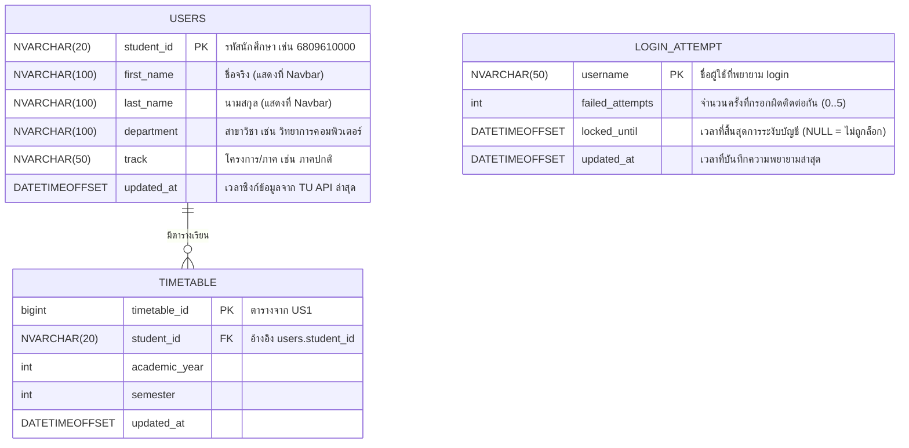

# US3-T06 — ER Diagram (DB)

โครงสร้างฐานข้อมูลส่วนนักศึกษา ประวัติส่วนตัว (`users`) และการนับจำนวนครั้งที่เข้าสู่ระบบผิดพลาด (`login_attempt`) พร้อมความสัมพันธ์กับตาราง `timetable` ของ [US1-T06](../../US1/T06/US1-T06-ER-Diagram.md) สอดคล้องกับ Entity ใน [DAO Class Diagram](./US3-T06-DAO-Class-Diagram.md)

## แผนภาพ ER Diagram (Mermaid)

## ข้อกำหนดของตาราง

| ตาราง | คอลัมน์ / Constraint | เหตุผล |
| --- | --- | --- |
| `users` | `pk_users` PRIMARY KEY (`student_id`) | ใช้รหัสนักศึกษา (`NVARCHAR(20)`) เป็น PK ตรงกับ `timetable.student_id` ของ US1 และไม่ต้องมี surrogate ID เพิ่ม |
| `users` | `first_name`, `last_name`, `department`, `track` ใช้ `NVARCHAR` | รองรับชื่อ-นามสกุลและชื่อสาขา/ภาคทั้งภาษาไทยและภาษาอังกฤษตามมาตรฐาน Flyway ใน `CONTRIBUTING.md` |
| `login_attempt` | `pk_login_attempt` PRIMARY KEY (`username`) | นับจำนวนครั้งที่ผิดต่อ `username` ที่กรอกเข้ามา (แม้ `username` นั้นยังไม่มีในตาราง `users` หรือยังไม่เคย login สำเร็จ จึงไม่ผูก FK กับ `users`) |
| `login_attempt` | `ck_login_attempt_count` CHECK (`failed_attempts >= 0`) | จำนวนครั้งที่ผิดต้องไม่ติดลบ |
| `login_attempt` | `locked_until` (`DATETIMEOFFSET NULL`) | เป็น `NULL` เมื่อยังไม่ถูกล็อก และมีค่าเท่ากับ `now + 15 นาที` เมื่อ `failed_attempts` ครบ 5 ครั้ง |

**รายละเอียดเพิ่มเติม**

- **ทำไมตั้งชื่อตารางว่า `users` แทน `user`:** คำว่า `USER` เป็นคำสงวน (Reserved Keyword) ใน SQL Server การใช้ชื่อตาราง `users` (`@Table(name = "users")` บนคลาส `User`) ช่วยให้เขียน query และ migration ได้โดยไม่ต้องใส่ `[user]` ทุกครั้ง
- **ข้อมูลนักศึกษาและประวัติส่วนตัว (`users`):** ตามที่ตกลงใน [US3 DTO & API Spec](../T05/US3-DTO-API-Spec.md) และ [US3-T16](../US3-T16.md) ระบบดึงข้อมูลนักศึกษา (`student_id`, `first_name`, `last_name`, `department`, `track`) จาก TU Login API ตอนเข้าสู่ระบบสำเร็จ แล้วทำ Upsert ลงตาราง `users` เพื่อใช้แสดงชื่อ-นามสกุลและรหัสนักศึกษาบน Navbar (`GET /api/users/me`, TC7)
- **ทำไม `login_attempt` ไม่ผูก Foreign Key กับ `users`:** ผู้ใช้อาจกรอก `username` ที่ไม่ถูกต้องหรือยังไม่เคยเข้าสู่ระบบในตาราง `users` ติดต่อกัน 5 ครั้ง (TC5, TC6) ตาราง `login_attempt` จึงต้องเก็บแยกด้วย `username` เป็น PK อิสระจาก `users`
- **การเชื่อมกับตาราง `timetable` ของ US1:** `timetable.student_id` (`NVARCHAR(20)`) อ้างอิงรหัสนักศึกษาเดียวกับ `users.student_id` ทั้งนี้ไม่ใส่ `FOREIGN KEY` บังคับระดับ DB บนตาราง `timetable` เดิมของ US1 เพื่อไม่ให้กระทบชุดข้อมูลทดสอบ (`DaoFixture` / `TimetableRepositoryTest` ของ US1 และ US2 ที่สร้างแถว `timetable` โดยตรงโดยไม่สร้าง `users` ก่อน) ตามแนวทางแยกฟีเจอร์ใน `CONTRIBUTING.md`

## เอกสารที่เกี่ยวข้อง

- [Sequence Diagram](./US3-T06-Sequence-Diagram.md)
- [DAO Class Diagram](./US3-T06-DAO-Class-Diagram.md)
- [Extended API Class Diagram](./US3-T06-Extended-API-Class-Diagram.md)
- [ER Diagram (DB)](./US3-T06-ER-Diagram.md)
- [DTO & API Spec](../T05/US3-DTO-API-Spec.md) (US3-T05)
- [US1-T06 — ER Diagram](../../US1/T06/US1-T06-ER-Diagram.md)
