# US3-T06 — Extended API Class Diagram

ขยายจาก [API Class Diagram](../T05/US3-API-Class-Diagram.md) ของ US3-T05 โดยเพิ่มสถาปัตยกรรมชั้น Security / JWT (`SecurityConfig`, `JwtAuthenticationFilter`, `JwtService`, `SecurityContextHolder`), ความสัมพันธ์ระหว่างชั้น Service (`AuthService`, `UserService`, `LoginAttemptService`) กับชั้น Repository (`UserRepository`, `LoginAttemptRepository`), DTO จากระบบภายนอก (`TuAuthDto`), และการเชื่อมต่อ `SecurityContextStudentProvider` เข้ากับ `CurrentStudentProvider` เดิมของ US1

## แผนภาพ Extended API Class Diagram (Mermaid)

```mermaid
classDiagram
    direction TB

    class SecurityConfig {
        <<US3 Configuration>>
        +securityFilterChain(http: HttpSecurity, jwtService: JwtService) SecurityFilterChain
        -unauthorizedEntryPoint()$ AuthenticationEntryPoint
    }
    class JwtAuthenticationFilter {
        <<US3 Filter>>
        -jwtService: JwtService
        +doFilterInternal(request: HttpServletRequest, response: HttpServletResponse, filterChain: FilterChain) void
    }
    class SecurityContextHolder {
        <<Spring Security>>
        +getContext() SecurityContext
    }
    class AuthService {
        <<US3 Service>>
        -tuApiClient: TuApiClient
        -userRepository: UserRepository
        -loginAttemptService: LoginAttemptService
        -jwtService: JwtService
        +authenticate(request: LoginRequest) LoginResponse
        -verifyTuStudentStatus(tuResponse: TuAuthDto) void
        -upsertUser(tuResponse: TuAuthDto) User
    }
    class UserService {
        <<US3 Service>>
        -userRepository: UserRepository
        +getProfile(studentId: String) UserProfileResponse
    }
    class LoginAttemptService {
        <<US3 Service>>
        -maxAttempts: int
        -lockSeconds: long
        -loginAttemptRepository: LoginAttemptRepository
        -clock: Clock
        +loginSucceeded(key: String) void
        +loginFailed(key: String) void
        +isLocked(key: String) boolean
        +getWaitTime(key: String) long
    }
    class JwtService {
        <<US3 Service>>
        -encoder: JwtEncoder
        -decoder: JwtDecoder
        -expirationMs: long
        -clock: Clock
        +generateToken(studentId: String) String
        +extractStudentId(token: String) String
        +isTokenValid(token: String) boolean
    }
    class TuApiClient {
        <<US3 interface>>
        +verifyCredentials(username: String, password: String) TuAuthDto
        +unavailable()$ BusinessRuleException
    }
    class HttpTuApiClient {
        <<US3 Component ใช้งานจริง>>
        -restClient: RestClient
        -applicationKey: String
        +verifyCredentials(username: String, password: String) TuAuthDto
    }
    class StubTuApiClient {
        <<US3 Component profile stub-tu>>
        +verifyCredentials(username: String, password: String) TuAuthDto
    }
    class TuAuthDto {
        <<US3 External DTO>>
        -boolean status
        -String message
        -String error
        -String type
        -String username
        -String tuStatus
        -String statusid
        -String displaynameTh
        -String displaynameEn
        -String email
        -String department
        -String faculty
    }
    class CurrentStudentProvider {
        <<US1 interface>>
        +currentStudentId() String
    }
    class SecurityContextStudentProvider {
        <<US3 Component>>
        +currentStudentId() String
    }
    class UserRepository {
        <<interface>>
    }
    class LoginAttemptRepository {
        <<interface>>
    }
    class BusinessRuleException {
        <<มีอยู่แล้ว>>
        -status: HttpStatus
        -code: String
        -properties: Map
    }
    class ResourceNotFoundException {
        <<มีอยู่แล้ว>>
    }

    SecurityConfig ..> JwtAuthenticationFilter : new และ register in filter chain
    JwtAuthenticationFilter --> JwtService : validate & extract studentId
    JwtAuthenticationFilter ..> SecurityContextHolder : set Authentication
    SecurityContextStudentProvider ..> SecurityContextHolder : get Authentication (studentId)
    SecurityContextStudentProvider ..|> CurrentStudentProvider
    AuthService --> TuApiClient
    AuthService --> UserRepository
    AuthService --> LoginAttemptService
    AuthService --> JwtService : generateToken()
    TuApiClient ..> TuAuthDto : คืน
    HttpTuApiClient ..|> TuApiClient
    StubTuApiClient ..|> TuApiClient
    TuApiClient ..> BusinessRuleException : throws 503
    UserService --> UserRepository
    LoginAttemptService --> LoginAttemptRepository
    AuthService ..> BusinessRuleException : throws 401, 403, 429
    UserService ..> ResourceNotFoundException : throws 404
```

**รายละเอียดเพิ่มเติม**

- **ชั้น Security & JWT Architecture (Spring Security Filter Chain):**
  - **`SecurityConfig`:** กำหนด Bean `SecurityFilterChain` แบบ Stateless (`SessionCreationPolicy.STATELESS`), ปิด CSRF (เนื่องจากใช้ Bearer Token), ใช้ CORS จาก `CorsConfig` เดิม, เปิด Public เฉพาะ `POST /api/auth/login` และบังคับ Authenticate ทุก `/api/**` อื่น (รวม `GET /api/users/me`, `/api/timetable/**`, `/api/courses`) โดยแทรก `JwtAuthenticationFilter` ก่อน `UsernamePasswordAuthenticationFilter` · ไม่มี token หรือ token ไม่ถูกต้องตอบ `401` ProblemDetail จาก `AuthenticationEntryPoint` ที่เขียน body เอง เพราะ `GlobalExceptionHandler` จับ exception ที่เกิดใน filter ไม่ได้
  - **`JwtAuthenticationFilter`:** สืบทอดจาก `OncePerRequestFilter` ทำหน้าที่ดึง Header `Authorization: Bearer <token>` หากมี Token จะเรียก `jwtService.isTokenValid(token)` ก่อน แล้วจึง `jwtService.extractStudentId(token)` หากถูกต้องจะสร้าง `UsernamePasswordAuthenticationToken` ใส่ลงใน `SecurityContextHolder.getContext().setAuthentication(...)` ก่อนส่งต่อ Request ตาม Filter Chain · ไม่ใส่ `@Component` แต่ให้ `SecurityConfig` สร้างเอง เพราะ Spring Boot จะลงทะเบียน filter ที่เป็น bean เป็น servlet filter ซ้ำอีกชั้น และ `@WebMvcTest` จะดึง filter มาโดยไม่มี `JwtService`
  - **`JwtService`:** รับผิดชอบสร้าง Token (`generateToken`), ถอดรหัสอ่านรหัสนักศึกษา (`extractStudentId`), และตรวจสอบความถูกต้องและวันหมดอายุของ Token (`isTokenValid`) · ใช้ HS256 ผ่าน `NimbusJwtEncoder`/`NimbusJwtDecoder` ของ `spring-security-oauth2-jose` · secret จาก `app.auth.jwt.secret` (env `JWT_SECRET` ยาวอย่างน้อย 32 byte) และอายุ token จาก `app.auth.jwt.expiration-ms` (3 ชั่วโมง)
  - **`SecurityContextStudentProvider`:** Implement `CurrentStudentProvider` ของ US1 โดยดึง `studentId` จาก `SecurityContextHolder.getContext().getAuthentication().getName()` ทำให้ทั้ง `TimetableController` (US1), `TimetableDeleteController` (US2) และ `UserController` (US3) ใช้ interface เดียวกันได้อย่างสมบูรณ์โดยไม่ต้องแก้โค้ดของ US1/US2
- **`TuApiClient` และ `TuAuthDto` (แก้ตอน US3-T08 ตาม response จริงของ TU API):**
  - `TuApiClient` เป็น interface มี 2 implementation: `HttpTuApiClient` เรียก `POST https://restapi.tu.ac.th/api/v1/auth/Ad/verify` (header `Application-Key`, body `{"UserName", "PassWord"}`) และ `StubTuApiClient` สำหรับ Postman/dev เปิดด้วย profile `stub-tu` (บัญชีตามประเภทใน US3-T16 รหัสผ่าน `Passw0rd!`)
  - `TuAuthDto` มี field ตาม response ของ TU API (`tu_status`, `displayname_th`, `displayname_en` map ด้วย `@JsonProperty`) ไม่มี field บอกภาค (ปกติ/พิเศษ)
  - `HttpTuApiClient` ถือว่ารหัสผิดเฉพาะ HTTP 400 + `status: false` + `message: "Users or Password Invalid!"` ส่วน Application-Key ผิด (`status: false` + `error`), 5xx, timeout หรือ body ไม่ใช่ JSON โยน `503 TU_API_UNAVAILABLE` และ `AuthService` ไม่นับ attempt เพื่อไม่ให้ config ผิดทำให้ผู้ใช้ทุกคนถูกล็อก
- **`AuthService`:**
  - `verifyTuStudentStatus(tuResponse)` ตรวจ `tu_status == "ปกติ"` ก่อน (ไม่ผ่าน → `403 ACCOUNT_INACTIVE`) แล้วตรวจ `type == "student"` และ `department == "ภาควิชาวิทยาการคอมพิวเตอร์"` และหลักที่ 5–6 ของรหัสนักศึกษาไม่ใช่ `65` (ภาคพิเศษ) (ไม่ผ่าน → `403 NOT_CS_STUDENT`)
  - `upsertUser(tuResponse)` ค้นหา `User` จาก `userRepository.findById(username)` ถ้ามีแล้วให้อัปเดตชื่อ-นามสกุล สาขา และภาค (`updateProfile`) ถ้ายังไม่มีให้สร้าง `User` ใหม่ แล้ว `save` ลงตาราง `users` · ชื่อ-นามสกุลแยกจาก `displayname_th` ที่ช่องว่างแรก (นามสกุลหลายคำอยู่ครบ) · `track` เก็บ `"ภาคปกติ"` เพราะ TU API ไม่บอกภาค
  - เรียก `jwtService.generateToken(studentId)` เพื่อออก JWT Token ห่อด้วย `LoginResponse.of(token)`
- **`UserService`:**
  - รับ `studentId` ที่ `UserController` อ่านมาจาก `CurrentStudentProvider.currentStudentId()` แล้วเรียก `userRepository.findById(studentId)` แปลงเป็น `UserProfileResponse.from(user)` หากไม่พบโยน `ResourceNotFoundException` (404)
- **`LoginAttemptService` (Transaction Isolation):**
  - `maxAttempts = 5` และ `lockSeconds = 900` วินาที (15 นาที) อ่านจาก `app.auth.max-attempts` และ `app.auth.lock-seconds` · `clock` (Asia/Bangkok) ฉีดผ่าน constructor เพื่อให้ unit test กำหนดเวลาได้
  - เมธอด `loginSucceeded` และ `loginFailed` กำหนด `@Transactional(propagation = Propagation.REQUIRES_NEW)` เพื่อแยก Transaction อิสระจาก `AuthService` เมื่อ `AuthService` ตรวจสอบสถานะแล้วโยน `BusinessRuleException` (401/403/429) การล้างประวัติ (`deleteById`) หรือการนับจำนวนครั้งที่ผิด (`save`) จะไม่ถูก Rollback
  - เมธอด `isLocked` และ `getWaitTime` กำหนด `REQUIRES_NEW` (readOnly) ด้วย ถ้าอ่านใน transaction ของ `AuthService` จะได้ `LoginAttempt` ที่ cache ไว้ตั้งแต่ตรวจครั้งแรก และไม่เห็นการล็อกที่ `loginFailed` เพิ่ง commit (รหัสผิดครั้งที่ 5 จะตอบ 401 แทน 429)
- Method ของแต่ละ Repository และ Entity อยู่ใน [DAO Class Diagram](./US3-T06-DAO-Class-Diagram.md) ส่วน field ทุกตัวเป็น `private final` ฉีดผ่าน constructor ด้วย `@RequiredArgsConstructor` ตามมาตรฐานของโปรเจกต์

## เอกสารที่เกี่ยวข้อง

- [Sequence Diagram](./US3-T06-Sequence-Diagram.md)
- [DAO Class Diagram](./US3-T06-DAO-Class-Diagram.md)
- [Extended API Class Diagram](./US3-T06-Extended-API-Class-Diagram.md)
- [ER Diagram (DB)](./US3-T06-ER-Diagram.md)
- [DTO & API Spec](../T05/US3-DTO-API-Spec.md) (US3-T05)
- [API Class Diagram](../T05/US3-API-Class-Diagram.md) (US3-T05)
- [DTO Class Diagram](../T05/US3-DTO-Class-Diagram.md) (US3-T05)
