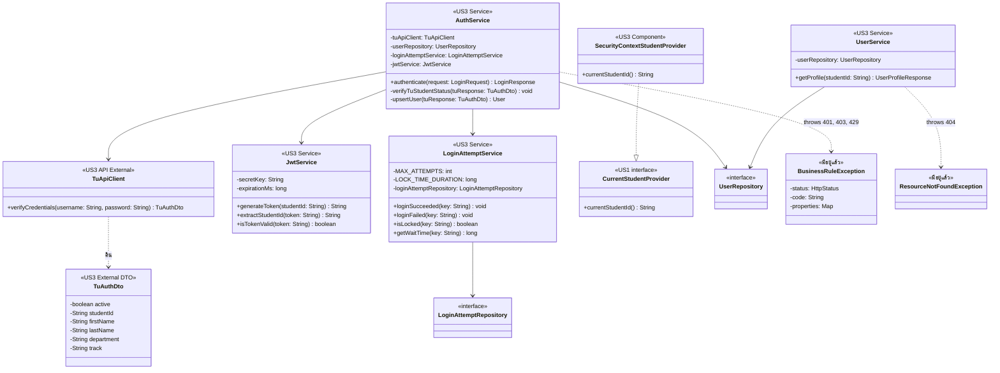

# US3-T06 — Extended API Class Diagram

ขยายจาก [API Class Diagram](../T05/US3-API-Class-Diagram.md) ของ US3-T05 โดยเพิ่มความสัมพันธ์ระหว่างชั้น Service (`AuthService`, `UserService`, `LoginAttemptService`) กับชั้น Repository (`UserRepository`, `LoginAttemptRepository`), DTO จากระบบภายนอก (`TuAuthDto`), และการเชื่อมต่อ `SecurityContextStudentProvider` เข้ากับ `CurrentStudentProvider` เดิมของ US1 ส่วน Controller, `GlobalExceptionHandler` และโมดูลฝั่ง frontend ไม่เปลี่ยนจาก T05 จึงวาดเฉพาะส่วนที่ขยายในชั้น Backend

## แผนภาพ Extended API Class Diagram (Mermaid)

**รายละเอียดเพิ่มเติม**

- **`AuthService`:**
  - `upsertUser(tuResponse)` ค้นหา `User` จาก `userRepository.findById(studentId)` ถ้ามีแล้วให้อัปเดตชื่อ-นามสกุล สาขา และภาค (`updateProfile`) ถ้ายังไม่มีให้สร้าง `User` ใหม่ แล้ว `save` ลงตาราง `users`
  - เรียก `jwtService.generateToken(studentId)` เพื่อออก JWT Token ห่อด้วย `LoginResponse.of(token)`
- **`UserService`:**
  - รับ `studentId` ที่ `UserController` อ่านมาจาก `CurrentStudentProvider.currentStudentId()` แล้วเรียก `userRepository.findById(studentId)` แปลงเป็น `UserProfileResponse.from(user)` หากไม่พบโยน `ResourceNotFoundException` (404)
- **`LoginAttemptService`:**
  - `MAX_ATTEMPTS = 5` และ `LOCK_TIME_DURATION = 900` วินาที (15 นาที) อ่านจาก config (หรือค่า default)
  - เชื่อมกับ `LoginAttemptRepository` เพื่อบันทึกจำนวนครั้งที่ผิดลงตาราง `login_attempt` โดย `loginFailed` แยก transaction (`Propagation.REQUIRES_NEW`) เพื่อไม่ให้ถูก rollback เมื่อ `AuthService` โยน `BusinessRuleException`
- **`SecurityContextStudentProvider`:**
  - Implement `CurrentStudentProvider` ของ US1 โดยอ่าน `studentId` จาก JWT / Spring Security Context แทน `DemoStudentProvider` ทำให้ `TimetableController` (US1), `TimetableDeleteController` (US2) และ `UserController` (US3) ใช้งาน `CurrentStudentProvider` ตัวเดียวกันได้โดยไม่ต้องแก้โค้ดของ US1 และ US2
- Method ของแต่ละ Repository และ Entity อยู่ใน [DAO Class Diagram](./US3-T06-DAO-Class-Diagram.md) ส่วน field ทุกตัวเป็น `private final` ฉีดผ่าน constructor ด้วย `@RequiredArgsConstructor` ตามมาตรฐานของโปรเจกต์

## เอกสารที่เกี่ยวข้อง

- [Sequence Diagram](./US3-T06-Sequence-Diagram.md)
- [DAO Class Diagram](./US3-T06-DAO-Class-Diagram.md)
- [Extended API Class Diagram](./US3-T06-Extended-API-Class-Diagram.md)
- [ER Diagram (DB)](./US3-T06-ER-Diagram.md)
- [DTO & API Spec](../T05/US3-DTO-API-Spec.md) (US3-T05)
- [API Class Diagram](../T05/US3-API-Class-Diagram.md) (US3-T05)
- [DTO Class Diagram](../T05/US3-DTO-Class-Diagram.md) (US3-T05)
