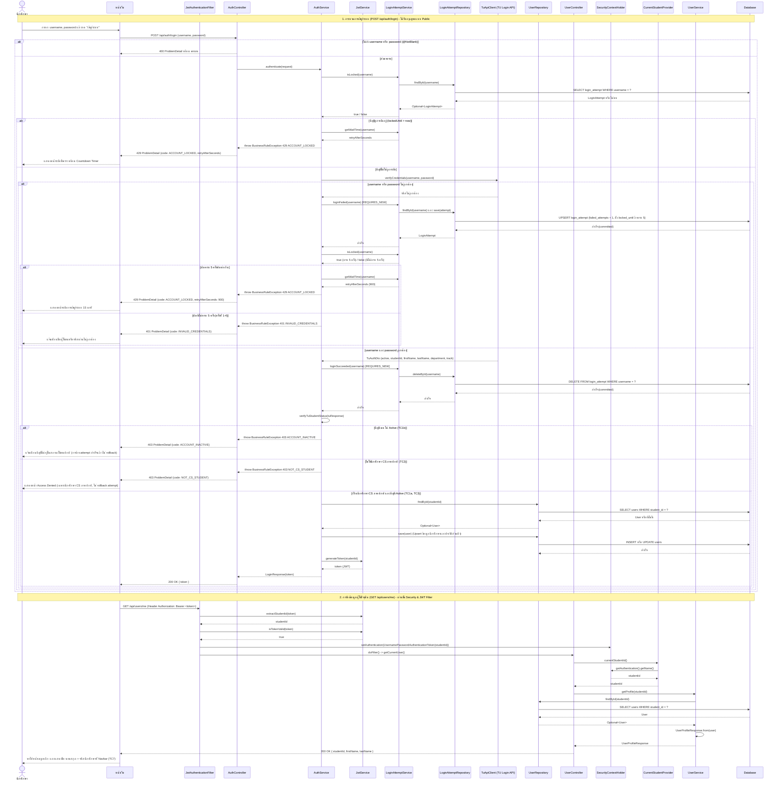

# US3-T06 — Sequence Diagram: เข้าสู่ระบบ (Log-in) และดึงข้อมูลผู้ใช้ปัจจุบัน

ลำดับการทำงานระหว่าง UI, Controller, Service, TU Login API, Repository (DAO) และ Database ของ `POST /api/auth/login` และ `GET /api/users/me` ต่อจาก US3-T05

ข้อกำหนดที่ใช้ตาม [DTO & API Spec](../T05/US3-DTO-API-Spec.md) และ [UAT (US3-T16)](../US3-T16.md):

- ลำดับตรวจใน `AuthService.authenticate`:
  1. ตรวจ body (`username`, `password` ไม่ว่าง) → `400 Bad Request`
  2. ตรวจว่าบัญชีถูกระงับอยู่หรือไม่ (`loginAttemptService.isLocked(username)`) → ถ้าล็อกอยู่โยน `429 ACCOUNT_LOCKED` พร้อม `retryAfterSeconds` ทันทีโดยไม่ยิง TU Login API (TC6)
  3. ยิงตรวจสอบ `username` / `password` กับระบบของมหาวิทยาลัยผ่าน `TuApiClient.verifyCredentials(username, password)` (TC1a, TC3, TC4, TC5)
  4. ถ้ารหัสผ่านไม่ถูกต้อง: เรียก `loginAttemptService.loginFailed(username)` (ทำงานใน Transaction ใหม่แยกอิสระ `REQUIRES_NEW`) เพื่อบวกจำนวนครั้งที่ผิด แล้วตรวจว่าครบ 5 ครั้งหรือไม่ → ถ้าครบ 5 ครั้งโยน `429 ACCOUNT_LOCKED` พร้อม `retryAfterSeconds` (900 วินาที = 15 นาที, TC6) ถ้ายังไม่ครบ 5 ครั้งโยน `401 INVALID_CREDENTIALS` (TC4, TC5)
  5. ถ้ารหัสผ่านถูกต้อง: ล้างประวัติจำนวนครั้งที่ผิดด้วย `loginAttemptService.loginSucceeded(username)` ทันที (ทำงานใน Transaction ใหม่แยกอิสระ `REQUIRES_NEW` เรียก `deleteById(username)`)
  6. ตรวจสถานะบัญชีและสาขาด้วย `verifyTuStudentStatus(tuResponse)` → ถ้าบัญชีไม่อยู่ในสถานะ Active โยน `403 ACCOUNT_INACTIVE` (TC1b) · ถ้า `department` ไม่ใช่สาขาวิทยาการคอมพิวเตอร์ หรือ `track` ไม่ใช่ภาคปกติ โยน `403 NOT_CS_STUDENT` (TC2) (การลบ `login_attempt` ในข้อ 5 จะไม่ถูก Rollback)
  7. บันทึกหรืออัปเดตข้อมูลนักศึกษา (Upsert) ลงตาราง `users` ผ่าน `UserRepository` และสร้าง JWT Token ผ่าน `JwtService.generateToken(studentId)` คืน `200 OK` (`LoginResponse`)
- หลังได้ `token` แล้ว ทุก Request ถัดไป (รวมถึง `GET /api/users/me`) จะส่ง Header `Authorization: Bearer <token>` ถูกดักโดย `JwtAuthenticationFilter` ตรวจสอบ Token ผ่าน `JwtService` และกำหนด `Authentication` ลง `SecurityContextHolder` จากนั้น `CurrentStudentProvider` (`SecurityContextStudentProvider`) จะดึง `studentId` ไปใช้ต่อ (TC7)
- ชื่อ "DAO" ในการ์ดคือ Repository (`UserRepository` และ `LoginAttemptRepository`) เหมือน US1-T06 และ US2-T06

## แผนภาพ Sequence Diagram (Mermaid)

หมายเหตุ

- **`BusinessRuleException` ทุกกรณี** (`ACCOUNT_LOCKED`, `INVALID_CREDENTIALS`, `ACCOUNT_INACTIVE`, `NOT_CS_STUDENT`) ถูกจับโดย `GlobalExceptionHandler.handleBusinessRule` เดิม แปลงเป็น `ProblemDetail` (RFC 9457) พร้อม `code` และ `retryAfterSeconds` ตาม API Spec
- **การแยก Transaction ด้วย `Propagation.REQUIRES_NEW` ป้องกัน Rollback:**
  - `AuthService` ถูกกำกับด้วย `@Transactional` ระดับ class (US3-T05)
  - ทั้ง `LoginAttemptService.loginSucceeded` และ `loginFailed` กำหนด `@Transactional(propagation = Propagation.REQUIRES_NEW)` เพื่อเปิด Transaction ใหม่แยกต่างหากและ commit ทันที
  - ส่งผลให้เมื่อ `AuthService` โยน `BusinessRuleException` (เช่น `403 ACCOUNT_INACTIVE` หรือ `403 NOT_CS_STUDENT`) การล้างประวัติการใส่รหัสผิด (`deleteById`) ที่ commit ไปแล้วจะไม่ถูก Rollback ทำให้เงื่อนไข "ล้างจำนวนครั้งที่ผิดทันทีเมื่อรหัสผ่านถูก" ทำงานถูกต้อง
  - เช่นเดียวกัน เมื่อรหัสผิด การเพิ่ม `failed_attempts` และ `locked_until` ใน `loginFailed` ก็ถูก commit ลง DB ทันที ไม่ถูก rollback เมื่อโยน `401 INVALID_CREDENTIALS` หรือ `429 ACCOUNT_LOCKED`
- **การออกแบบชั้น Security / JWT Filter:**
  - `SecurityConfig` กำหนด Filter Chain แบบ Stateless โดยมี `JwtAuthenticationFilter` ดักจับทุก Request
  - สำหรับ Endpoint ที่ต้องการการยืนยันตัวตน เช่น `GET /api/users/me` และ `/api/timetables/**` ฟิลเตอร์จะตรวจ Token จาก Header `Authorization: Bearer <token>` ผ่าน `JwtService` หากถูกต้องจะบรรจุ `Authentication` ลงใน `SecurityContextHolder`
  - `CurrentStudentProvider` ถูก implement ด้วย `SecurityContextStudentProvider` เพื่อดึงรหัสนักศึกษาจาก `SecurityContextHolder.getContext().getAuthentication().getName()` ทำให้ Controller เดิมของ US1/US2 และ US3 ทำงานร่วมกันได้ทันทีโดยไม่ต้องแก้ Interface
- **ตรวจสถานะล็อกก่อนยิง TU API:** ถ้าบัญชีถูกล็อกอยู่แล้ว (`isLocked(username) == true`) จะโยน `429 ACCOUNT_LOCKED` ทันทีโดยไม่เรียก `TuApiClient` เพื่อลดภาระของระบบมหาวิทยาลัยและป้องกันการเดารหัสผ่านระหว่างถูกระงับ
- **การล้างจำนวนครั้งที่ผิด (`deleteById`) ทำทันทีเมื่อรหัสผ่านถูก:** ก่อนตรวจ `verifyTuStudentStatus` เพราะผู้ใช้พิสูจน์รหัสผ่านผ่านแล้ว หากเป็นนักศึกษาต่างสาขา (`403 NOT_CS_STUDENT`) จึงไม่ถูกนับเป็นการเดารหัสผ่านผิด และใช้คำสั่ง `deleteById(username)` รูปแบบเดียวเท่านั้น

## เอกสารที่เกี่ยวข้อง

- [Sequence Diagram](./US3-T06-Sequence-Diagram.md)
- [DAO Class Diagram](./US3-T06-DAO-Class-Diagram.md)
- [Extended API Class Diagram](./US3-T06-Extended-API-Class-Diagram.md)
- [ER Diagram (DB)](./US3-T06-ER-Diagram.md)
- [DTO & API Spec](../T05/US3-DTO-API-Spec.md) (US3-T05)
- [API Class Diagram](../T05/US3-API-Class-Diagram.md) (US3-T05)
- [DTO Class Diagram](../T05/US3-DTO-Class-Diagram.md) (US3-T05)
