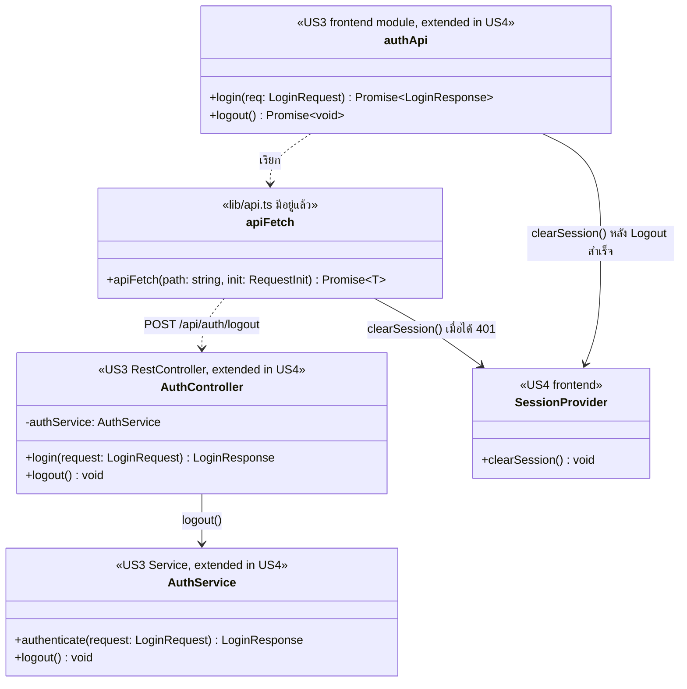

# US4 — API Class Diagram

US4 เพิ่มการ Logout โดยใช้ Authentication / Session ที่มีอยู่จาก US3 ไม่สร้างระบบ Authentication ใหม่ การออกจากระบบเป็นแบบ **stateless** คือ backend ไม่เก็บและไม่ยกเลิก token ฝั่ง server ส่วน Frontend เป็นฝ่ายล้าง token และ authentication state

## ส่วนประกอบ

| ส่วน | ฝั่ง | หน้าที่ |
| --- | --- | --- |
| AuthController | Backend | `@RestController @RequestMapping("/api/auth")` เพิ่ม `logout = POST /logout` ตอบ `204 No Content` |
| AuthService | Backend | เพิ่ม `logout()` ซึ่งไม่ยกเลิก token และไม่เข้าถึง DB เพราะ US4 เป็น stateless token ยังใช้ได้จนหมดอายุเอง |
| authApi | Frontend | เพิ่ม `logout()` เรียก `POST /api/auth/logout` แล้วสั่ง `SessionProvider.clearSession()` |
| apiFetch | Frontend | (`lib/api.ts` มีอยู่แล้ว) ส่ง `Authorization: Bearer <token>` และเมื่อได้ `401` ให้ล้าง Session แล้วกลับหน้า Login |
| SessionProvider | **Frontend เท่านั้น** | เก็บ token และ authentication state ฝั่ง Client มี `clearSession()` ล้างค่าและพากลับหน้า Login |

## ความสัมพันธ์

- `authApi` เรียก `apiFetch` และ `apiFetch` เรียก `AuthController` ผ่าน `POST /api/auth/logout`
- `AuthController` เรียก `AuthService.logout()`
- **`SessionProvider` อยู่ฝั่ง Frontend เท่านั้น** ถูกเรียกโดย `authApi` และ `apiFetch` ส่วน `AuthService` (backend) ไม่เกี่ยวข้องกับ `SessionProvider`
- Session หมดอายุ: `apiFetch` ได้ `401` จาก API ใดๆ แล้วเรียก `clearSession()` ไม่ต้องเรียก Logout API

**หมายเหตุ:** `AuthController`, `AuthService`, `apiFetch` และระบบ Authentication หลักต่อยอดจาก US3 US4 เพิ่มเฉพาะความสามารถ Logout ไม่สร้าง Authentication ใหม่ และไม่วาด `CurrentStudentProvider`, `BusinessRuleException`, `GlobalExceptionHandler` เพราะ Logout ไม่ใช้ (`401` มาจาก Authentication ของ US3)
