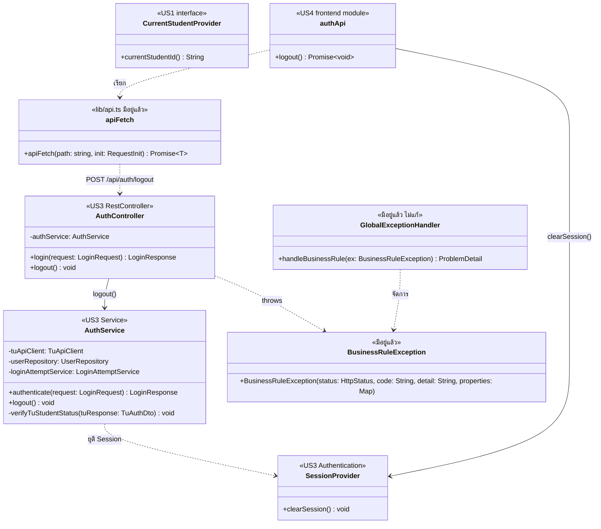

# US4 — API Class Diagram

US4 เพิ่มการ Logout ฝั่ง backend โดยใช้ Authentication / Session ที่มีอยู่จาก US3 ไม่สร้างระบบ Authentication ใหม่ และเพิ่ม API สำหรับให้ผู้ใช้ยุติการเข้าสู่ระบบ

## ส่วนประกอบ

| ส่วน | หน้าที่ |
| --- | --- |
| AuthController | `@RestController @RequestMapping("/api/auth")` · เพิ่ม `logout = POST /logout` เพื่อรับคำขอออกจากระบบจาก Frontend |
| AuthService | จัดการกระบวนการ Logout โดยใช้ Authentication / Session ที่มีอยู่จาก US3 และยุติ Session ของผู้ใช้ปัจจุบัน |
| SessionProvider | ส่วนที่จัดการ Session / Authentication ของผู้ใช้ปัจจุบัน ใช้สำหรับยุติ Session เมื่อ Logout |
| authApi | frontend module สำหรับเรียก `POST /api/auth/logout` และจัดการผลลัพธ์หลัง Logout |
| apiFetch | (`lib/api.ts` มีอยู่แล้ว) ฟังก์ชันกลางสำหรับเรียก API และจัดการ Authentication / HTTP Error |
| GlobalExceptionHandler | (มีอยู่แล้ว) จัดการ `BusinessRuleException` |
| BusinessRuleException | (มีอยู่แล้ว) ใช้สำหรับ Error ที่เกิดจากกฎของระบบ |

## ความสัมพันธ์

- `authApi` เรียก `apiFetch`
- `apiFetch` เรียก `AuthController` ผ่าน `POST /api/auth/logout`
- `AuthController` เรียก `AuthService.logout()`
- `AuthService` ใช้ `SessionProvider` เพื่อยุติ Session
- หลัง Logout สำเร็จ `authApi` สั่ง `SessionProvider.clearSession()` เพื่อล้าง Authentication ฝั่ง Client
- `GlobalExceptionHandler` จัดการ `BusinessRuleException`

**หมายเหตุ:** `AuthController`, `AuthService`, `apiFetch` และระบบ Authentication หลักเป็นส่วนที่ต่อยอดจาก US3; US4 เพิ่มเฉพาะความสามารถ Logout ไม่สร้าง Authentication ใหม่
