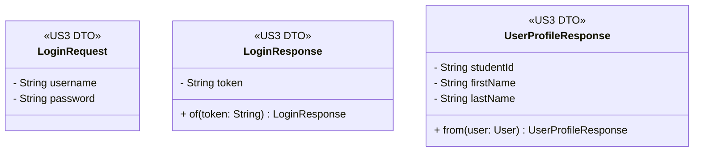

# US4 — DTO Class Diagram

UUS4 ไม่เพิ่ม DTO ใหม่ เนื่องจาก Logout ไม่มีข้อมูลที่ต้องรับหรือส่งใน Request / Response Body

## DTO ที่เกี่ยวข้อง

| DTO | หน้าที่ |
| --- | --- |
| `LoginRequest` | รับ Username และ Password สำหรับเข้าสู่ระบบใน US3 |
| `LoginResponse` | ส่ง JWT Token หลังเข้าสู่ระบบสำเร็จใน US3 |
| `UserProfileResponse` | ส่งข้อมูลรหัสนักศึกษา ชื่อ และนามสกุลไปแสดงที่ Navbar |

US4 ไม่เพิ่ม DTO ใหม่ เนื่องจาก Logout ใช้ Authentication / Session ที่มีอยู่จาก US3 และไม่มีข้อมูลที่ต้องรับหรือส่งใน Request / Response Body
