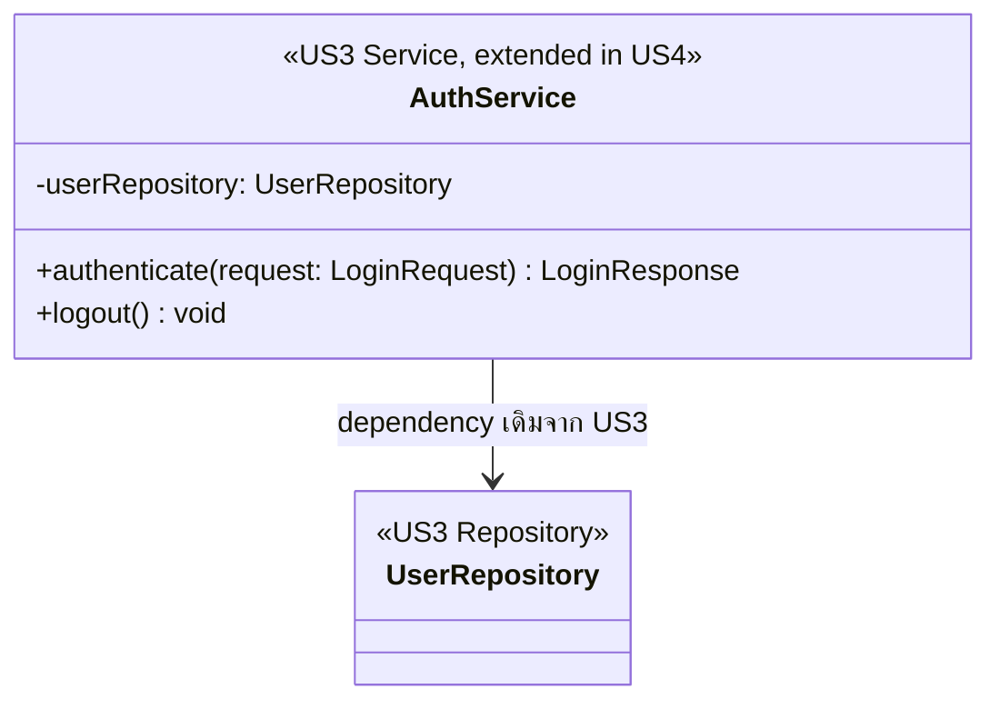

# US4-T06 — DAO Class Diagram

US4 **ไม่มี entity หรือ repository ใหม่ และไม่เพิ่ม method ใน repository** ใช้ของ US3 ทั้งหมด แผนภาพนี้วาดเฉพาะ DAO ที่ `AuthService` มีอยู่จาก US3 เพื่อให้เห็นว่า US4 reuse DAO เดิมและไม่มี DAO ใหม่ ดู flow ใน [Sequence Diagram](./US4-T06-Sequence-Diagram.md)

`AuthService.logout()` ไม่เรียก `UserRepository` เลย `UserRepository` ยังอยู่ในแผนภาพเพราะเป็น dependency เดิมของ `AuthService`

| Repository | ที่มา | ใช้โดย | ใช้ใน US4-T06 |
| --- | --- | --- | --- |
| `UserRepository` | US3 | `AuthService` | ไม่ถูกเรียกโดย `logout()` และไม่มี method ใหม่ |

**ทำไมไม่มี DAO ใหม่**

- Logout ใช้ `POST /api/auth/logout` ไม่มี Request Body และใช้ Authentication/Session ของ US3
- Session หมดอายุตรวจที่ Authentication/`apiFetch` ไม่มีการอ่านหรือเขียนข้อมูลผ่าน DAO
- ไม่มีตารางใหม่ จึงไม่มี Entity หรือ Repository ใหม่ ดู [ER Diagram](./US4-T06-ER-Diagram.md)
- ไม่ควรสร้าง Repository หรือ method เพียงเพื่อให้แผนภาพมีองค์ประกอบเพิ่ม

รายละเอียดของ `UserRepository` และ Entity `User` ให้ยึดตามการออกแบบของ US3

## เอกสารที่เกี่ยวข้อง

- [Sequence Diagram](./US4-T06-Sequence-Diagram.md)
- [DAO Class Diagram](./US4-T06-DAO-Class-Diagram.md)
- [Extended API Class Diagram](./US4-T06-Extended-API-Class-Diagram.md)
- [ER Diagram (DB)](./US4-T06-ER-Diagram.md)
- [US4-T05 — API Class Diagram](../US4-API-Class-Diagram.md)
- [US4-T05 — DTO & API Spec](../US4-DTO-&-API-Spec.md)
- [US3 — API Class Diagram](../../US3/T05/US3-API-Class-Diagram.md)
