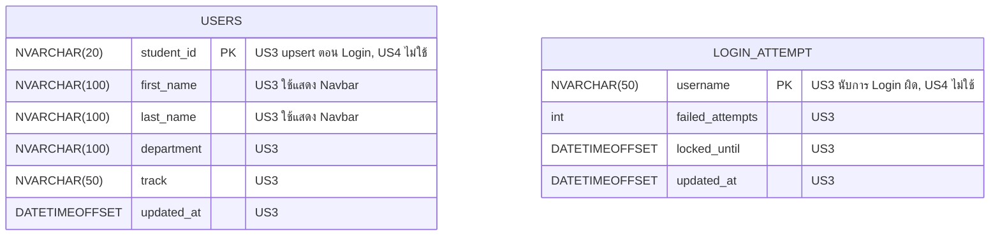

# US4-T06 — ER Diagram (DB)

US4 **ไม่เปลี่ยน schema และไม่มี migration ใหม่** Logout และ Session หมดอายุไม่อ่านหรือเขียนตารางใดเลย แผนภาพนี้แสดงตารางที่ US3 สร้างไว้ (`users`, `login_attempt`) เพื่อยืนยันว่า US4 ไม่แตะต้อง

> โครงสร้างตารางอ้างจาก [ER Diagram ของ US3-T06](../../US3/T06/US3-T06-ER-Diagram.md) และ migration `V20261019_0106__create_users_login_attempt_tables.sql` ชื่อตารางคือ `users` (ไม่ใช่ `user` เพราะเป็นคำสงวนของ SQL Server)

US4 ทำอะไรกับแต่ละตาราง

| ตาราง | US4 ทำอะไร | ผ่านอะไร |
| --- | --- | --- |
| `users` | ไม่ทำอะไร | ไม่มี |
| `login_attempt` | ไม่ทำอะไร (Logout ไม่เกี่ยวกับการนับ Login ผิด) | ไม่มี |
| ตารางอื่นทั้งหมด (`timetable`, `timetable_entry`, `section`, `course`, `schedule_slot`) | ไม่ทำอะไร | ไม่มี |

- **ไม่มี Session table** Authentication ใช้ JWT ของ US3 ไม่มีตาราง session หรือ token denylist ใน schema US4 จึงไม่ลบหรืออัปเดตแถวใดตอน Logout
- **token หมดอายุ** ตรวจจาก `exp` ใน token ด้วย `JwtService.isTokenValid()` ของ US3 ไม่ต้องอ่าน DB
- **inactivity timeout** จับเวลาฝั่ง Client ไม่เรียก API และไม่ต้องอ่าน DB
- ถ้าภายหลังต้องการ invalidate token ฝั่ง server ทันทีหลัง Logout (เช่น denylist) จะต้องมี migration และ repository ใหม่ ซึ่งอยู่นอกขอบเขต US4 นี้ ดูข้อจำกัดใน [Sequence Diagram](./US4-T06-Sequence-Diagram.md#ความหมายของ-logout-ใน-us4-stateless-jwt)

## เอกสารที่เกี่ยวข้อง

- [Sequence Diagram](./US4-T06-Sequence-Diagram.md)
- [DAO Class Diagram](./US4-T06-DAO-Class-Diagram.md)
- [Extended API Class Diagram](./US4-T06-Extended-API-Class-Diagram.md)
- [ER Diagram (DB)](./US4-T06-ER-Diagram.md)
- [DTO & API Spec](../T05/US4-DTO%20%26%20API%20Spec.md) (US4-T05)
- [US3 — ER Diagram](../../US3/T06/US3-T06-ER-Diagram.md)
