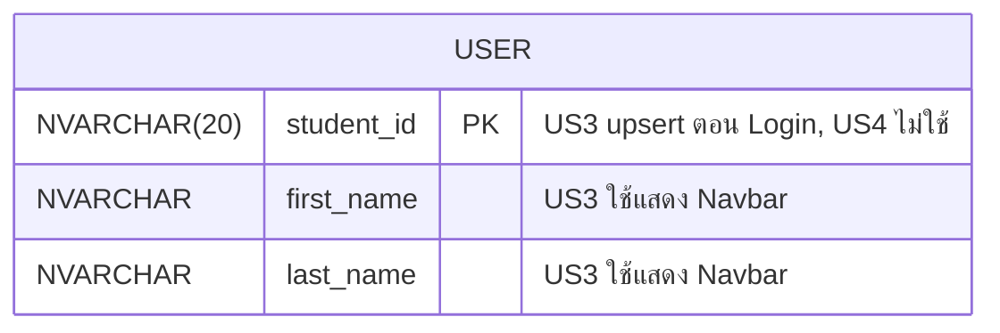

# US4-T06 — ER Diagram (DB)

US4 **ไม่เปลี่ยน schema และไม่มี migration ใหม่** Logout และ Session หมดอายุไม่อ่านหรือเขียนตารางใดเลย แผนภาพนี้แสดงตารางที่ US3 สร้างไว้ (`user`) เพื่อยืนยันว่า US4 ไม่แตะต้อง

> คอลัมน์ของ `user` อ้างจาก `UserProfileResponse` (`studentId`, `firstName`, `lastName`) ใน US3-T05 ให้ตรวจชื่อคอลัมน์ ชนิดข้อมูล และคอลัมน์อื่นกับ ER Diagram / migration ของ US3 อีกครั้ง

US4 ทำอะไรกับแต่ละตาราง

| ตาราง | US4 ทำอะไร | ผ่านอะไร |
| --- | --- | --- |
| `user` | ไม่ทำอะไร | ไม่มี |
| ตารางอื่นทั้งหมด (`timetable`, `timetable_entry`, `section`, `course`, `schedule_slot`) | ไม่ทำอะไร | ไม่มี |

- **ไม่มี Session table** Authentication ใช้ JWT ของ US3 ไม่มีตาราง session หรือ token blacklist ใน schema ที่มี US4 จึงไม่ลบหรืออัปเดตแถวใดตอน Logout
- **Session หมดอายุ** ตรวจจากอายุของ token ไม่ต้องอ่าน DB
- ถ้าภายหลังต้องการ invalidate token ฝั่ง server (เช่น blacklist) จะต้องมี migration และ repository ใหม่ ซึ่งอยู่นอกขอบเขต US4 นี้

## เอกสารที่เกี่ยวข้อง

- [Sequence Diagram](./US4-T06-Sequence-Diagram.md)
- [DAO Class Diagram](./US4-T06-DAO-Class-Diagram.md)
- [Extended API Class Diagram](./US4-T06-Extended-API-Class-Diagram.md)
- [ER Diagram (DB)](./US4-T06-ER-Diagram.md)
- [DTO & API Spec](../T05/US4-DTO%20%26%20API%20Spec.md) (US4-T05)
