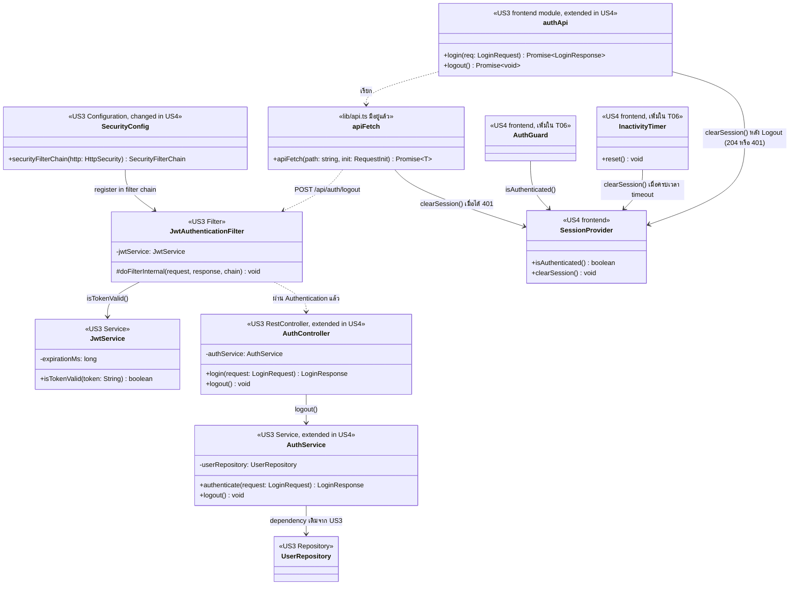

# US4-T06 — Extended API Class Diagram

ขยายจาก [API Class Diagram](../T05/US4-API-Class-Diagram.md) ของ US4-T05 โดยเพิ่ม

- dependency ของ `AuthService` ที่ US3 มีอยู่แล้ว (`UserRepository`)
- ชั้น Security ของ US3 ที่ทำให้เกิด `401` (`SecurityConfig`, `JwtAuthenticationFilter`, `JwtService`) และสิ่งที่ US4 ต้องแก้ใน `SecurityConfig`
- ส่วน Frontend ที่ T05 ยังไม่มี แต่ต้องมีเพื่อให้ตรงกับ [US4-T16](../US4-T16-uat-test-cases.md): `AuthGuard` (กดย้อนกลับหลัง Logout) และ `InactivityTimer` (Logout อัตโนมัติเมื่อไม่มีการใช้งาน)

`GlobalExceptionHandler`, `BusinessRuleException`, `CurrentStudentProvider` และ `LoginAttemptService`/`TuApiClient` ไม่เกี่ยวกับ Logout จึงไม่วาดซ้ำ

US4 เป็นแบบ **stateless JWT** backend ไม่ invalidate token ฝั่ง server ผู้ใช้ออกจากระบบเพราะ Frontend ล้าง token และข้อมูลผู้ใช้ผ่าน `SessionProvider.clearSession()` ขอบเขตของสิ่งที่รับประกันดูที่ [Sequence Diagram](./US4-T06-Sequence-Diagram.md#ความหมายของ-logout-ใน-us4-stateless-jwt)

| ส่วน | ที่มา | บทบาทใน US4-T06 |
| --- | --- | --- |
| `SecurityConfig` | US3 เดิม | **US4 ต้องแก้** white-list จาก `POST /api/auth/**` เป็นเฉพาะ `POST /api/auth/login` เพื่อให้ `POST /api/auth/logout` ต้องผ่าน Authentication และตอบ `401` เมื่อไม่มี token หรือ token ใช้ไม่ได้ |
| `JwtAuthenticationFilter` | US3 เดิม | ตรวจ `Authorization: Bearer` ทุก request ถ้า token ใช้ไม่ได้ request จะไม่ถึง Controller และได้ `401` |
| `JwtService` | US3 เดิม | `isTokenValid()` ตรวจลายเซ็นและวันหมดอายุ (`expirationMs`) เป็นที่มาของกรณี token หมดอายุ |
| `AuthController` | US3 เดิม | เพิ่ม `logout()` = `POST /api/auth/logout` ตอบ `204 No Content` |
| `AuthService` | US3 เดิม | เพิ่ม `logout()` ไม่ invalidate token และไม่เรียก DAO (stateless) |
| `UserRepository` | US3 เดิม | dependency เดิม ไม่มี method ใหม่ และ `logout()` ไม่เรียก |
| `authApi` | Frontend เดิมจาก US3 | เพิ่ม `logout(): Promise<void>` แล้วสั่ง `SessionProvider.clearSession()` ทุกกรณี |
| `apiFetch` | `lib/api.ts` เดิม | ส่ง `Authorization: Bearer` และเมื่อได้ `401` ให้ล้าง Session แล้วกลับหน้า Login |
| `SessionProvider` | US4 (Frontend เท่านั้น) | เก็บ token และ authentication state ฝั่ง Client `clearSession()` ล้าง token, authentication state และข้อมูลผู้ใช้ที่ cache ไว้ T06 เพิ่ม `isAuthenticated()` ให้ `AuthGuard` ใช้ |
| `AuthGuard` | US4 (Frontend) เพิ่มใน T06 | ครอบทุกหน้าที่ต้อง Login ถ้า `isAuthenticated()` เป็น `false` ไม่ render หน้าและไปหน้า Login (รองรับ US4-T16 Test case ที่ 2) |
| `InactivityTimer` | US4 (Frontend) เพิ่มใน T06 | เริ่มจับเวลาเมื่อ Login, `reset()` ทุกครั้งที่ผู้ใช้ใช้งาน และเรียก `clearSession()` เมื่อครบเวลา timeout (รองรับ US4-T16 Test case ที่ 3) |

- field อื่นของ `AuthService` (`tuApiClient`, `loginAttemptService`, `jwtService`) และ `verifyTuStudentStatus` เป็นของ Login ดู [Extended API Class Diagram ของ US3-T06](../../US3/T06/US3-T06-Extended-API-Class-Diagram.md)
- `401` มาจาก Spring Security ของ US3 ไม่ใช่ `BusinessRuleException` จึงไม่วาด `GlobalExceptionHandler` Body ของ `401` ต้องเป็น `ProblemDetail` ตาม US4-T05 ให้ตรวจ `AuthenticationEntryPoint` ใน implementation ของ US3
- `SessionProvider`, `AuthGuard` และ `InactivityTimer` ไม่ถูกเรียกจาก backend เพราะอยู่คนละฝั่ง (backend กับ frontend ไม่แชร์ class)
- **หลัง Logout ผู้ใช้เข้าถึงข้อมูลเดิมผ่านแอปไม่ได้** เพราะ Client ไม่มี token และข้อมูลผู้ใช้เหลืออยู่ ส่วน token ที่ถูกคัดลอกออกไปก่อน Logout ยังใช้เรียก API ตรงได้จนหมดอายุ (ข้อจำกัดของ stateless JWT อยู่นอกขอบเขต US4)
- token หมดอายุ: `apiFetch` ได้ `401` แล้วเรียก `clearSession()` ไม่ต้องเรียก Logout API
- inactivity timeout: `InactivityTimer` เรียก `clearSession()` โดยไม่เรียก API (backend เป็น stateless จึงไม่ติดตามการไม่ใช้งาน) ระยะเวลา timeout เป็นค่า config ฝั่ง Frontend ที่ทีมต้องกำหนด
- `AuthGuard` และ `InactivityTimer` ยังไม่อยู่ใน API Class Diagram ของ US4-T05 ชื่อในแผนภาพเป็นชื่อเชิงหน้าที่ ชื่อจริงขึ้นกับ implementation
- ลำดับการทำงานดู [Sequence Diagram](./US4-T06-Sequence-Diagram.md)

## ขอบเขต DAO และ DB

ไม่มี Entity, Repository หรือ method ใหม่ และไม่มี Database operation ใหม่ ดู [DAO Class Diagram](./US4-T06-DAO-Class-Diagram.md) และ [ER Diagram](./US4-T06-ER-Diagram.md)

## เอกสารที่เกี่ยวข้อง

- [Sequence Diagram](./US4-T06-Sequence-Diagram.md)
- [DAO Class Diagram](./US4-T06-DAO-Class-Diagram.md)
- [Extended API Class Diagram](./US4-T06-Extended-API-Class-Diagram.md)
- [ER Diagram (DB)](./US4-T06-ER-Diagram.md)
- [API Class Diagram](../T05/US4-API-Class-Diagram.md) (US4-T05)
- [DTO & API Spec](../T05/US4-DTO%20%26%20API%20Spec.md) (US4-T05)
- [US4-T16 — UAT Test Cases](../US4-T16-uat-test-cases.md)
- [US3 — Extended API Class Diagram](../../US3/T06/US3-T06-Extended-API-Class-Diagram.md)
