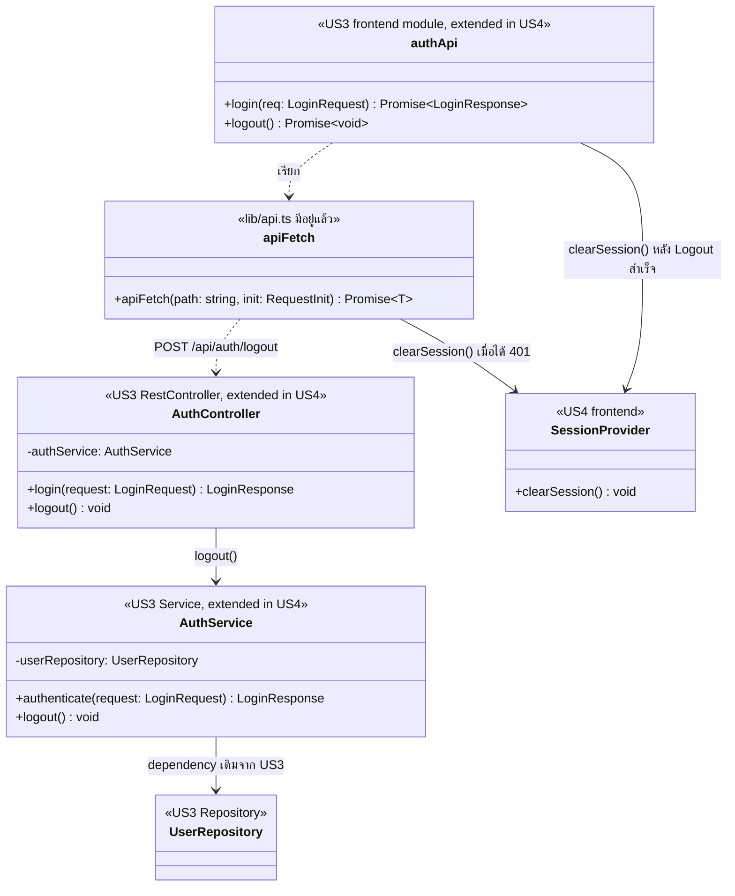

# US4-T06 — Extended API Class Diagram

ขยายจาก [API Class Diagram](../T05/US4-API-Class-Diagram.md) ของ US4-T05 โดยเพิ่ม dependency ของ `AuthService` ที่ US3 มีอยู่แล้ว `GlobalExceptionHandler`, `BusinessRuleException`, `CurrentStudentProvider` และ `LoginAttemptService`/`TuApiClient` ไม่เกี่ยวกับ Logout จึงไม่วาดซ้ำ

US4 เป็นแบบ **stateless JWT** backend ไม่ invalidate token ฝั่ง server ผู้ใช้ออกจากระบบเพราะ Frontend ล้าง token ผ่าน `SessionProvider` (ฝั่ง Frontend เท่านั้น)

| ส่วน | ที่มา | บทบาทใน US4-T06 |
| --- | --- | --- |
| `AuthController` | US3 เดิม | เพิ่ม `logout()` = `POST /api/auth/logout` ตอบ `204 No Content` |
| `AuthService` | US3 เดิม | เพิ่ม `logout()` ไม่ invalidate token และไม่เรียก DAO (stateless) |
| `UserRepository` | US3 เดิม | dependency เดิม ไม่มี method ใหม่ และ `logout()` ไม่เรียก |
| `authApi` | Frontend เดิมจาก US3 | เพิ่ม `logout(): Promise<void>` แล้วสั่ง `SessionProvider.clearSession()` |
| `apiFetch` | `lib/api.ts` เดิม | ส่ง `Authorization: Bearer` และเมื่อได้ `401` ให้ล้าง Session แล้วกลับหน้า Login |
| `SessionProvider` | US4 (Frontend เท่านั้น) | เก็บและล้าง token/authentication state ฝั่ง Client ตาม US4-T05 |

- field อื่นของ `AuthService` (`tuApiClient`, `loginAttemptService`) และ `verifyTuStudentStatus` เป็นของ Login ดู [API Class Diagram ของ US3-T05](../../US3/T05/US3-API-Class-Diagram.md)
- `401` มาจาก Authentication ของ US3 ไม่ใช่ `BusinessRuleException` จึงไม่วาด `GlobalExceptionHandler`
- `SessionProvider` ไม่ถูกเรียกจาก `AuthService` เพราะอยู่คนละฝั่ง (backend กับ frontend ไม่แชร์ class)
- **หลัง Logout ผู้ใช้เข้าถึงข้อมูลเดิมผ่านแอปไม่ได้** เพราะ Client ล้าง token แล้ว แต่ token เดิมยังใช้ได้จนหมดอายุหากเรียก API ตรง (ข้อจำกัดของ stateless JWT)
- Session หมดอายุ: `apiFetch` ได้ `401` แล้วเรียก `clearSession()` ไม่ต้องเรียก Logout API
- inactivity timeout: ตัวจับเวลาฝั่ง Client เรียก `SessionProvider.clearSession()` โดยไม่เรียก API (backend เป็น stateless จึงไม่ติดตามการไม่ใช้งาน) ผู้เรียกนี้ยังไม่อยู่ใน API Class Diagram ของ US4-T05 ถ้าต้องการให้แผนภาพตรงกันต้องเพิ่มใน T05
- ลำดับการทำงานดู [Sequence Diagram](./US4-T06-Sequence-Diagram.md)

## ขอบเขต DAO และ DB

ไม่มี Entity, Repository หรือ method ใหม่ และไม่มี Database operation ใหม่ ดู [DAO Class Diagram](./US4-T06-DAO-Class-Diagram.md) และ [ER Diagram](./US4-T06-ER-Diagram.md)

## เอกสารที่เกี่ยวข้อง

- [Sequence Diagram](./US4-T06-Sequence-Diagram.md)
- [DAO Class Diagram](./US4-T06-DAO-Class-Diagram.md)
- [Extended API Class Diagram](./US4-T06-Extended-API-Class-Diagram.md)
- [ER Diagram (DB)](./US4-T06-ER-Diagram.md)
- [API Class Diagram](../US4-API-Class-Diagram.md)
- [DTO & API Spec](../US4-DTO-&-API-Spec.md)
- [US3 — API Class Diagram](../../US3/T05/US3-API-Class-Diagram.md)
