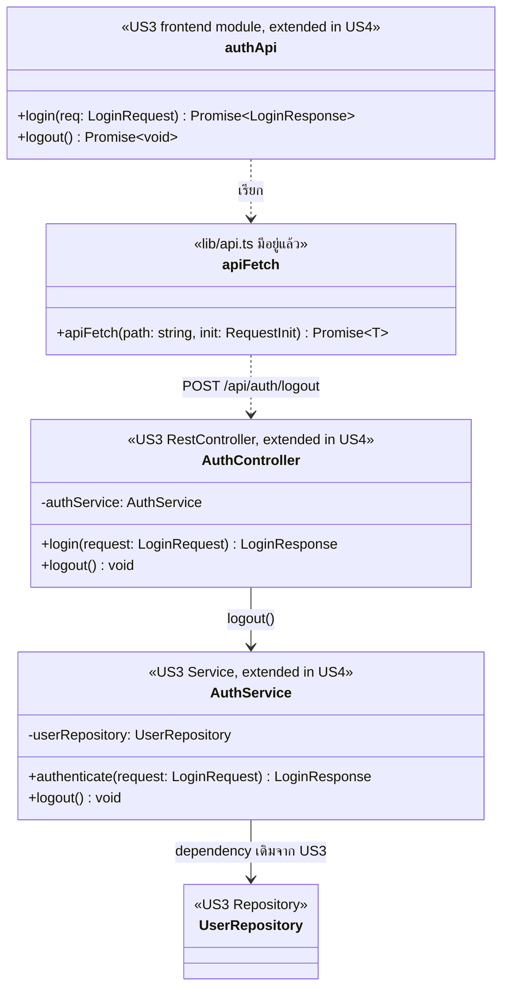

# US4-T06 — Extended API Class Diagram

ขยายจาก [API Class Diagram](../T05/US4-API-Class-Diagram.md) ของ US4-T05 โดยเพิ่ม dependency ของ `AuthService` ที่ US3 มีอยู่แล้ว `GlobalExceptionHandler`, `BusinessRuleException`, `CurrentStudentProvider` และ `LoginAttemptService`/`TuApiClient` ไม่เกี่ยวกับ Logout จึงไม่วาดซ้ำ

| ส่วน | ที่มา | บทบาทใน US4-T06 |
| --- | --- | --- |
| `AuthController` | US3 เดิม | เพิ่ม `logout()` = `POST /api/auth/logout` ตอบ `204` |
| `AuthService` | US3 เดิม | เพิ่ม `logout()` โดย reuse Authentication/Session ของ US3 |
| `UserRepository` | US3 เดิม | dependency เดิม ไม่มี method ใหม่ และ `logout()` ไม่เรียก |
| `authApi` | Frontend เดิมจาก US3 | เพิ่ม `logout(): Promise<void>` |
| `apiFetch` | `lib/api.ts` เดิม | ส่ง request พร้อม `Authorization: Bearer` และจัดการ `401` ทั้งกรณี Logout และ Session หมดอายุ |

- field อื่นของ `AuthService` (`tuApiClient`, `loginAttemptService`) และ `verifyTuStudentStatus` เป็นของ Login ดู [API Class Diagram ของ US3-T05](../../US3/T05/US3-API-Class-Diagram.md)
- ข้อผิดพลาดของ Logout ที่แสดงในแผนภาพนี้มีเพียง `401` จาก Authentication จึงไม่วาด `BusinessRuleException` และ `GlobalExceptionHandler` (ส่วน Response/Error ของ US4-T05 ยังไม่ครบ ถ้าเพิ่ม Error อื่นต้องกลับมาปรับ)
- **ฝั่ง Client** การล้าง authentication state และกลับหน้า Login ทำหลัง `logout()` สำเร็จ หรือเมื่อ `apiFetch` พบ `401` (Session หมดอายุ) เอกสาร US3 ยังไม่มี class ที่เก็บ state ฝั่ง Client จึงไม่วาด `SessionProvider`
- ลำดับการทำงานดู [Sequence Diagram](./US4-T06-Sequence-Diagram.md)

## ขอบเขต DAO และ DB

ไม่มี Entity, Repository หรือ method ใหม่ และไม่มี Database operation ใหม่ ดู [DAO Class Diagram](./US4-T06-DAO-Class-Diagram.md) และ [ER Diagram](./US4-T06-ER-Diagram.md)

## เอกสารที่เกี่ยวข้อง

- [Sequence Diagram](./US4-T06-Sequence-Diagram.md)
- [DAO Class Diagram](./US4-T06-DAO-Class-Diagram.md)
- [Extended API Class Diagram](./US4-T06-Extended-API-Class-Diagram.md)
- [ER Diagram (DB)](./US4-T06-ER-Diagram.md)
- [API Class Diagram](../US4-API-Class-Diagram.md)
- [DTO & API Spec](../US4-DTO-&-API-Spec.md)
- [US3 — API Class Diagram](../../US3/T05/US3-API-Class-Diagram.md)
