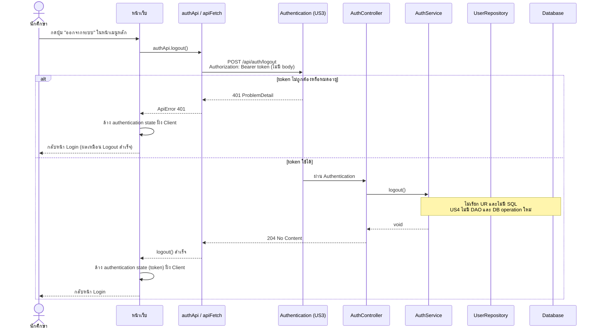
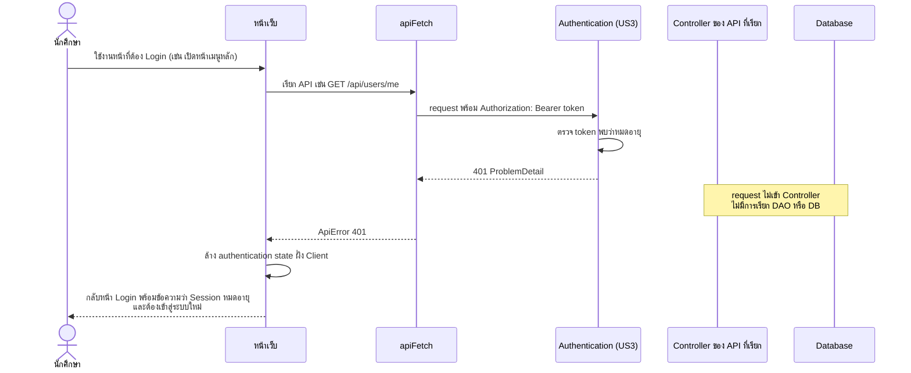

# US4-T06 — Sequence Diagram: ออกจากระบบ (Logout) และ Session หมดอายุ

ลำดับการทำงานระหว่าง UI, API, DAO (repository) และ DB ของ `POST /api/auth/logout` และกรณี Session หมดอายุ ต่อจาก US4-T05

ข้อกำหนดที่ใช้ตาม [DTO & API Spec](../T05/US4-DTO%20%26%20API%20Spec.md):

- `POST /api/auth/logout` ไม่มี Request Body รับ JWT ผ่าน `Authorization: Bearer <token>` และตอบ `204 No Content` ตาม [DTO Class Diagram](../T05/US4-DTO-Class-Diagram.md)
- US4 reuse Authentication/Session จาก US3 ไม่มี Entity, Repository หรือ DB operation ใหม่ แผนภาพจึงแสดง `UserRepository` และ Database ไว้เพื่อยืนยันว่า **ไม่ถูกเรียก**
- Session หมดอายุไม่เรียก Logout API Frontend ตรวจพบ `401` จาก API ใดก็ได้ที่ต้อง Authentication แล้วล้าง authentication state และพากลับหน้า Login พร้อมข้อความแจ้ง
- ชื่อ "DAO" ในการ์ดคือ repository เหมือน US1-T06 และ US2-T06

## 1. Logout (ผู้ใช้กดปุ่มออกจากระบบ)

## 2. Session หมดอายุ (ถูก Logout อัตโนมัติ)

## หมายเหตุ

- **ไม่มี DAO/DB ใน US4** ทั้งสอง flow จบที่ Authentication/Controller/Service ไม่มี SQL ใหม่ ดู [DAO Class Diagram](./US4-T06-DAO-Class-Diagram.md) และ [ER Diagram](./US4-T06-ER-Diagram.md)
- **Logout ที่ได้ `401`** (เช่น กดออกจากระบบตอน token หมดอายุไปแล้ว) Frontend ต้องล้าง state และกลับหน้า Login เหมือนกรณีสำเร็จ ไม่ควรค้างอยู่หน้าเดิม
- **ล้าง state ฝั่ง Client เสมอ** ทั้งกรณี `204` และ `401` เพราะสิ่งที่ผู้ใช้ต้องได้คือการออกจากระบบ
- **ไม่มีการเรียก `GlobalExceptionHandler` เพิ่ม** `401` มาจาก Authentication ไม่ใช่ `BusinessRuleException` ใหม่
- ถ้า implementation จริงเป็น JWT แบบ stateless การ Logout ฝั่ง server อาจไม่ invalidate token ซึ่งต้องบันทึกเป็นข้อจำกัดไว้ใน PR

## เอกสารที่เกี่ยวข้อง

- [Sequence Diagram](./US4-T06-Sequence-Diagram.md)
- [DAO Class Diagram](./US4-T06-DAO-Class-Diagram.md)
- [Extended API Class Diagram](./US4-T06-Extended-API-Class-Diagram.md)
- [ER Diagram (DB)](./US4-T06-ER-Diagram.md)
- [US4-T05 — DTO & API Spec](../US4-DTO-&-API-Spec.md)
- [US3 — API Class Diagram](../../US3/T05/US3-API-Class-Diagram.md)
