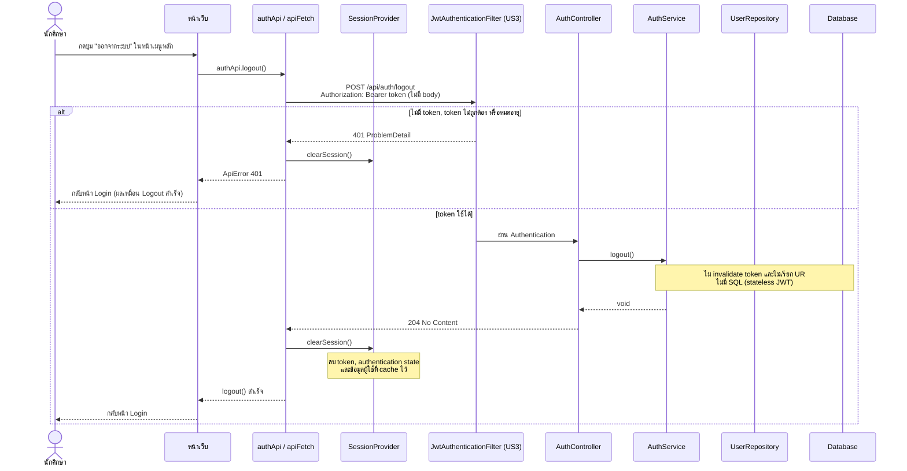
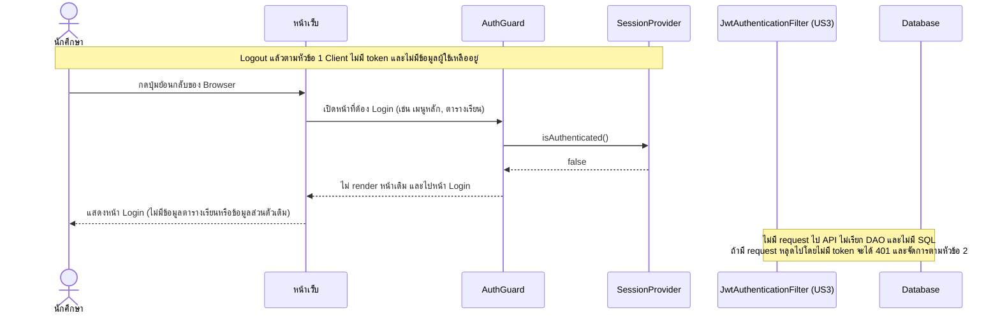
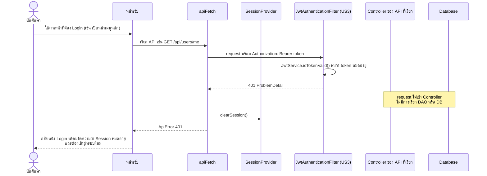
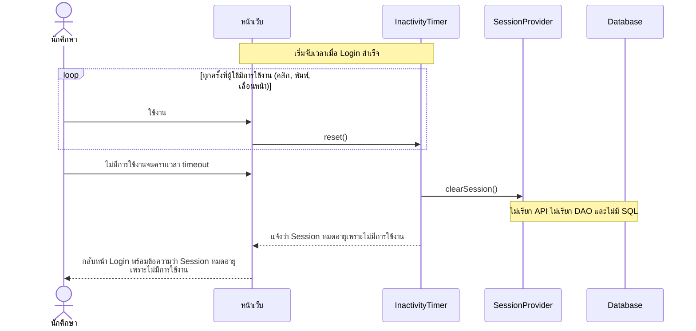

# US4-T06 — Sequence Diagram: ออกจากระบบ (Logout) และ Session หมดอายุ

ลำดับการทำงานระหว่าง UI, API, DAO (repository) และ DB ของ `POST /api/auth/logout` และกรณี Session หมดอายุ ต่อจาก US4-T05

ข้อกำหนดที่ใช้ตาม [DTO & API Spec](../T05/US4-DTO%20%26%20API%20Spec.md):

- `POST /api/auth/logout` ไม่มี Request Body รับ JWT ผ่าน `Authorization: Bearer <token>` และตอบ `204 No Content` ตาม [DTO Class Diagram](../T05/US4-DTO-Class-Diagram.md)
- US4 reuse Authentication จาก US3 (`SecurityConfig`, `JwtAuthenticationFilter`, `JwtService`) ไม่มี Entity, Repository หรือ DB operation ใหม่ แผนภาพจึงแสดง `UserRepository` และ Database ไว้เพื่อยืนยันว่า **ไม่ถูกเรียก**
- ชื่อ "DAO" ในการ์ดคือ repository เหมือน US1-T06 และ US2-T06

## ความหมายของ "Logout" ใน US4 (stateless JWT)

US4 เลือกแนวทาง **stateless** ตาม US4-T05 คือ backend ไม่เก็บและไม่ invalidate token การออกจากระบบเกิดจาก Frontend ทิ้ง token และข้อมูลของผู้ใช้ที่อยู่ใน Client

| สิ่งที่รับประกัน | กลไก | Flow |
| --- | --- | --- |
| กด Logout แล้วกลับหน้า Login ทันที | `authApi.logout()` → `SessionProvider.clearSession()` → ไปหน้า Login | หัวข้อ 1 |
| หลัง Logout กดย้อนกลับแล้วไม่เห็นข้อมูลตารางเรียนหรือข้อมูลส่วนตัวเดิม | `clearSession()` ลบ token **และ** ข้อมูลผู้ใช้ที่ cache ไว้ใน Client (profile, ตารางเรียน) ส่วน `AuthGuard` ตรวจทุกหน้าที่ต้อง Login ก่อน render ถ้าไม่มี token ให้ไปหน้า Login ทันที | หัวข้อ 1.1 |
| Browser ใช้สถานะ Login เดิมเรียก API ไม่ได้ | ไม่มี token ใน Client แล้ว request ที่ไม่มี `Authorization` จะได้ `401` | หัวข้อ 1.1, 2 |
| ไม่มีการใช้งานเกินเวลาที่กำหนดแล้ว Logout อัตโนมัติ | `InactivityTimer` ฝั่ง Client เรียก `clearSession()` | หัวข้อ 3 |
| token หมดอายุตามอายุ JWT แล้วต้อง Login ใหม่ | `JwtService.isTokenValid()` ของ US3 ปฏิเสธ → `401` → `apiFetch` เรียก `clearSession()` | หัวข้อ 2 |

**สิ่งที่ไม่รับประกัน (ข้อจำกัดของ stateless JWT):** ถ้ามีผู้คัดลอก token ไปก่อน Logout แล้วเรียก API ตรง (ไม่ผ่านแอป) token นั้นยังใช้ได้จนหมดอายุ (`exp`) เพราะ backend ไม่ invalidate ถ้าต้องการให้ใช้ไม่ได้ทันทีต้องเพิ่ม denylist ฝั่ง server ซึ่งต้องมีตารางและ repository ใหม่ อยู่นอกขอบเขต US4 นี้

ดังนั้น "ข้อมูลเดิมต้องไม่สามารถเข้าถึงได้โดยอาศัยสถานะการเข้าสู่ระบบเดิม" ใน [US4-T16](../US4-T16-uat-test-cases.md) Test case ที่ 2 หมายถึง **สถานะการเข้าสู่ระบบที่เก็บใน Browser** (token และ authentication state) ซึ่งถูกลบตอน Logout ไม่ได้หมายถึง token ที่ถูกคัดลอกออกไปนอกแอป

> **สมมติฐาน**
> 1. **Session หมดอายุมี 2 กรณีที่แยกกัน** (ก) token หมดอายุตามอายุ JWT (`expirationMs` ของ `JwtService` ใน US3) ตรวจที่ server ได้ `401` (หัวข้อ 2) และ (ข) inactivity timeout ซึ่ง backend เป็น stateless จึงไม่รู้ว่าผู้ใช้หยุดใช้งาน ตัวจับเวลาจึงอยู่ฝั่ง Client (หัวข้อ 3) **US4-T16 Test case ที่ 3 ทดสอบกรณี (ข)** ไม่ใช่ (ก)
> 2. ระยะเวลา inactivity timeout เป็นค่า config ฝั่ง Frontend ยังไม่ได้กำหนดค่า ทีมต้องกำหนดและแจ้งผู้ทดสอบ US4-T16 ก่อนทดสอบ (ตาม Precondition ของ Test case ที่ 3)
> 3. `SecurityConfig` ของ US3 เปิด `POST /api/auth/**` เป็น public US4 ต้องจำกัดให้เปิดเฉพาะ `POST /api/auth/login` เพื่อให้ `POST /api/auth/logout` ต้องผ่าน Authentication ไม่เช่นนั้นกรณี `401` ในหัวข้อ 1 จะไม่เกิด
> 4. `401` ต้องตอบเป็น `ProblemDetail` ตาม US4-T05 ซึ่งต้องมี `AuthenticationEntryPoint` ของ Spring Security ให้ตรวจกับ implementation ของ US3

## 1. Logout (ผู้ใช้กดปุ่มออกจากระบบ)

## 1.1 หลัง Logout: กดย้อนกลับ (US4-T16 Test case ที่ 2)

## 2. Session หมดอายุ: token หมดอายุตามอายุ JWT (ได้ 401 จาก API)

> กรณีนี้เกิดเมื่อผู้ใช้กลับมาใช้งานหลัง token หมดอายุ (`exp`) ไม่ใช่ inactivity timeout ของ US4-T16 Test case ที่ 3 (ดูหัวข้อ 3)

## 3. Session หมดอายุ: inactivity timeout (US4-T16 Test case ที่ 3)

> inactivity timeout ตรวจที่ Client เท่านั้น ไม่เรียก API เพราะ backend (stateless JWT) ไม่เก็บสถานะการใช้งาน ส่วน token ที่หมดอายุตามอายุ JWT ใช้ flow ในหัวข้อ 2

## หมายเหตุ

- **ไม่มี DAO/DB ใน US4** ทุก flow ไม่มี SQL ใหม่ ดู [DAO Class Diagram](./US4-T06-DAO-Class-Diagram.md) และ [ER Diagram](./US4-T06-ER-Diagram.md)
- **Logout ที่ได้ `401`** (เช่น กดออกจากระบบตอน token หมดอายุไปแล้ว) Frontend ต้องล้าง Session และกลับหน้า Login เหมือนกรณีสำเร็จ
- **ล้าง Session ฝั่ง Client เสมอ** ทั้งกรณี `204`, `401`, เรียก API ไม่สำเร็จ (เช่น network error) และ inactivity timeout เพราะ backend ไม่มีสถานะที่ต้องล้าง สิ่งที่ผู้ใช้ต้องได้คือออกจากระบบ
- **`clearSession()` ต้องล้างข้อมูลผู้ใช้ที่ cache ไว้ด้วย** ไม่ใช่แค่ token เพื่อให้กดย้อนกลับแล้วไม่เห็นข้อมูลเดิม (US4-T16 Test case ที่ 2)
- `401` มาจาก Authentication ของ US3 ไม่ใช่ `BusinessRuleException` จึงไม่ต้องเพิ่ม handler ใน `GlobalExceptionHandler`
- ชื่อ `AuthGuard` และ `InactivityTimer` เป็นชื่อเชิงหน้าที่ที่เพิ่มใน T06 ชื่อจริงขึ้นกับ implementation ฝั่ง Frontend ดู [Extended API Class Diagram](./US4-T06-Extended-API-Class-Diagram.md)

## เอกสารที่เกี่ยวข้อง

- [Sequence Diagram](./US4-T06-Sequence-Diagram.md)
- [DAO Class Diagram](./US4-T06-DAO-Class-Diagram.md)
- [Extended API Class Diagram](./US4-T06-Extended-API-Class-Diagram.md)
- [ER Diagram (DB)](./US4-T06-ER-Diagram.md)
- [DTO & API Spec](../T05/US4-DTO%20%26%20API%20Spec.md) (US4-T05)
- [US4-T16 — UAT Test Cases](../US4-T16-uat-test-cases.md)
- [US3 — Extended API Class Diagram](../../US3/T06/US3-T06-Extended-API-Class-Diagram.md)
