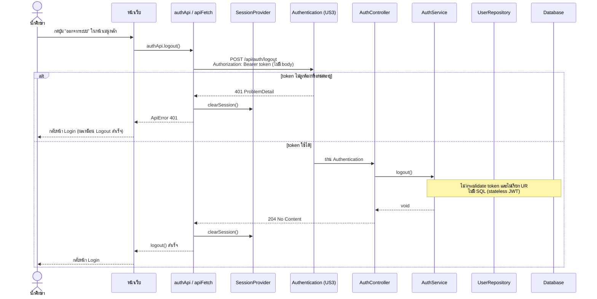
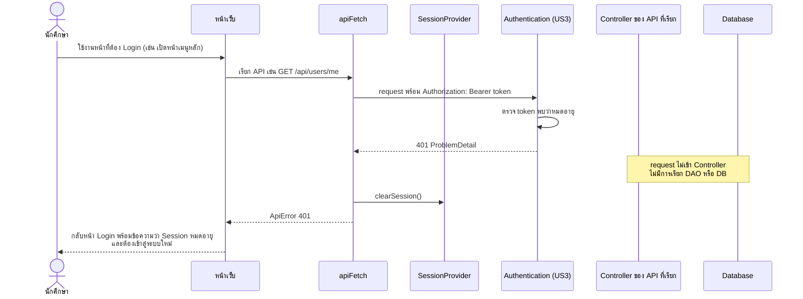
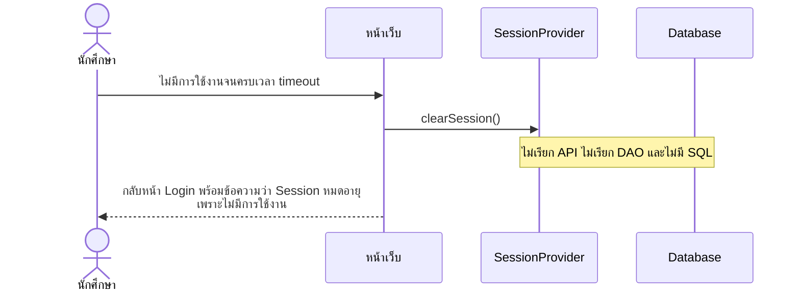

# US4-T06 — Sequence Diagram: ออกจากระบบ (Logout) และ Session หมดอายุ

ลำดับการทำงานระหว่าง UI, API, DAO (repository) และ DB ของ `POST /api/auth/logout` และกรณี Session หมดอายุ ต่อจาก US4-T05

ข้อกำหนดที่ใช้ตาม [DTO & API Spec](../T05/US4-DTO%20%26%20API%20Spec.md):

- `POST /api/auth/logout` ไม่มี Request Body รับ JWT ผ่าน `Authorization: Bearer <token>` และตอบ `204 No Content` ตาม [DTO Class Diagram](../T05/US4-DTO-Class-Diagram.md)
- US4 reuse Authentication/Session จาก US3 ไม่มี Entity, Repository หรือ DB operation ใหม่ แผนภาพจึงแสดง `UserRepository` และ Database ไว้เพื่อยืนยันว่า **ไม่ถูกเรียก**
- ชื่อ "DAO" ในการ์ดคือ repository เหมือน US1-T06 และ US2-T06

## ความหมายของ "Logout" ใน US4 (stateless JWT)

- **backend ไม่ invalidate token** `AuthService.logout()` ไม่ยกเลิก token และไม่เข้าถึง DB
- **ผู้ใช้เข้าถึงข้อมูลเดิมผ่านแอปไม่ได้** เพราะ Frontend ล้าง token และ authentication state (`SessionProvider.clearSession()`) แล้วกลับหน้า Login จึงไม่มี token ส่งไปกับ request ถัดไป และได้ `401`
- **ข้อจำกัด** ผู้ที่ถือ token เดิมแล้วเรียก API ตรง (ไม่ผ่านแอป) ยังใช้ได้จนกว่า token จะหมดอายุ ถ้าต้องการให้ใช้ไม่ได้ทันทีต้องเพิ่ม denylist ฝั่ง server ซึ่งอยู่นอกขอบเขต US4 นี้

> **สมมติฐาน**
> 1. Session หมดอายุมี 2 กรณี: (ก) token หมดอายุตามอายุ JWT ตรวจที่ server ได้ `401` (หัวข้อ 2) และ (ข) inactivity timeout ซึ่ง backend เป็น stateless จึงติดตามการไม่ใช้งานไม่ได้ ตัวจับเวลาอยู่ฝั่ง Client และเรียก `SessionProvider.clearSession()` เอง (หัวข้อ 3) ผู้เรียกนี้ยังไม่อยู่ใน API Class Diagram ของ US4-T05
## 1. Logout (ผู้ใช้กดปุ่มออกจากระบบ)

## 2. Session หมดอายุ: token หมดอายุ (ได้ 401 จาก API)

## 3. Session หมดอายุ: inactivity timeout (ตรวจที่ Client)

> inactivity timeout ตรวจที่ Client เท่านั้น ไม่เรียก API เพราะ backend (stateless JWT) ไม่เก็บสถานะการใช้งาน ส่วน token ที่หมดอายุตามอายุ JWT ใช้ flow ในหัวข้อ 2

## หมายเหตุ

- **ไม่มี DAO/DB ใน US4** ทุก flow ไม่มี SQL ใหม่ ดู [DAO Class Diagram](./US4-T06-DAO-Class-Diagram.md) และ [ER Diagram](./US4-T06-ER-Diagram.md)
- **Logout ที่ได้ `401`** (เช่น กดออกจากระบบตอน token หมดอายุไปแล้ว) Frontend ต้องล้าง Session และกลับหน้า Login เหมือนกรณีสำเร็จ
- **ล้าง Session ฝั่ง Client เสมอ** ทั้งกรณี `204`, `401` และ inactivity timeout เพราะสิ่งที่ผู้ใช้ต้องได้คือออกจากระบบ
- `401` มาจาก Authentication ของ US3 ไม่ใช่ `BusinessRuleException` จึงไม่ต้องเพิ่ม handler

## เอกสารที่เกี่ยวข้อง

- [Sequence Diagram](./US4-T06-Sequence-Diagram.md)
- [DAO Class Diagram](./US4-T06-DAO-Class-Diagram.md)
- [Extended API Class Diagram](./US4-T06-Extended-API-Class-Diagram.md)
- [ER Diagram (DB)](./US4-T06-ER-Diagram.md)
- [DTO & API Spec](../T05/US4-DTO%20%26%20API%20Spec.md) (US4-T05)
- [US3 — API Class Diagram](../../US3/T05/US3-API-Class-Diagram.md)
