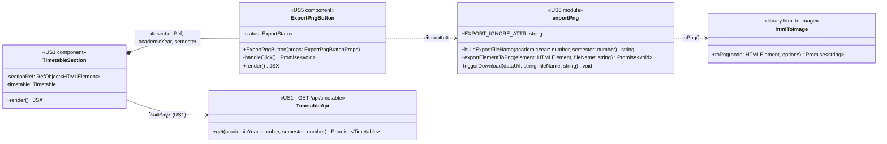

# US5 — API Class Diagram

US5 **ไม่มี controller / service / repository ใหม่ฝั่ง backend** แผนภาพจึงวาดโมดูลฝั่ง frontend ของ US5 และจุดที่พึ่ง US1 กับไลบรารีภายนอก

| ส่วน | หน้าที่ |
| --- | --- |
| `TimetableSection` (US1) | โหลด `Timetable` ด้วย `GET /api/timetable` วาดกล่องตาราง และส่ง `ref` ของกล่องให้ปุ่ม PNG — US5 ไม่ได้เพิ่ม method ในนี้ แค่วางปุ่มกับใส่ `data-export-ignore` ตอน Integrate |
| `ExportPngButton` | เก็บ `status` ตัดสินว่าปุ่มกดได้ไหม และแสดงข้อความ error ตามตาราง "พฤติกรรมของปุ่ม" ใน Spec |
| `exportPng.buildExportFileName` | สร้างชื่อ `timetable-{ปี}-{ภาค}.png` (pure function เทสต์ง่าย) |
| `exportPng.exportElementToPng` | รอฟอนต์ → `toPng` (pixelRatio 2, พื้นขาว, ขนาดเต็ม scroll, filter `data-export-ignore`) → ดาวน์โหลด |
| `exportPng.triggerDownload` (private) | สร้าง `<a download>` แล้วคลิก |

ชื่อ `TimetableSection` และ `TimetableApi` ของ US1 เป็นชื่อชั่วคราว ให้ยืนยันกับเจ้าของ US1-T07 (Develop UI)

สัญลักษณ์: `+` = export ออกจากโมดูล / ส่วนที่คนอื่นเรียกได้, `-` = ใช้ภายใน (state, handler, helper ที่ไม่ export) ไม่มี `#` เพราะ React function component และ ES module ไม่มีการสืบทอด
