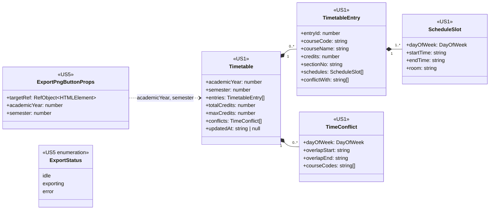

# US5 — DTO Class Diagram

US5 **ไม่มี DTO ใหม่** แผนภาพนี้แสดง DTO ของ US1 (`<<US1>>`) ที่ US5 อ่านค่าไปวาดภาพ และ type ใหม่ฝั่ง frontend ของ US5 เอง (`<<US5>>`) ซึ่งไม่ได้ส่งผ่าน API

| Type | เจ้าของ | US5 ใช้อย่างไร |
| --- | --- | --- |
| `Timetable` | US1 (`features/timetable/types.ts`) | ข้อมูลทั้งหมดในภาพ + `academicYear` / `semester` สำหรับชื่อไฟล์ |
| `TimetableEntry`, `ScheduleSlot`, `TimeConflict` | US1 | วาดบล็อกวิชาและบล็อกเวลาชนในภาพ (US1 วาดบนหน้าจอ US5 ถ่ายภาพตามนั้น) |
| `ExportPngButtonProps` | US5 (`features/timetable-export/types.ts`) | props ของปุ่ม PNG |
| `ExportStatus` | US5 | สถานะปุ่ม `idle` / `exporting` / `error` |

ฝั่ง backend ไม่มี record ใหม่ field ทุกตัวของ type ฝั่ง frontend เป็น public (+) เพราะเป็น TypeScript type ไม่มี private/protected
