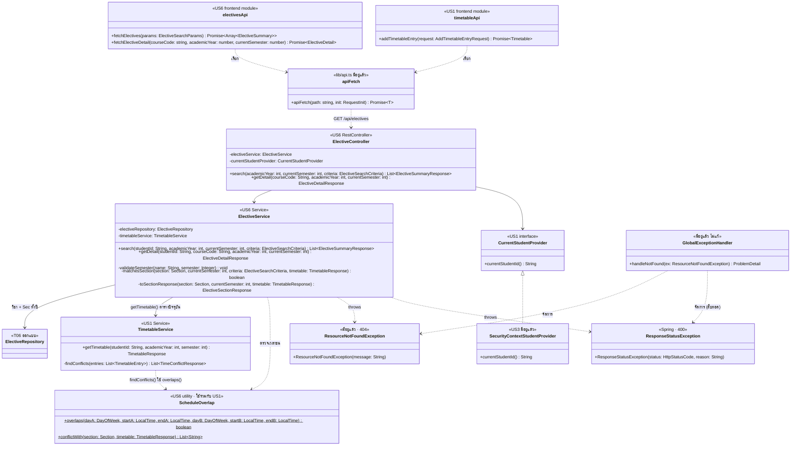

# US6 — API Class Diagram

US6 เพิ่ม **controller กับ service ใหม่** ใน package `elective/` helper ตรวจเวลาชนที่ใช้ร่วมกับ US1 และโมดูลเรียก API ฝั่ง frontend แผนภาพวาด class ของ US6 (`<<US6>>`) กับจุดที่พึ่ง US1/US3 และของที่มีอยู่แล้ว ปุ่ม "เพิ่มลงตาราง" เรียก `addTimetableEntry` → `POST /api/timetable/entries` ของ US1 โดยตรง backend ของ US6 จึงไม่มี method เพิ่มวิชา

| ส่วน | หน้าที่ |
| --- | --- |
| `ElectiveController` | `@RestController @RequestMapping("/api/electives")` · `search` = `GET` รับ `academicYear`, `currentSemester` ด้วย `@RequestParam` และ param ที่เหลือด้วย `@ModelAttribute ElectiveSearchCriteria` · `getDetail` = `GET /{courseCode}` · ทั้งสองตอบ `200` ขอ `studentId` จาก `CurrentStudentProvider` แล้วส่งต่อให้ service |
| `ElectiveService.search` | `@Transactional(readOnly = true)` · ลำดับตาม API Spec: `validateSemester` ทั้ง `currentSemester` และ `semester` (400) → ถ้า `excludeConflicts` เรียก `getTimetable` → ดึงวิชาตาม `q`, `group` พร้อม Sec ทั้งปีจาก `ElectiveRepository` → เก็บวิชาที่มีอย่างน้อย 1 Sec ผ่าน `matchesSection` → แปลงด้วย `ElectiveSummaryResponse.from` เรียงตาม `InterestGroup` แล้ว `courseCode` |
| `ElectiveService.getDetail` | `validateSemester` (400) → หาวิชาเสรีแนะนำที่มี Sec ในปีนั้น (404) → `getTimetable` → `toSectionResponse` ทุก Sec → `ElectiveDetailResponse.of` |
| `matchesSection` | กติกาการกรองข้อ 3 ใน API Spec ทั้งหมดอยู่ที่นี่: `semester`, `day` + `timeSlot` ในคาบเดียวกัน (`TimeSlot.contains`), และ `excludeConflicts` (Sec ต้องอยู่ `currentSemester`, `ScheduleOverlap.conflictWith` ว่าง และ `courseCode` ไม่อยู่ใน `timetable.entries`) |
| `toSectionResponse` | `inTimetable` = `sectionId` อยู่ใน `timetable.entries` · `conflictWith` = `ScheduleOverlap.conflictWith` เฉพาะ Sec ที่ `selectable` (อีกภาค = `[]`) |
| `ScheduleOverlap` | กติกาชนจุดเดียวของระบบ `overlaps` = วันเดียวกัน `&& startA < endB && startB < endA` รับเป็นค่า primitive จึงใช้ได้ทั้งกับ entity `ScheduleSlot` (US1) และ `ScheduleSlotResponse` ใน `TimetableResponse` (US6) · `conflictWith` คืนรหัสวิชาในตารางที่ชนกับ Sec นี้ ไม่ซ้ำ ตามลำดับใน `entries` และข้าม entry ที่เป็นวิชาเดียวกับ Sec (ไม่นับว่าชนกับตัวเอง) |
| `TimetableService.getTimetable` (US1) | ให้ตารางปัจจุบันพร้อม `entries[].sectionId`, `courseCode`, `schedules` ซึ่งพอสำหรับตรวจเวลาชนและ `inTimetable` โดยไม่ต้องเพิ่ม method ใน US1 ยังไม่มีตาราง = ได้ `entries: []` |
| `TimetableService.findConflicts` (US1) | แก้ 1 จุด: เปลี่ยนเงื่อนไข `isBefore` ใน loop เป็นเรียก `ScheduleOverlap.overlaps` เพื่อไม่ให้กติกาชนมีสองชุด เป็นไฟล์ของ US1 ต้องบอกเจ้าของและแยก PR เล็กตาม CONTRIBUTING ผลลัพธ์ของ US1 ไม่เปลี่ยน |
| `ElectiveRepository` | query วิชาเสรีแนะนำตาม `q` / `group` และ Sec + คาบของทั้งปี ชื่อ method และจะแยก repository หรือเพิ่มใน `CourseRepository` / `SectionRepository` เดิมเป็นงานของ US6-T06 (DAO Class Diagram) |
| `CurrentStudentProvider` (US1) / `SecurityContextStudentProvider` (US3) | ให้ `studentId` จาก JWT ของผู้ใช้ปัจจุบัน ไม่มี token ถูกกันที่ `SecurityConfig` (401) ก่อนถึง controller |
| `ResourceNotFoundException` | `getDetail` ไม่พบวิชา / ไม่ใช่วิชาเสรีแนะนำ / ไม่มี Sec ในปีนั้น → `404` ผ่าน `handleNotFound` เดิม |
| `ResponseStatusException` | `currentSemester` หรือ `semester` ไม่ใช่ 1, 2 → `400` · `GlobalExceptionHandler` จัดการผ่าน `ResponseEntityExceptionHandler` ที่สืบทอดมา ไม่ต้องเพิ่ม handler หรือ `code` ใหม่ (400 จาก param ผิดชนิด/enum ผิดค่า Spring จัดการเองเช่นกัน) |
| `electivesApi` | `frontend/features/electives/api.ts` สร้าง query string จาก `ElectiveSearchParams` โดย**ไม่ใส่ key ที่เป็น `undefined`** (ไม่งั้นได้ `?day=undefined` → 400) และส่ง `excludeConflicts` เฉพาะตอน `true` |
| `timetableApi.addTimetableEntry` (US1) | ปุ่ม "+ เพิ่มลงตาราง" ใน modal ส่ง `sectionId` ของ Sec ที่เลือก error 409 อ่าน `ApiError.code` / `message` ตามตารางผลลัพธ์ใน API Spec |
| `apiFetch` | ตัวเดิมใน `lib/api.ts` แนบ `Authorization` ให้อัตโนมัติ และ 401 → `expireSession()` กลับหน้า Login |

ไม่ได้วาด entity (`Course`, `Section`, `ScheduleSlot`, ข้อมูลแนะนำวิชา) และ method ใน repository เพราะเป็นงานของ Extended API Class Diagram ใน US6-T06 แบบเดียวกับที่ US1, US2 แยกไว้ ส่วน component หน้าจอ (`ElectivesPage`, ตัวกรอง, การ์ด, modal) ออกแบบใน US6-T07 ตาม [UI Prototype](./ui-prototype)

**ทำไมพึ่ง `TimetableService` แทนอ่าน `TimetableEntryRepository` เอง:** `getTimetable` คืนข้อมูลที่ต้องใช้ครบแล้ว และยังรวมกฎ "ยังไม่มีตาราง = ว่าง" ไว้ที่เดียว ถ้าภายหลัง US1 เปลี่ยนวิธีเก็บตาราง US6 ไม่ต้องแก้ ข้อเสียคือได้ `conflicts` ของตารางมาด้วยโดยไม่ใช้ ซึ่งตารางมีไม่เกิน 22 หน่วยกิต (ราว 7 วิชา) จึงไม่กระทบประสิทธิภาพ

สัญลักษณ์: `+` = public, `-` = private, `$` = static · field ทุกตัวเป็น `private final` ฉีดผ่าน constructor ด้วย `@RequiredArgsConstructor` ตามแบบ `ItemController` · ไม่มี `#` เพราะ class ใหม่ของ US6 ไม่มีการสืบทอด · เส้นทึบ = เรียกใช้ผ่าน field, เส้นประ = เรียก static / throws / จัดการ exception / เรียกผ่าน HTTP, `<|..` = implements

## เอกสารที่เกี่ยวข้อง

- [DTO & API Spec](./US6-DTO%20&%20API%20Spec.md)
- [DTO Class Diagram](./US6-DTO-Class-Diagram.md)
- [US1 — API Class Diagram](../../US1/T05/US1-API-Class-Diagram.md)
- [US2 — API Class Diagram](../../US2/T05/US2-API-Class-Diagram.md)
