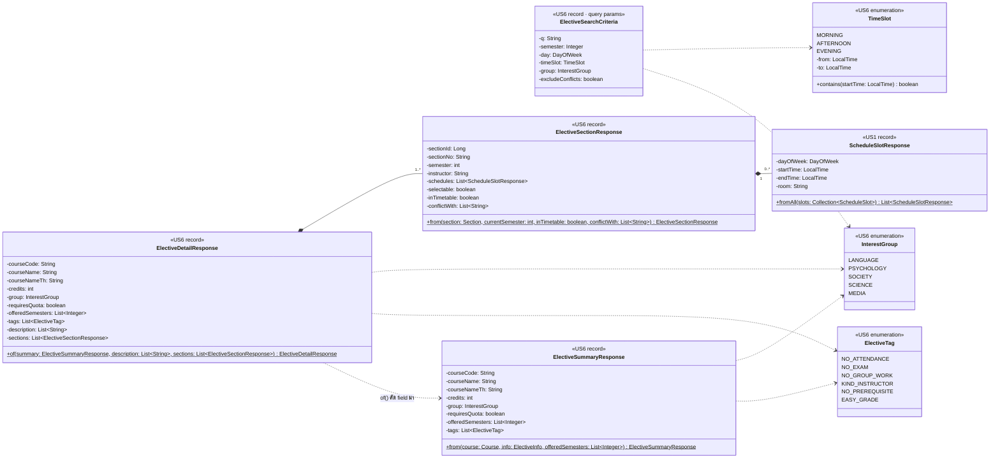

# US6 — DTO Class Diagram

US6 เพิ่ม DTO ใหม่ 3 record กับ enum 3 ตัวใน `elective/dto/` (`<<US6>>`) และ reuse `ScheduleSlotResponse` ของ US1 (`<<US1>>`) สำหรับคาบเรียนใน Sec ปุ่ม "เพิ่มลงตาราง" ใช้ `AddTimetableEntryRequest` / `TimetableResponse` ของ US1 ตามเดิม จึงไม่วาดซ้ำ

| Type | ใช้กับ | หน้าที่ |
| --- | --- | --- |
| `ElectiveSearchCriteria` | `GET /api/electives` | รวม query param ที่ไม่บังคับ 6 ตัวเป็นก้อนเดียว (bind ด้วย `@ModelAttribute`) ให้ service รับ parameter สั้นลง ไม่ส่งออกเป็น JSON · `semester` เป็น `Integer` เพราะ `null` = ทุกภาคเรียน · `excludeConflicts` ไม่ส่ง = `false` · `academicYear` และ `currentSemester` บังคับจึงรับแยกที่ controller |
| `ElectiveSummaryResponse` | `GET /api/electives` | การ์ดวิชา 1 ใบ |
| `ElectiveDetailResponse` | `GET /api/electives/{courseCode}` | modal รายละเอียด · field 8 ตัวแรกเหมือน `ElectiveSummaryResponse` ทุกตัว (JSON แบน ตาม API Spec) record สืบทอดกันไม่ได้จึงเขียนซ้ำ และสร้างผ่าน `of(summary, …)` แทนการแปลง entity ซ้ำสองที่ |
| `ElectiveSectionResponse` | ใน `ElectiveDetailResponse.sections` | การ์ด Sec ใน modal · `selectable` คำนวณใน `from()` จาก `section.semester == currentSemester` ส่วน `inTimetable` กับ `conflictWith` service คำนวณจากตารางปัจจุบันแล้วส่งเข้ามา |
| `ScheduleSlotResponse` | US1 (`course.dto`) | คาบเรียน · `fromAll` เรียงตามวันแล้วเวลาเริ่มให้อยู่แล้ว · `room` เป็น `null` ได้ |
| `InterestGroup` | param `group` และ field `group` | 5 หมวดหมู่ความสนใจ ลำดับ enum = ลำดับหัวข้อหมวดในหน้า (ใช้เรียงผลลัพธ์) |
| `TimeSlot` | param `timeSlot` | ช่วงเวลา 3 ช่วง เก็บ `from` / `to` ใน enum · `contains(start)` = `!start.isBefore(from) && start.isBefore(to)` ตามกติกา [from, to) ใน API Spec |
| `ElectiveTag` | field `tags` | ป้ายลักษณะวิชา ข้อความและสีอยู่ฝั่ง frontend (`ELECTIVE_TAG_LABELS`) |

| Static method | หน้าที่ |
| --- | --- |
| `ElectiveSummaryResponse.from(course, info, offeredSemesters)` | แปลงวิชาพร้อมข้อมูลแนะนำ `offeredSemesters` service ส่งมาจาก Sec ทั้งปี (ไม่ผ่านตัวกรอง) |
| `ElectiveDetailResponse.of(summary, description, sections)` | ประกอบ modal จาก summary + รีวิว + Sec |
| `ElectiveSectionResponse.from(section, currentSemester, inTimetable, conflictWith)` | แปลง Sec 1 Sec ใช้ `ScheduleSlotResponse.fromAll(section.getSlots())` |

**ชื่อ entity ยังเป็นชื่อชั่วคราว:** `Course`, `Section`, `ScheduleSlot` เป็นของ US1 ส่วน `ElectiveInfo` (ชื่อไทย หมวด โควตา tags รีวิว) เป็นชื่อสมมติ US6-T06 อาจเลือกเพิ่มคอลัมน์ใน `course` แทนการแยกตาราง ถ้าเป็นเช่นนั้น `from()` จะเหลือ `from(course, offeredSemesters)` ให้ปรับแผนภาพนี้ตาม ER Diagram ของ T06

ฝั่ง frontend type `ElectiveSummary`, `ElectiveDetail`, `ElectiveSection`, `ElectiveSearchParams`, `InterestGroup`, `TimeSlot`, `ElectiveTag` อยู่ใน `frontend/features/electives/types.ts` ตรงกับ record ด้านบนทีละ field (ดู [DTO & API Spec](./US6-DTO%20&%20API%20Spec.md#typescript-types-frontend)) `ElectiveSearchParams` มี `academicYear` และ `currentSemester` รวมอยู่ด้วยเพราะฝั่ง browser ส่งเป็น query string ชุดเดียว

สัญลักษณ์: field ของ record เป็น `private final` (-) ส่วน accessor และ constructor แบบ public ที่ record สร้างให้อัตโนมัติไม่ได้วาด static method มี `$` (ขีดเส้นใต้ใน UML) ไม่มี `#` เพราะ record และ enum สืบทอดไม่ได้ · `*--` = composition (ส่วนประกอบใน JSON), `..>` = ใช้งาน

## เอกสารที่เกี่ยวข้อง

- [DTO & API Spec](./US6-DTO%20&%20API%20Spec.md)
- [API Class Diagram](./US6-API-Class-Diagram.md)
- [US1 — DTO Class Diagram](../../US1/T05/US1-DTO-Class-Diagram.md)
