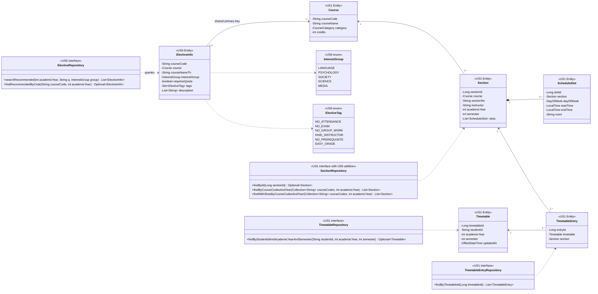

# US6-T06 — DAO Class Diagram

Entity / repository (DAO) ตาม [ER Diagram](./US6-T06-ER-Diagram.md) และ [US6-T05 API Spec รุ่น 8213f9a](https://github.com/Non-Sin/CS261-G3-MockTimetableTU/blob/8213f9acded350f8837eefc6a1b96564c82a297d/.doc/US6/T05/US6-DTO%20%26%20API%20Spec.md) ชื่อใหม่เป็นแบบที่จะ implement ใน T09 ไม่ใช่ class ที่มีในโค้ดแล้ว

## Class Diagram



แสดงเฉพาะ fields/method ที่เกี่ยวข้องกับ US6 และ flow เพิ่มของ US1; `save`, `saveAll` ฯลฯ สืบทอดจาก `JpaRepository` ตามเดิม ไม่ได้เพิ่ม API เขียนข้อมูลแนะนำใน US6

## การ map entity

| ส่วน | Mapping / หน้าที่ |
|---|---|
| `ElectiveRepository` | `JpaRepository<ElectiveInfo, String>` ใน package `elective`; หาวิชาที่มี metadata/review และ section ในปีที่ขอ |
| `ElectiveInfo` | `@Table(name = "elective_info")`; `courseCode` เป็น `@Id`; `course` ใช้ `@OneToOne(fetch = LAZY)` + `@MapsId` + `@JoinColumn(name = "course_code")` |
| `interestGroup` | `@Enumerated(STRING)` ไม่ชนกับคอลัมน์ `course.category` |
| `tags` | `@ElementCollection(fetch = LAZY)` เป็น `Set<ElectiveTag>`, `@CollectionTable(name = "elective_tag")`, `@Enumerated(STRING)`, คอลัมน์ `tag`; query fetch ตามแผนด้านล่างแล้ว service เรียง enum ก่อนคืน DTO |
| `description` | `@ElementCollection(fetch = LAZY)` เป็น `List<String>`, `@CollectionTable(name = "elective_review_point")`, `@Column(name = "review_text")`, `@OrderColumn(name = "sort_order")` เริ่ม 0 |
| ตารางลูก | เป็น value collections ไม่มี id/entity/repository ของรีวิวหรือ tag แยก เพราะไม่มี lifecycle และ endpoint เขียนของตัวเอง |
| `Course` / `Section` / `ScheduleSlot` | reuse entity เดิม; `slots` อาจว่าง และ instructor/room อาจ NULL |

## Query และแผนการโหลด

เลือก `ElectiveRepository` แยกเพื่อคงความหมาย `CourseRepository.search` ของ US1 ที่ค้นเฉพาะหนึ่งภาค การค้นหา US6 ต้องรองรับทั้งปี, ชื่อไทย, metadata และ eligibility เพิ่มขึ้น แต่ reuse `Course` ผ่าน association และเพิ่มเพียง method โหลด section ทั้งปีใน `SectionRepository`

### 1. `searchRecommended(academicYear, q, group)`

query root `ElectiveInfo` แบบ `SELECT DISTINCT info` พร้อม `JOIN FETCH info.course` และ `LEFT JOIN FETCH info.tags` โดย:

- บังคับ `course.category = FREE_ELECTIVE`
- `info.description IS NOT EMPTY` เพื่อไม่เผยแพร่วิชาที่ยังไม่มีรีวิว
- `EXISTS section` ของวิชานั้นใน `academicYear` ไม่กรอง `semester` ที่ขั้นนี้
- `group` ไม่ว่างให้ตรง `info.interestGroup`
- `q` strip ช่องว่าง; null/ว่างไม่กรอง; รหัสวิชา prefix, ชื่ออังกฤษ word prefix ต้นคำ/หลังช่องว่าง/หลัง `-` เหมือน US1, ชื่อไทย substring; ไม่สนตัวพิมพ์อังกฤษ
- bind parameter และ escape `!`, `%`, `_`, `[` ของ SQL Server LIKE เหมือน repository US1 ค้นอักขระเหล่านี้ตามตัวอักษร ไม่ต่อคำค้นเป็น SQL และไม่ bind null เข้า LIKE pattern

ใช้ `EXISTS` กับ review/section เพื่อตรวจสิทธิ์เข้ารายการโดยไม่ fetch รีวิวเข้าหน้ารวม แล้วใช้ section query ด้านล่างเป็น query ที่สองสำหรับตัวกรองคาบ

### 2. `findRecommendedByCode(courseCode, academicYear)`

ใช้เงื่อนไข eligibility เดียวกับ search, รหัสวิชาตรงกัน พร้อม fetch course และ tags แต่ไม่ใช้ตัวกรองหน้ารายการ ถ้าไม่พบคืน `Optional.empty()` ให้ service โยน `ResourceNotFoundException` (404) ก่อนโหลดตารางผู้ใช้

### 3. `SectionRepository.findByCourseCodesAndYear(courseCodes, academicYear)` — method ใหม่

เป็น wrapper แบบเดียวกับ `findByCourseCodesAndTerm` เดิม: list ว่างคืน `List.of()` ไม่ออก SQL; list มีค่าจึงเรียก query method `findWithSlotsByCourseCodesAndYear`:

```sql
-- JPQL (ไม่ใช่ SQL migration)
select distinct s from Section s
join fetch s.course c
left join fetch s.slots
where c.courseCode in :courseCodes and s.academicYear = :academicYear
order by c.courseCode, s.semester, s.sectionNo
```

ใช้ `LEFT JOIN` เพื่อรักษา section ไม่มีคาบไว้ ตัวกรองวัน/เวลา/ภาค/ไม่ชนทำใน service บนชุด section นี้ ไม่ใช้ method เดิมที่บังคับหนึ่งภาค เพราะรายละเอียดต้องแสดง Sec ของทั้งปี และ `offeredSemesters` ต้องไม่เปลี่ยนตามตัวกรอง

### 4. รายละเอียดโหลดรีวิวใน read-only transaction

หลังพบ `ElectiveInfo` ให้ initialize `description` ภายใน `ElectiveService.getDetail` (`info.getDescription().size()` หรือ ORM initialization ที่เหมาะสม) จึงเกิด collection SELECT เพิ่มอีก 1 query ตาม `course_code` และเรียงด้วย `sort_order` ก่อนแปลง DTO

Search เมื่อพบ candidate ใช้ **2 metadata/section queries** รวม tags ใน query แรก ไม่ initialize `description` ของแต่ละวิชา จึงไม่เกิด N+1 รีวิว; ถ้า metadata ว่างใช้เพียง 1 query และข้าม section query ส่วน detail ที่พบวิชาใช้ **3 queries**: metadata+tags, section+slots, description สำหรับหนึ่งวิชา (ไม่พบวิชาใช้ metadata query เดียวแล้ว 404) การอ่านตารางผ่าน US1 เป็น query เพิ่มแยกจากจำนวนนี้: 1 query ตาราง และอีก 1 query entries หากพบตาราง

ไม่ fetch `tags` กับ `description` พร้อมกัน เพราะจะคูณจำนวนแถวเป็นจำนวน tags × จำนวน review points ต่อวิชา; query แรก fetch เพียง tags ส่วน query section fetch เพียง slots เหตุผลนี้ไม่ได้หมายความว่า Hibernate ห้าม fetch ทุกกรณีที่มีหลาย collection ทุก DTO ประกอบใน transaction (`open-in-view: false`) ก่อนออกจาก service จำนวน query เป็นแผนของ T06 ที่ T09 ต้องยืนยันด้วย SQL log/integration test หลัง implement ไม่ใช่ผลวัด runtime ในงานเอกสารนี้

## จุดเชื่อมกับ US1

- Search ที่ `excludeConflicts=true` และ detail ใช้ `TimetableService.getTimetable(studentId, academicYear, currentSemester)` ไม่เรียก HTTP GET วนกลับเข้า backend
- US1 ใช้ `TimetableRepository.findByStudentIdAndAcademicYearAndSemester` → ถ้าพบจึงเรียก `TimetableEntryRepository.findByTimetableId` (fetch section/course/slots ตามโค้ดเดิม); ถ้าไม่พบคืนตารางว่างโดยไม่สร้างแถวใหม่
- เพิ่มวิชาผ่าน `TimetableService.addEntry` ตาม [Sequence เพิ่มลงตาราง](./US6-T06-Sequence-Diagram-AddEntry.md) repository เขียนตารางเดิม ไม่เขียนสามตาราง metadata
- การเพิ่ม method ใน `SectionRepository` และแยก `ScheduleOverlap` จาก loop ของ US1 ต้องประสานเจ้าของก่อน implement ตาม CONTRIBUTING งาน T06 นี้กำหนดแบบและผลลัพธ์ที่ต้องคงไว้

## เอกสารที่เกี่ยวข้อง

- [ER Diagram และ constraints](./US6-T06-ER-Diagram.md)
- [Extended API Class Diagram](./US6-T06-Extended-API-Class-Diagram.md)
- [Sequence ค้นหา](./US6-T06-Sequence-Diagram-Search.md)
- [Sequence รายละเอียด](./US6-T06-Sequence-Diagram-Detail.md)
- [Sequence เพิ่มลงตาราง](./US6-T06-Sequence-Diagram-AddEntry.md)
