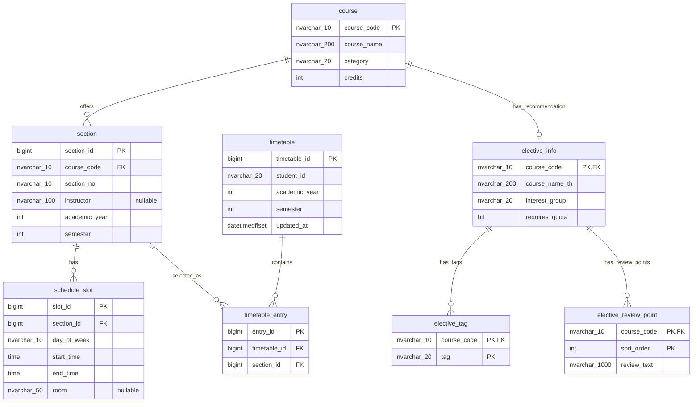

# US6-T06 — ER Diagram: ข้อมูลแนะนำวิชาเสรี

เอกสารออกแบบสำหรับ US6-T09 ใช้ต่อจาก [US6-T05 API Spec รุ่น 8213f9a](https://github.com/Non-Sin/CS261-G3-MockTimetableTU/blob/8213f9acded350f8837eefc6a1b96564c82a297d/.doc/US6/T05/US6-DTO%20%26%20API%20Spec.md) ของ PR #87 และ schema US1 ใน `V20261014_1940__create_timetable_tables.sql` ยังไม่ได้สร้างตารางหรือ seed จริงจากงานเอกสารนี้

## การตัดสินใจ

แยก metadata เฉพาะ US6 เป็น `elective_info` แบบ 0..1 ต่อ `course` และแยก tags / bullet รีวิวเป็นตารางลูก เพราะเป็นข้อมูลหลายค่าที่มีข้อกำหนดความซ้ำและลำดับต่างกัน วิชาทั่วไปของ US1 ไม่จำเป็นต้องมีข้อมูลนี้ จึงไม่เพิ่มคอลัมน์ nullable หลายตัวใน `course`

`course_code` ของ `elective_info` เป็นทั้ง PK และ FK ใช้รหัสเดิมชนิด `NVARCHAR(10)` ไม่สร้างรหัสวิชาอีกชุด ส่วน section, วันเวลา, ห้อง, ผู้สอน และตารางนักศึกษาใช้ตารางเดิมทั้งหมด

การ์ดงาน T06 เดิมกล่าวถึง onsite/online และวิธีวัดผล แต่ T05 รุ่นที่ใช้อ้างอิงตัดตัวกรองเหล่านั้นออกแล้ว จึงไม่มีคอลัมน์ `learning_mode` หรือ enum วิธีวัดผลใหม่ วิธีวัดผล/ลักษณะวิชาที่มีใน Prototype เก็บใน `tags` และ bullet `description` ตามสัญญาปัจจุบัน

## ER Diagram



`course`, `section`, `schedule_slot`, `timetable`, `timetable_entry` เป็นตารางเดิม เส้น `elective_info` → รีวิวใช้ 0..* ตามสิ่งที่ FK/PK บังคับได้จริง แต่ **วิชาที่เผยแพร่ใน US6 ต้องมีรีวิวอย่างน้อย 1 ข้อ** ตรวจด้วย query eligibility และตรวจ seed ก่อนส่งงาน ไม่อ้างว่า FK หรือ CHECK บังคับจำนวนแถวลูกขั้นต่ำได้

## ตารางใหม่และ constraints

| ตาราง | คีย์/เงื่อนไข | เหตุผล |
|---|---|---|
| `elective_info` | PK/FK `course_code`; ทุก field NOT NULL | 1 วิชามี metadata ได้ชุดเดียว; ชื่อไทยเก็บ Unicode |
| `elective_info` | `interest_group` CHECK 5 ค่าใน T05 | แยกหมวดความสนใจออกจาก `course.category` |
| `elective_info` | `requires_quota BIT NOT NULL DEFAULT 0` | ใช้แสดงป้ายและลิงก์ขอโควตา ไม่ใช่สถานะอนุมัติลงทะเบียน |
| `elective_tag` | PK `(course_code, tag)`; CHECK enum 6 ค่า | ป้ายเดิมไม่ซ้ำในวิชาเดียวกัน |
| `elective_review_point` | PK `(course_code, sort_order)`; `sort_order >= 0`; ข้อความไม่ว่าง | ลำดับ bullet คงที่และไม่ซ้ำ; ใช้ index เริ่ม 0 ให้ตรง JPA `@OrderColumn` |
| ตารางลูกทั้งสอง | FK ไป `elective_info` พร้อม `ON DELETE CASCADE` | ลบข้อมูลแนะนำแล้วไม่เหลือป้ายหรือรีวิวกำพร้า |

หมวด: `LANGUAGE`, `PSYCHOLOGY`, `SOCIETY`, `SCIENCE`, `MEDIA` เรียงตามลำดับนี้ใน response ไม่ใช้การเรียงตัวอักษรของ DB

ป้าย: `NO_ATTENDANCE`, `NO_EXAM`, `NO_GROUP_WORK`, `KIND_INSTRUCTOR`, `NO_PREREQUISITE`, `EASY_GRADE` เรียงตาม enum นี้ก่อนคืน DTO ไม่พึ่งลำดับแถวใน `elective_tag`

## แบบ DDL สำหรับ migration ใหม่

ชื่อความยาวคอลัมน์และ constraints ด้านล่างเป็นข้อเสนอที่ T09 ใช้ implement ได้; ทุกไฟล์ migration ต้องใช้ชื่อ timestamp ใหม่ตาม CONTRIBUTING และไม่แก้ migration ที่ merge แล้ว

```sql
CREATE TABLE elective_info (
    course_code NVARCHAR(10) NOT NULL,
    course_name_th NVARCHAR(200) NOT NULL,
    interest_group NVARCHAR(20) NOT NULL,
    requires_quota BIT NOT NULL CONSTRAINT df_elective_info_quota DEFAULT 0,
    CONSTRAINT pk_elective_info PRIMARY KEY (course_code),
    CONSTRAINT fk_elective_info_course FOREIGN KEY (course_code)
        REFERENCES course(course_code),
    CONSTRAINT ck_elective_info_group CHECK (interest_group IN
        ('LANGUAGE', 'PSYCHOLOGY', 'SOCIETY', 'SCIENCE', 'MEDIA')),
    CONSTRAINT ck_elective_info_name CHECK (LEN(LTRIM(RTRIM(course_name_th))) > 0)
);

CREATE TABLE elective_tag (
    course_code NVARCHAR(10) NOT NULL,
    tag NVARCHAR(20) NOT NULL,
    CONSTRAINT pk_elective_tag PRIMARY KEY (course_code, tag),
    CONSTRAINT fk_elective_tag_info FOREIGN KEY (course_code)
        REFERENCES elective_info(course_code) ON DELETE CASCADE,
    CONSTRAINT ck_elective_tag_value CHECK (tag IN
        ('NO_ATTENDANCE', 'NO_EXAM', 'NO_GROUP_WORK',
         'KIND_INSTRUCTOR', 'NO_PREREQUISITE', 'EASY_GRADE'))
);

CREATE TABLE elective_review_point (
    course_code NVARCHAR(10) NOT NULL,
    sort_order INT NOT NULL,
    review_text NVARCHAR(1000) NOT NULL,
    CONSTRAINT pk_elective_review_point PRIMARY KEY (course_code, sort_order),
    CONSTRAINT fk_elective_review_info FOREIGN KEY (course_code)
        REFERENCES elective_info(course_code) ON DELETE CASCADE,
    CONSTRAINT ck_elective_review_order CHECK (sort_order >= 0),
    CONSTRAINT ck_elective_review_text CHECK (LEN(LTRIM(RTRIM(review_text))) > 0)
);
```

PK ของตารางลูกเริ่มด้วย `course_code` จึงใช้โหลดลูกของชุดวิชาได้ การเสนอ index เพิ่มสำหรับปริมาณข้อมูลจริงให้พิจารณาจาก query plan ภายหลัง ไม่ต้องเพิ่ม index ซ้ำกับ PK นี้

## การเผยแพร่ข้อมูลและ seed

วิชาเข้า GET รายการ/รายละเอียดเมื่อเป็น `FREE_ELECTIVE`, มี `elective_info`, มี bullet รีวิวอย่างน้อยหนึ่งข้อ และมี section ใน `academicYear` ที่ขอ วิชาที่ข้อมูลไม่ครบไม่แสดงในรายการ และรายละเอียดได้ `404` ตาม T05

ลำดับ seed: `course` → `section` / `schedule_slot` ตามข้อมูลจริง → `elective_info` → `elective_tag` / `elective_review_point` ใช้ `N'ข้อความไทย'` ใน SQL Server และเตรียม 18 วิชาให้ตรง Prototype ก่อนตรวจรับจำนวนการ์ด ตรวจให้ review order เริ่ม 0 และต่อเนื่อง, enum ถูกต้อง, ไม่มีรีวิวว่าง และ `category = FREE_ELECTIVE` สำหรับวิชาที่ seed ข้อมูลแนะนำ การเป็น FREE_ELECTIVE เป็นกฎ query/seed ข้ามตาราง ไม่ใช่ CHECK ที่อ้างอีกตาราง

- FR205: รองรับหลาย section ในภาคเดียวกันและ `requiresQuota = true`
- PY250: มี section ต่างภาค; ภาคอื่นยังแสดงรายละเอียดแต่กดเลือกไม่ได้
- SA240: ค้นหาแล้วได้ `[]` หากไม่ใช่วิชาแนะนำที่ครบเงื่อนไข ไม่จำเป็นต้องลบจาก `course`
- section แบบ e-learning ไม่มีแถว `schedule_slot` ได้; `instructor` และ `room` เป็น NULL ได้ตาม schema เดิม

`offeredSemesters` คำนวณจาก section ทั้งปี **ก่อนกรอง**, ส่วน `selectable`, `inTimetable`, `conflictWith` คำนวณตามตารางปัจจุบัน ไม่เก็บค่าที่เปลี่ยนตามผู้ใช้เหล่านี้ใน DB และไม่สร้างตารางเก็บ dropdown, การขอโควตา หรือคะแนนรีวิวที่อยู่นอก scope

## เอกสารที่เกี่ยวข้อง

- [DAO Class Diagram และวิธีโหลด collection](./US6-T06-DAO-Class-Diagram.md)
- [Extended API Class Diagram](./US6-T06-Extended-API-Class-Diagram.md)
- [Sequence ค้นหา](./US6-T06-Sequence-Diagram-Search.md)
- [Sequence รายละเอียด](./US6-T06-Sequence-Diagram-Detail.md)
- [Sequence เพิ่มลงตาราง](./US6-T06-Sequence-Diagram-AddEntry.md)
- [US1 ER Diagram](../../US1/T06/US1-T06-ER-Diagram.md)
