# US6-T06 — Extended API Class Diagram

เชื่อม UI API module → Controller → Service → DAO / Entity / DTO ตาม [US6-T05 API Spec รุ่น 8213f9a](https://github.com/Non-Sin/CS261-G3-MockTimetableTU/blob/8213f9acded350f8837eefc6a1b96564c82a297d/.doc/US6/T05/US6-DTO%20%26%20API%20Spec.md) และ [API Class Diagram ของ T05](https://github.com/Non-Sin/CS261-G3-MockTimetableTU/blob/8213f9acded350f8837eefc6a1b96564c82a297d/.doc/US6/T05/US6-API-Class-Diagram.md) ยืนยันชื่อ entity `ElectiveInfo` ที่ T05 ตั้งไว้ชั่วคราวตาม [ER](./US6-T06-ER-Diagram.md)

## Class Diagram

```mermaid
classDiagram
    direction TB
    class ElectiveController {
        <<US6 RestController>>
        -ElectiveService electiveService
        -CurrentStudentProvider currentStudentProvider
        +search(int academicYear, int currentSemester, ElectiveSearchCriteria criteria) List~ElectiveSummaryResponse~
        +getDetail(String courseCode, int academicYear, int currentSemester) ElectiveDetailResponse
    }
    class ElectiveService {
        <<US6 Service>>
        -ElectiveRepository electiveRepository
        -SectionRepository sectionRepository
        -TimetableService timetableService
        +search(String studentId, int academicYear, int currentSemester, ElectiveSearchCriteria criteria) List~ElectiveSummaryResponse~
        +getDetail(String studentId, String courseCode, int academicYear, int currentSemester) ElectiveDetailResponse
        -validateSemester(String name, Integer semester) void
        -matchesSection(Section section, int currentSemester, ElectiveSearchCriteria criteria, TimetableResponse timetable) boolean
        -toSectionResponse(Section section, int currentSemester, TimetableResponse timetable) ElectiveSectionResponse
    }
    class ElectiveRepository {
        <<US6 interface>>
        +searchRecommended(int academicYear, String q, InterestGroup group) List~ElectiveInfo~
        +findRecommendedByCode(String courseCode, int academicYear) Optional~ElectiveInfo~
    }
    class SectionRepository {
        <<US1 with US6 method>>
        +findById(Long sectionId) Optional~Section~
        +findByCourseCodesAndYear(Collection~String~ courseCodes, int academicYear) List~Section~
    }
    class ElectiveInfo {
        <<US6 Entity>>
        -String courseCode
        -Course course
        -String courseNameTh
        -InterestGroup interestGroup
        -boolean requiresQuota
        -Set~ElectiveTag~ tags
        -List~String~ description
    }
    class Course {
        <<US1 Entity>>
        -String courseCode
        -String courseName
        -CourseCategory category
        -int credits
    }
    class Section {
        <<US1 Entity>>
        -Long sectionId
        -Course course
        -int academicYear
        -int semester
        -List~ScheduleSlot~ slots
    }
    class ScheduleSlot {
        <<US1 Entity>>
        -DayOfWeek dayOfWeek
        -LocalTime startTime
        -LocalTime endTime
        -String room
    }
    class ScheduleOverlap {
        <<US6 shared utility>>
        +overlaps(DayOfWeek dayA, LocalTime startA, LocalTime endA, DayOfWeek dayB, LocalTime startB, LocalTime endB) boolean$
        +conflictWith(Section section, TimetableResponse timetable) List~String~$
    }
    class TimeSlot {
        <<US6 enum>>
        -LocalTime from
        -LocalTime to
        +contains(LocalTime startTime) boolean
    }
    class ElectiveSearchCriteria {
        <<US6 query record>>
        -String q
        -Integer semester
        -DayOfWeek day
        -TimeSlot timeSlot
        -InterestGroup group
        -boolean excludeConflicts
    }
    class ElectiveSummaryResponse {
        <<US6 DTO record>>
        +from(Course course, ElectiveInfo info, List~Integer~ offeredSemesters) ElectiveSummaryResponse$
    }
    class ElectiveDetailResponse {
        <<US6 DTO record>>
        +of(ElectiveSummaryResponse summary, List~String~ description, List~ElectiveSectionResponse~ sections) ElectiveDetailResponse$
    }
    class ElectiveSectionResponse {
        <<US6 DTO record>>
        +from(Section section, int currentSemester, boolean inTimetable, List~String~ conflictWith) ElectiveSectionResponse$
    }
    class TimetableResponse {
        <<US1 DTO record>>
        -List~TimetableEntryResponse~ entries
        -List~TimeConflictResponse~ conflicts
    }
    class TimetableService {
        <<US1 Service>>
        +getTimetable(String studentId, int academicYear, int semester) TimetableResponse
        +addEntry(String studentId, AddTimetableEntryRequest request) TimetableResponse
        -findConflicts(List~TimetableEntry~ entries) List~TimeConflictResponse~
    }
    class TimetableController {
        <<US1 RestController>>
        +addEntry(AddTimetableEntryRequest request) TimetableResponse
    }
    class CurrentStudentProvider {
        <<US1 interface implemented by US3>>
        +currentStudentId() String
    }

    ElectiveController --> ElectiveService
    ElectiveController --> CurrentStudentProvider
    ElectiveController ..> ElectiveSearchCriteria
    ElectiveService --> ElectiveRepository
    ElectiveService --> SectionRepository
    ElectiveService --> TimetableService : current timetable
    ElectiveService ..> ScheduleOverlap
    ElectiveService ..> TimeSlot
    ElectiveService ..> ElectiveSummaryResponse
    ElectiveService ..> ElectiveDetailResponse
    ElectiveService ..> ElectiveSectionResponse
    ElectiveRepository ..> ElectiveInfo
    ElectiveInfo "0..1" --> "1" Course
    SectionRepository ..> Section
    Course "1" <-- "0..*" Section
    Section "1" *-- "0..*" ScheduleSlot
    ElectiveDetailResponse ..> ElectiveSummaryResponse : copies fields
    ElectiveDetailResponse "1" *-- "1..*" ElectiveSectionResponse
    TimetableService ..> ScheduleOverlap : overlaps in findConflicts
    TimetableService ..> TimetableResponse
    ScheduleOverlap ..> TimetableResponse
    TimetableController --> TimetableService
    TimetableController --> CurrentStudentProvider
```

แสดงเฉพาะ field/method ที่เชื่อม flow; fields DTO ทั้งหมดอยู่ใน T05 ส่วน repository ของ timetable และรายละเอียด JPA อยู่ใน [DAO Class Diagram](./US6-T06-DAO-Class-Diagram.md) สัญลักษณ์ `$` คือ static, `-` private, `+` public ไม่ได้เพิ่มการสืบทอดระหว่าง record

## หน้าที่และสัญญาระหว่างส่วน

| ส่วน | วิธีทำงาน |
|---|---|
| `ElectiveController` | `@RestController @RequestMapping("/api/electives")`; GET รายการรับปี/ภาคปัจจุบันแยกจาก `@ModelAttribute ElectiveSearchCriteria`; GET detail รับ path courseCode; ขอ studentId จาก provider แล้วส่งต่อ service |
| `ElectiveService` | `@Transactional(readOnly = true)`; validate ภาค, ขอ snapshot ตารางเมื่อจำเป็น, query metadata/section, กรองและประกอบ DTO ก่อนจบ transaction |
| `ElectiveRepository` | จำกัด eligibility และตัวกรองระดับวิชา q/group เท่านั้น ไม่กรอง section จนข้อมูลสำหรับ offeredSemesters หาย |
| `SectionRepository` | เพิ่ม method โหลด Sec ทั้งปีแบบ batch; query slots ด้วย LEFT JOIN ไม่ใช้ method เดิมที่จำกัดหนึ่งภาค |
| `matchesSection` | `semester` ตรง; day/timeSlot ต้องตรงคาบเดียวกัน; หากเปิด excludeConflicts ต้องอยู่ currentSemester, courseCode ยังไม่อยู่ใน entries และ helper ไม่พบคู่ชน; ไม่อ่าน snapshot ที่ไม่ได้โหลดเมื่อ toggle ปิด |
| `toSectionResponse` | selectable ดูภาคเพียงอย่างเดียว; inTimetable ตรวจ sectionId; เรียก helper เฉพาะ Sec ใน currentSemester อีกภาค conflictWith ว่างเสมอ |
| `ElectiveSummaryResponse.from` | จาก course + info ที่ fetch แล้ว; offeredSemesters มาจาก section ทั้งปี distinct/sorted; tags เรียง enum |
| `ElectiveDetailResponse.of` | คืน JSON แบนเหมือน summary แล้วเพิ่ม ordered description และ Sec ทั้งปีเรียงภาค/Sec; ไม่ใช้ตัวกรองหน้ารายการ |
| `ElectiveSectionResponse.from` | reuse `ScheduleSlotResponse.fromAll(section.getSlots())` ของ US1 (เรียงวัน/เวลา) และรับค่า inTimetable/conflictWith ที่ service คำนวณ |

T05 เดิมแสดง dependency ของ service เป็น `ElectiveRepository` กับ `TimetableService` โดยเว้นการออกแบบ DAO ให้ T06 แบบนี้เพิ่ม field `SectionRepository` ใน service เพื่อทำ query ที่สองอย่างชัดเจน public endpoint/DTO และชื่อ factory method ยังเหมือน T05 ส่วน T08 ควรปรับ dependency ในแผนภาพ T05 ให้ตรงตอน implement

## Helper ตรวจเวลาชนร่วมกับ US1

เสนอ `ScheduleOverlap` ใน package `common.schedule` เป็น utility ไม่มี state และไม่เรียก DB:

1. `overlaps(...)` คืน `dayA == dayB && startA.isBefore(endB) && startB.isBefore(endA)` คาบต่อกันพอดีจึงไม่ชน ใช้ primitive วัน/เวลาเพื่อรับได้ทั้ง entity และ DTO schedule
2. `conflictWith(section, timetable)` วน entries ของตาราง ข้าม **courseCode เดียวกัน** (รวมกรณีคนละ Sec ของวิชาเดียวกันตามข้อเสนอแนะรีวิว) และเก็บรหัสที่มีอย่างน้อยหนึ่งคู่คาบ overlap ใน `LinkedHashSet` ตามลำดับ entries
3. Sec ไม่มีคาบได้ `[]`; ไม่เรียก helper สำหรับ Sec อีกภาคใน detail และ matchesSection ต้องตัดภาคที่ไม่ใช่ currentSemester ก่อนตรวจ

`TimetableService.findConflicts` ของ US1 เปลี่ยนเฉพาะเงื่อนไขวัน/เวลาใน loop ให้เรียก `overlaps` ยังรวมช่วงเวลาและเรียง TimeConflictResponse แบบเดิม ไม่แทนกระบวนการทั้งหมดด้วย `conflictWith` และไม่เปลี่ยน POST ให้ปฏิเสธเวลาชน

## การเรียกจาก frontend

| Module / action | Endpoint / ผล |
|---|---|
| `electivesApi.fetchElectives(params)` | GET รายการ สร้าง query เฉพาะ key ที่มีค่า ไม่ส่ง `undefined` เป็น string และส่ง excludeConflicts เมื่อ true |
| `electivesApi.fetchElectiveDetail(courseCode, academicYear, currentSemester)` | GET รายละเอียดตอนกดการ์ด/อ่านรีวิว ไม่ส่งตัวกรองรายการมาด้วย |
| `timetableApi.addTimetableEntry({sectionId})` ของ US1 | POST entries โดยตรง ใช้ selectable ของรายละเอียดปัจจุบันป้องกันส่งผิดภาค; ถ้า Sec ใดของวิชานี้อยู่ในตารางแล้ว disable ปุ่มทั้งวิชา |
| `apiFetch` เดิม | แนบ Bearer; 401 ใช้ flow session ของ US4, error อ่านจาก ApiError; 409 ของ US6 แสดง detail ใน modal ตาม T05 |

ไม่เพิ่ม method add ใน ElectiveService; HTTP POST เข้า `TimetableController.addEntry` แล้ว `TimetableService.addEntry` ของ US1 ทำ transaction ตาม [Sequence เพิ่ม](./US6-T06-Sequence-Diagram-AddEntry.md) หลัง 201 ถ้า toggle ไม่ชนเปิดอยู่ให้ refresh รายการเพื่อไม่ใช้ snapshot เก่า

`CurrentStudentProvider` ใช้ implementation `SecurityContextStudentProvider` ของ US3 ที่มีอยู่แล้ว ไม่มี endpoint ให้ browser ส่ง studentId เอง และไม่มี UserRepository query เพิ่มใน flow นี้

## Error และ validation

| จุด | ผล |
|---|---|
| Security ของ US3 | ไม่มี/ผิด/หมดอายุ JWT → 401 ก่อน Controller |
| Spring binding | param บังคับหาย, ชนิดข้อมูล/enum/boolean ผิด → 400 ผ่าน ResponseEntityExceptionHandler เดิม |
| `validateSemester` | ภาค 3/ค่าอื่นที่ไม่ใช่ 1–2 → ResponseStatusException 400 ก่อน query; search ตรวจ semester ที่ optional เฉพาะเมื่อมีค่า |
| Detail ไม่ผ่าน eligibility | ResourceNotFoundException 404 ผ่าน GlobalExceptionHandler.handleNotFound เดิม |
| Search ไม่พบ | 200 [] ไม่ใช้ exception |
| Add ซ้ำ/หน่วยกิตเกิน | BusinessRuleException 409 ของ US1 พร้อม code เดิม ไม่เพิ่ม code ของ US6 |

API ของ US6 เป็น read-only ไม่มี handler ใหม่สำหรับเขียนรีวิว/คะแนน/ขอโควตา รูปแบบการเรียน onsite/online ไม่มี param หรือ field ใหม่ใน T05 รุ่นนี้ ป้ายวิธีวัดผลใช้ tags/description ตาม [ER](./US6-T06-ER-Diagram.md)

## ตารางตรวจกลับไปยังข้อกำหนด

| การออกแบบ T06 | หลักฐานจาก T05 | เหตุผล/จุดที่นำไปใช้ |
|---|---|---|
| CoS TC1 เปิดเมนูวิชาเสรีแนะนำ | [Spec L35][t05-menu] | Sequence Search โหลดครั้งแรกและแสดงการ์ดแบ่งหมวด |
| กรองใน Sec เดียวและคาบเดียว | [Spec L82–88][t05-filter] | DAO หาวิชาที่มีสิทธิ์แสดง แล้ว matchesSection ตรวจวัน/เวลา/ภาคพร้อมกัน ไม่รวมผลคนละ Sec ให้ผ่าน |
| แยก currentSemester จาก dropdown semester | [Spec L43][t05-term] | Snapshot ตารางและ selectable ใช้ภาคปัจจุบัน ไม่เปลี่ยนไปตามตัวกรองหน้ารายการ |
| รายละเอียดคืน Sec ทั้งปี | [Spec L154][t05-detail] | SectionRepository เพิ่ม method ทั้งปี; ไม่ reuse method ที่จำกัดหนึ่งภาค และไม่กรอง Sec รายละเอียดตาม dropdown |
| เพิ่มวิชาที่เวลาชนได้ตาม US1 | [Spec L210–234][t05-add] | POST เดิมคืน 201 พร้อม conflicts; 409 ใช้กรณีซ้ำ/หน่วยกิตเกิน และ UI กัน selectable=false |
| รีวิวอย่างน้อย 1 ข้อและเรียงลำดับ | [Spec L212][t05-review] | Query ตรวจ description ไม่ว่างและ seed ตรวจขั้นต่ำ; เก็บ ordered review points |
| แยก elective_info / tag / review | [Spec L286–294][t05-db] | T05 ยกตัวอย่างโครงสร้างนี้และเปิดให้ T06 เลือก; ER เลือกแยกเพื่อรองรับหลายค่าและไม่เพิ่ม nullable fields ใน course |
| ไม่เก็บค่าที่คำนวณตามผู้ใช้ | [Spec L296][t05-derived] | offeredSemesters, selectable, inTimetable และ conflictWith คำนวณจากตารางเดิม ไม่ทำคอลัมน์ cache |
| ใช้ helper ร่วมและไม่นับวิชาเดียวกันว่าชนตัวเอง | [API Class Diagram L96–98][t05-helper] | ScheduleOverlap รับ entity/DTO ได้ และ US1 เปลี่ยนเฉพาะ boolean ตรวจชน |
| เลือก ElectiveRepository แยก | [API Class Diagram L99][t05-dao] | T05 เปิดให้ T06 กำหนด repository/method; คง search เดิมของ CourseRepository สำหรับ US1 และเพิ่ม year query ใน SectionRepository |
| ไม่มี param รูปแบบการเรียน/วิธีวัดผลใหม่ | [Spec L20–21][t05-scope] | ใช้ tags/description ตาม Prototype; ไม่เพิ่ม endpoint เขียนรีวิวหรือคะแนน |

ชื่อคอลัมน์ใหม่, ความยาว `NVARCHAR(1000)`, PK ของตารางลูก, `@MapsId`, `Set`/`List`, order เริ่ม 0 และการแบ่ง query เป็น **รายละเอียดที่ T06 เลือกออกแบบ** เพื่อทำตามข้อกำหนดข้างต้น ไม่ใช่ข้อความที่ T05 บังคับไว้ทั้งหมด ข้อกำหนด HTTP/DTO/กติกากรองยังคงตาม T05; ความถูกต้องของ SQL/JPA ที่รันจริงต้องตรวจเมื่อ implement

[t05-menu]: https://github.com/Non-Sin/CS261-G3-MockTimetableTU/blob/8213f9acded350f8837eefc6a1b96564c82a297d/.doc/US6/T05/US6-DTO%20%26%20API%20Spec.md#L35
[t05-filter]: https://github.com/Non-Sin/CS261-G3-MockTimetableTU/blob/8213f9acded350f8837eefc6a1b96564c82a297d/.doc/US6/T05/US6-DTO%20%26%20API%20Spec.md#L82-L88
[t05-term]: https://github.com/Non-Sin/CS261-G3-MockTimetableTU/blob/8213f9acded350f8837eefc6a1b96564c82a297d/.doc/US6/T05/US6-DTO%20%26%20API%20Spec.md#L43
[t05-detail]: https://github.com/Non-Sin/CS261-G3-MockTimetableTU/blob/8213f9acded350f8837eefc6a1b96564c82a297d/.doc/US6/T05/US6-DTO%20%26%20API%20Spec.md#L154
[t05-add]: https://github.com/Non-Sin/CS261-G3-MockTimetableTU/blob/8213f9acded350f8837eefc6a1b96564c82a297d/.doc/US6/T05/US6-DTO%20%26%20API%20Spec.md#L210-L234
[t05-review]: https://github.com/Non-Sin/CS261-G3-MockTimetableTU/blob/8213f9acded350f8837eefc6a1b96564c82a297d/.doc/US6/T05/US6-DTO%20%26%20API%20Spec.md#L212
[t05-db]: https://github.com/Non-Sin/CS261-G3-MockTimetableTU/blob/8213f9acded350f8837eefc6a1b96564c82a297d/.doc/US6/T05/US6-DTO%20%26%20API%20Spec.md#L286-L294
[t05-derived]: https://github.com/Non-Sin/CS261-G3-MockTimetableTU/blob/8213f9acded350f8837eefc6a1b96564c82a297d/.doc/US6/T05/US6-DTO%20%26%20API%20Spec.md#L296
[t05-helper]: https://github.com/Non-Sin/CS261-G3-MockTimetableTU/blob/8213f9acded350f8837eefc6a1b96564c82a297d/.doc/US6/T05/US6-API-Class-Diagram.md#L96-L98
[t05-dao]: https://github.com/Non-Sin/CS261-G3-MockTimetableTU/blob/8213f9acded350f8837eefc6a1b96564c82a297d/.doc/US6/T05/US6-API-Class-Diagram.md#L99
[t05-scope]: https://github.com/Non-Sin/CS261-G3-MockTimetableTU/blob/8213f9acded350f8837eefc6a1b96564c82a297d/.doc/US6/T05/US6-DTO%20%26%20API%20Spec.md#L20-L21

## จุดส่งต่องาน implement

- T08: controller/service/DTO และ frontend API types รวมถึง `ScheduleSlot.room` จาก string เป็น string-or-null ให้ตรง DB/DTO ตาม T05
- T09: metadata tables, entity mapping, repository queries, migration และ seed รีวิวอย่างน้อย 1 ข้อต่อวิชาแนะนำ
- ประสานเจ้าของ US1 ก่อนเพิ่ม method ใน SectionRepository และย้าย boolean ตรวจชนไป common helper ตาม CONTRIBUTING
- T08 อัปเดตตาราง API ใน README เมื่อ implement; T06 เป็นเอกสารออกแบบ ไม่ยืนยันว่า endpoint เหล่านี้ถูกเพิ่มในโค้ดแล้ว
- การตรวจที่ต้องส่งต่อ: same-section/same-slot filtering, คาบต่อกันไม่ชน, self-course ไม่ชนตัวเอง, อีกภาคเลือกไม่ได้, null room/instructor, รีวิว/section หายได้ 404, search [] และ 409 เดิม

## เอกสารที่เกี่ยวข้อง

- [Sequence ค้นหา](./US6-T06-Sequence-Diagram-Search.md)
- [Sequence รายละเอียด](./US6-T06-Sequence-Diagram-Detail.md)
- [Sequence เพิ่มลงตาราง](./US6-T06-Sequence-Diagram-AddEntry.md)
- [DAO Class Diagram](./US6-T06-DAO-Class-Diagram.md)
- [ER Diagram](./US6-T06-ER-Diagram.md)
