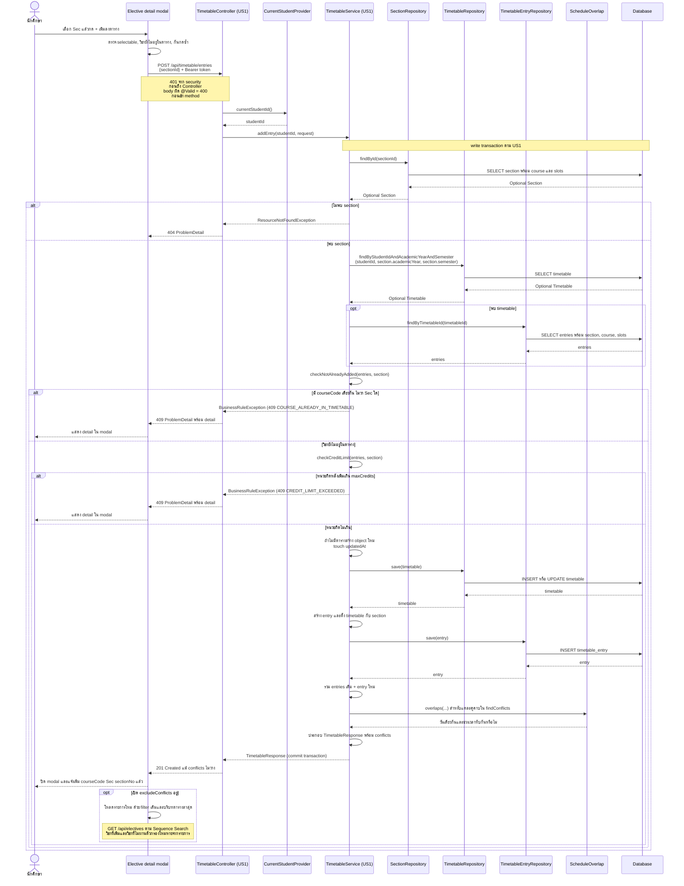

# US6-T06 — Sequence Diagram: เพิ่มวิชาเสรีลงตาราง

ใช้ `POST /api/timetable/entries` ของ US1 ตาม [US6-T05 รุ่น 8213f9a](https://github.com/Non-Sin/CS261-G3-MockTimetableTU/blob/8213f9acded350f8837eefc6a1b96564c82a297d/.doc/US6/T05/US6-DTO%20%26%20API%20Spec.md) ส่งเพียง `{ "sectionId": ... }` ไป `TimetableController.addEntry` โดยตรง ไม่ผ่าน `ElectiveController` / `ElectiveService` และไม่สร้าง endpoint เพิ่มวิชาเสรีใหม่

## เงื่อนไขก่อน POST

UI ต้องเลือก Sec ที่ `selectable: true` และวิชานี้ยังไม่มี Sec ใดที่ `inTimetable: true` ก่อนส่ง กันกดซ้ำขณะกำลังส่ง หาก modal เปิดค้างแล้วเปลี่ยนปี/ภาคตาราง ต้องโหลดรายละเอียดใหม่และตรวจ selection อีกครั้ง ไม่ใช้ selectable จากตารางก่อนหน้า

US1 **อ่านปี/ภาคจาก section** และไม่ได้รับ currentSemester เพื่อปฏิเสธอีกภาค หาก UI ส่ง Sec อีกภาคไป US1 อาจสร้างตารางอีกภาคได้ ไม่ใช่ 409 ดังนั้นกรณี PY250 อีกภาคต้องกันที่ UI ตาม T05 `conflictWith` ไม่ว่างยังเลือกและส่ง POST ได้ เวลาชนไม่ใช่ข้อห้ามเพิ่ม

## สิ่งที่ใช้จาก US1

ลำดับจริงใน `TimetableService.addEntry` คือ หา section → โหลดตาราง/entries → ตรวจวิชาซ้ำ → ตรวจหน่วยกิต → save → คำนวณ conflicts จาก entries ที่รวมแล้ว ไม่เพิ่มการตรวจชนก่อน save และไม่เรียก GET ตารางซ้ำเพื่อสร้าง response

ข้อความ INSERT/UPDATE ในภาพสื่อการเปลี่ยนข้อมูลใน transaction เวลาออก SQL จริงขึ้นกับ Hibernate flush/IDENTITY การตอบสำเร็จหมายถึง transaction commit แล้ว; exception ทำให้ transaction ไม่ค้างผลสำเร็จบางส่วน

`TimetableService.findConflicts` ยังสร้างคู่ชน/ช่วงเวลาและเรียงผลแบบ US1 เพียงเปลี่ยน boolean เงื่อนไขวัน+เวลาไปเรียก helper `ScheduleOverlap.overlaps` ที่ออกแบบร่วมกัน ไม่ใช้ `conflictWith` ของ Sec มาเป็นเหตุผลปฏิเสธ POST

## ผลตอบกลับ

| HTTP | การทำงาน UI / ข้อมูล |
|---|---|
| 201 | คืน `TimetableResponse` ของภาคที่ section อยู่; ใช้ response อัปเดตตาราง/หน่วยกิตและคำเตือนเวลาชนเมื่อหน้าตารางรับข้อมูล ชื่อวิชา/Sec สำหรับข้อความใช้ selection ที่ส่ง |
| 409 COURSE_ALREADY_IN_TIMETABLE | แสดง detail ใน modal เช่นเพิ่มจากอีกแท็บระหว่างดูข้อมูล; ไม่เพิ่ม entry ใหม่ |
| 409 CREDIT_LIMIT_EXCEEDED | แสดง detail ใน modal ตาม US6-T07 ต่างจาก UI หน้า US1 ที่อาจไม่แสดง; ไม่เพิ่ม entry ใหม่ |
| 404 | section ถูกลบหรือ selection เก่า; แจ้งตาม error ของ US1 และโหลดรายละเอียดใหม่ได้ |
| 400 | body ไม่ผ่าน validation ของ US1 |
| 401 | apiFetch ใช้ flow หมด session/กลับ Login เดิม ไม่มี DAO operation ของ request นี้ |

กติกา 1 วิชา 1 Sec ต้องตรวจที่ service ของ US1 ด้วย courseCode เพราะ unique `(timetable_id, section_id)` ใน DB กันได้เฉพาะ Sec เดิมซ้ำ ไม่ใช่ต่าง Sec ของวิชาเดียวกัน รายละเอียด concurrency เพิ่มเติมของ US1 ไม่ถูกเปลี่ยนจากงานออกแบบ US6

metadata ทั้งสามตารางเป็นข้อมูลอ่านอย่างเดียวใน flow นี้ ไม่มีการบันทึกรีวิว คะแนน หรือคำขอโควตา จากปุ่มเพิ่มวิชา

## เอกสารที่เกี่ยวข้อง

- [Sequence ค้นหา/refresh รายการ](./US6-T06-Sequence-Diagram-Search.md)
- [Sequence เปิดรายละเอียด](./US6-T06-Sequence-Diagram-Detail.md)
- [DAO Class Diagram](./US6-T06-DAO-Class-Diagram.md)
- [Extended API Class Diagram](./US6-T06-Extended-API-Class-Diagram.md)
- [ER Diagram](./US6-T06-ER-Diagram.md)
