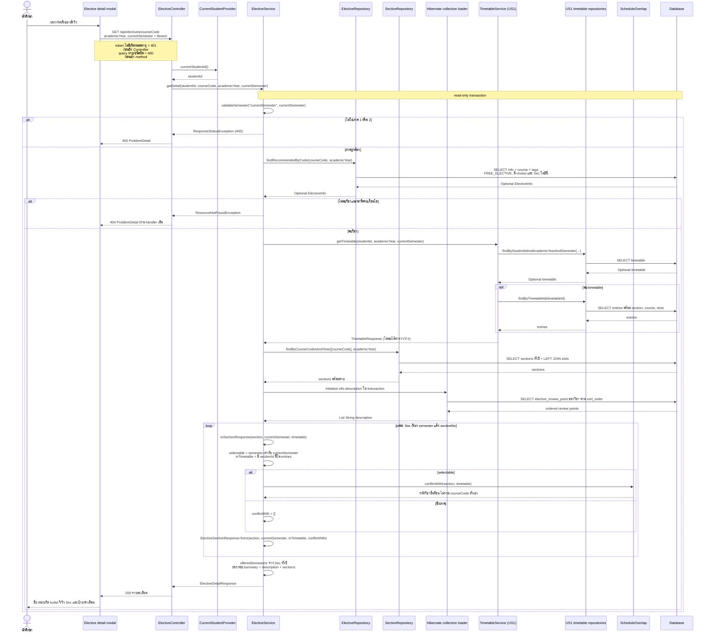

# US6-T06 — Sequence Diagram: เปิดรายละเอียดและรีวิว

`GET /api/electives/{courseCode}?academicYear=2568&currentSemester=1` ตาม [US6-T05 รุ่น 8213f9a](https://github.com/Non-Sin/CS261-G3-MockTimetableTU/blob/8213f9acded350f8837eefc6a1b96564c82a297d/.doc/US6/T05/US6-DTO%20%26%20API%20Spec.md) คืนรายละเอียด **ทุก Sec ในปีนั้น** แม้บาง Sec ไม่ผ่านตัวกรองหน้ารายการหรืออยู่อีกภาค ดูกรณี FR205 และ PY250 ใน Prototype ของ T05

`US1 timetable repositories` รวม lifeline ของ repository สองตัวตาม [DAO Class Diagram](./US6-T06-DAO-Class-Diagram.md) ส่วน `Hibernate collection loader` แสดง SQL ที่ ORM โหลด collection ให้ entity ไม่ใช่ service เปิด JDBC อ่าน DB เอง

## สถานะใน modal

| เงื่อนไข | DTO / การแสดงผล |
|---|---|
| Sec อยู่ในภาคปัจจุบัน | `selectable: true` แม้มีเวลาชนหรือมีวิชาเดิมอยู่แล้ว; การ disable เพิ่มพิจารณาอีกขั้นตาม T05 |
| Sec อยู่อีกภาค | `selectable: false`, `conflictWith: []`; UI แสดงสีจางและภาคปัจจุบัน เช่น PY250 Sec 230001 ของภาค 2 เมื่อเปิดตารางภาค 1 |
| sectionId อยู่ในตาราง | `inTimetable: true`; แสดงเพิ่มแล้ว; หาก **Sec ใดของวิชานี้** อยู่ในตาราง ปุ่มเพิ่มทั้งวิชา disabled แม้กำลังมองอีก Sec |
| candidate เวลาชน | `conflictWith` เป็นรหัสวิชาในตารางที่ชน ไม่ซ้ำ เรียงตาม entries; แค่เตือน ไม่ทำให้ `selectable` เป็น false |
| candidate วิชาเดียวกับ entry | helper ข้ามทั้ง courseCode เช่น FR205 อีก Sec ชน FR205 เดิม ไม่รายงานว่าชนตัวเอง; กฎวิชาซ้ำยังถูกตรวจแยก |
| คาบ/instructor/room | คาบว่างได้, instructor/room NULL แสดงไม่ระบุ ไม่ตัด Sec ทิ้งเพราะ left join |
| `requiresQuota: true` | แสดงป้ายและลิงก์ไปเมนูขอโควตา ไม่เรียก quota API ใหม่หรือบล็อกเพิ่มโดยอัตโนมัติ |

ไม่ส่ง `q`, `semester`, `day`, `timeSlot`, `group`, `excludeConflicts` ของหน้ารายการมายังกรายละเอียด การ์ดผ่านเพียง 1 Sec ก็ได้ แต่เปิด modal ต้องเห็นทุก Sec ทั้งปีเพื่อให้รู้ตัวเลือกอื่น

ชื่อไทย / หมวด / quota มาจาก `elective_info`; tags จาก `elective_tag` เรียง enum; bullet รีวิวจาก `elective_review_point` เรียง sort_order ทั้งหมดประกอบใน service ก่อนจบ transaction ไม่พึ่ง lazy loading หลังส่งออก DTO

## ปุ่มเพิ่มและ error

- ถ้ามี Sec ที่ `selectable && !inTimetable` เพียงตัวเดียว ให้ UI เลือกอัตโนมัติ; หากมีหลายตัวต้องตรวจว่ามี Sec ที่เลือกอยู่และยังเลือกได้ก่อนกดเพิ่ม
- UI ปิด modal/retry ได้เมื่อ GET ล้มเหลว; รายละเอียดไม่มีสิทธิ์เข้ารายการได้ 404 ไม่โหลดตารางผู้ใช้ต่อ
- วิชาที่ไม่มี review ไม่เข้ารายการและ detail ได้ 404 ตาม eligibility; fallback “ยังไม่มีรายละเอียดวิชา” ของ UI เป็นการรับมือข้อมูลผิดพลาด ไม่ใช่ผลสำเร็จปกติที่ seed ควรให้
- GET ไม่เขียน `timetable` หรือ metadata แม้นักศึกษายังไม่มีตาราง
- flow POST, 409 และการ refresh รายการหลังเพิ่มอยู่ใน [Sequence เพิ่มลงตาราง](./US6-T06-Sequence-Diagram-AddEntry.md)

## เอกสารที่เกี่ยวข้อง

- [Sequence ค้นหา](./US6-T06-Sequence-Diagram-Search.md)
- [DAO Class Diagram](./US6-T06-DAO-Class-Diagram.md)
- [ER Diagram](./US6-T06-ER-Diagram.md)
- [Extended API Class Diagram](./US6-T06-Extended-API-Class-Diagram.md)
