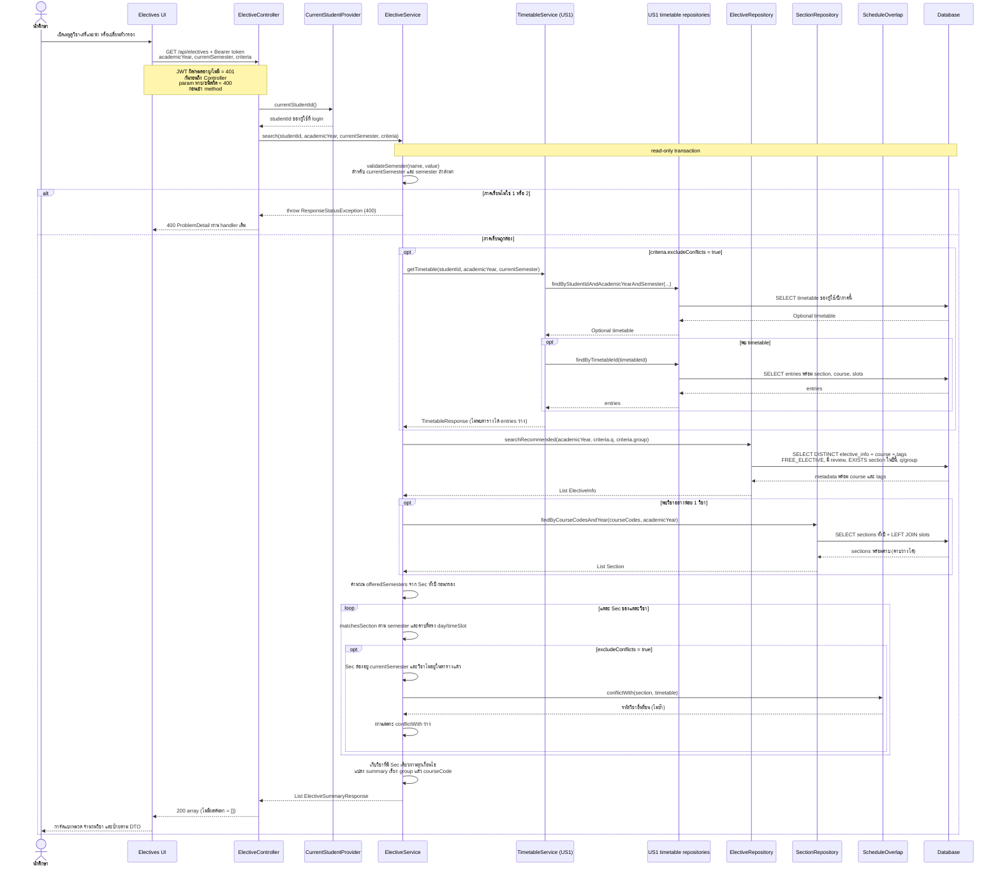

# US6-T06 — Sequence Diagram: ค้นหาและกรองวิชาเสรี

ใช้ `GET /api/electives` ตาม [US6-T05 รุ่น 8213f9a](https://github.com/Non-Sin/CS261-G3-MockTimetableTU/blob/8213f9acded350f8837eefc6a1b96564c82a297d/.doc/US6/T05/US6-DTO%20%26%20API%20Spec.md) ของ PR #87 การเปิดเมนูเรียกครั้งแรกด้วย `academicYear` / `currentSemester` ของตารางที่เปิดอยู่ ส่วนตัวกรองอื่นว่าง และ `excludeConflicts=false`

`semester` คือ dropdown ตัวกรอง ส่วน `currentSemester` คือภาคของตารางนักศึกษา ทั้งสองมีหน้าที่ต่างกัน `ElectiveService` เรียก `TimetableService` ภายใน process ไม่ใช่ HTTP request จาก service ไปหาเว็บตัวเอง

`US1 timetable repositories` ในภาพย่อ `TimetableRepository` และ `TimetableEntryRepository` รวมในหนึ่ง lifeline เพื่อให้อ่านง่าย ชื่อ method และ entity แยกไว้ใน [DAO Class Diagram](./US6-T06-DAO-Class-Diagram.md)

## กติกากรองที่ต้องคงไว้

| เงื่อนไข | การตัดสินใจ |
|---|---|
| วิชาแนะนำ | ต้องเป็น FREE_ELECTIVE, มี metadata, มี description อย่างน้อย 1 ข้อ และมี Sec ในปีที่ขอ |
| `q` / `group` | กรองระดับวิชา; คำค้นรหัส prefix, อังกฤษ word prefix, ไทย substring; ใช้ parameter และ escape LIKE ตาม US1 |
| `semester` / `day` / `timeSlot` | ต้องมี Sec **เดียวกัน** ผ่านทุกตัวกรอง; `day` กับ `timeSlot` ต้องตรงใน **คาบเดียวกัน** ของ Sec นั้น |
| ช่วงเวลา | ดูเวลาเริ่มคาบใน `[from,to)` ของ T05: MORNING 08:00–12:30, AFTERNOON 12:30–16:30, EVENING 16:30–21:00; ไม่ตรวจว่าทั้งคาบต้องอยู่ในช่วง |
| ไม่ชนตาราง | Sec อยู่ currentSemester, ไม่มีคาบใดชนตาราง และวิชาไม่ได้อยู่ในตารางแล้ว; เมื่อมีหลาย Sec ต้องเหลืออย่างน้อย 1 Sec ที่ผ่านเงื่อนไขอื่นพร้อมกัน |
| คาบชน | วันเดียวกันและ `startA < endB && startB < endA`; ต่อกันพอดีไม่ชน |
| Sec ไม่มีคาบ | ไม่ผ่าน day/timeSlot ที่ระบุ แต่ผ่านการตรวจไม่ชนเมื่ออยู่ currentSemester และวิชายังไม่ถูกเพิ่ม |
| `semester` ต่างจาก `currentSemester` + excludeConflicts | ไม่เหลือ Sec ได้ `200 []` ไม่ใช่ 400 |
| `offeredSemesters` | คำนวณจากทั้งปี ไม่หดตามตัวกรอง; รายการถูกกรองแต่ป้ายยังบอกภาคที่วิชาเปิดจริง |

ตัวอย่างที่ต้องใช้ตรวจแบบ: Sec A จันทร์เช้า, Sec B อังคารเย็น — ค้นจันทร์+เย็นต้องไม่ผ่าน; Sec เดียวมีคาบจันทร์เช้าและอังคารเย็นก็ไม่ผ่านจันทร์+เย็นเช่นกัน

## ผลลัพธ์และ error

- `200 []`: ไม่มีวิชาที่ผ่าน เช่น SA240; UI แสดง “ไม่พบรีวิววิชานี้” พร้อมคำค้น ปุ่มดูทั้งหมดล้างคำค้นและทุกตัวกรอง แล้วเรียกใหม่
- `200` มีข้อมูล: UI แบ่งกลุ่มตาม InterestGroup และนับจาก array ไม่สร้าง API นับต่างหาก; tag เรียงตาม enum ใน T05
- `400`: binding/enum/boolean ผิดค่า หรือ service ตรวจพบภาค 3; ไม่ query วิชาเมื่อภาคไม่ถูกต้อง
- `401`: security ของ US3 กันก่อน controller/DAO; `apiFetch` ใช้ flow session หมดอายุเดิม
- `day=SUNDAY` เป็น enum ที่ถูกต้อง ไม่ตอบ 400; ข้อมูล seed ที่ไม่มีวันอาทิตย์ค้นแล้วได้ `[]`

ลำดับอ่าน DB ตาม T05: validate → โหลดตารางเมื่อเปิด toggle → metadata query → section query กรณี metadata ว่างข้าม section query และไม่มีการสร้างตารางนักศึกษาจาก GET ทั้งสองชุด query ของวิชาโหลดเป็น batch ตาม [DAO](./US6-T06-DAO-Class-Diagram.md)

## เอกสารที่เกี่ยวข้อง

- [Sequence รายละเอียดวิชา](./US6-T06-Sequence-Diagram-Detail.md)
- [Sequence เพิ่มลงตาราง](./US6-T06-Sequence-Diagram-AddEntry.md)
- [ER Diagram](./US6-T06-ER-Diagram.md)
- [Extended API Class Diagram](./US6-T06-Extended-API-Class-Diagram.md)
