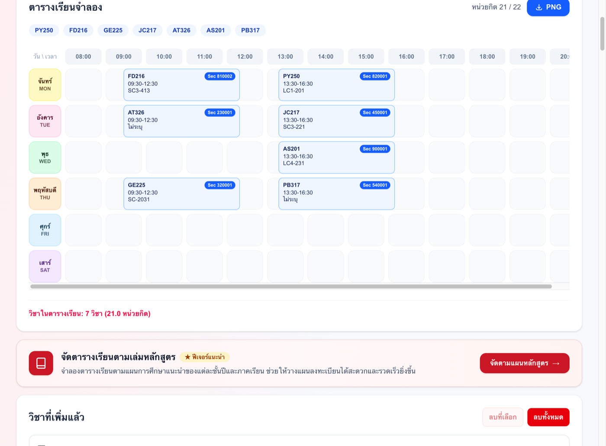
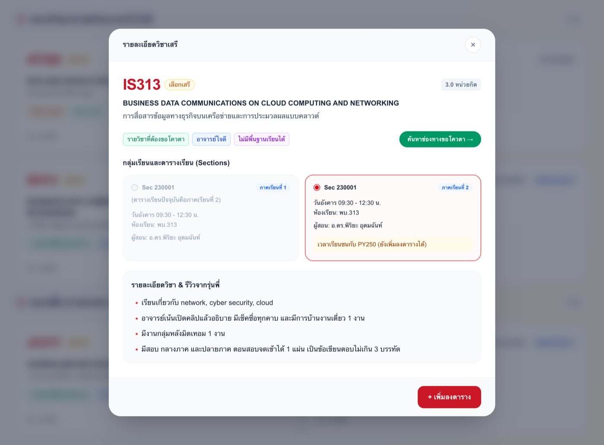

# US6-T10: ผลการเชื่อมต่อหน้าแนะนำวิชาเสรี UI ↔ API ↔ DB

| รายการ | รายละเอียด |
| --- | --- |
| User Story | US6: แนะนำวิชาเลือกเสรี |
| Task | US6-T10 Integrate UI_API_DAO |
| Branch | `feature/US6-T10-integrate-ui-api-dao` |
| โค้ดที่ทดสอบ | `develop` commit `3464d75` (รวม US6-T07 #112, US6-T08 #110, US6-T09 #109 แล้ว) |
| อ้างอิง | [US6 DTO & API Spec (T05)](../T05/US6-DTO%20&%20API%20Spec.md), Sequence ของ US6-T06: [Search](../T06/US6-T06-Sequence-Diagram-Search.md), [Detail](../T06/US6-T06-Sequence-Diagram-Detail.md), [AddEntry](../T06/US6-T06-Sequence-Diagram-AddEntry.md) |

## 1. จุดเชื่อมต่อ

หน้าเว็บเรียก API จริงทั้งหมด ไม่มี mock data

| ชั้น | ไฟล์ / คลาส | หน้าที่ |
| --- | --- | --- |
| UI | `frontend/features/electives/ElectivesPage.tsx`, `components/ElectiveDetailModal.tsx`, `hooks/useElectiveSearch.ts` | รายการ ตัวกรอง modal รายละเอียด และปุ่มเพิ่มลงตาราง |
| UI → API | `frontend/features/electives/api.ts` ผ่าน `lib/api.ts` (`apiFetch` แนบ JWT) และ Next.js rewrite `/api/*` ไป backend | `GET /api/electives`, `GET /api/electives/{courseCode}` |
| UI ↔ ตาราง US1 | `frontend/features/timetable/TimetableWorkspace.tsx` | ส่ง `selectedSemester` ของตารางเป็น `currentSemester` และใช้ `addSection` (`POST /api/timetable/entries`) ร่วมกับหน้าจัดตาราง จึงเห็นตารางเดียวกันทั้งสองเมนู |
| API | `ElectiveController`, `ElectiveService` | ค้นหา กรองระดับ Sec และคำนวณ `selectable` / `inTimetable` / `conflictWith` |
| DAO / DB | `ElectiveRepository`, `SectionRepository`, ตาราง `elective_info`, `elective_tag`, `elective_review_point` และ seed 18 วิชาจากชีต "เสรี" | ข้อมูลวิชาเสรีแนะนำ Sec และคาบเรียน |

## 2. สภาพแวดล้อม

- รันทั้งชุดด้วย `docker compose up -d --build` (`sqlserver`, `db-init`, `backend`, `frontend`) โดยตั้ง `SPRING_PROFILES_ACTIVE=stub-tu` ใน `.env`
- เปิดหน้าเว็บที่ `http://localhost:3000` ทดสอบผ่านเบราว์เซอร์จริง และยิง API ตรงที่ `http://localhost:8080` สำหรับเส้นทางที่ UI ส่งไม่ได้ (ภาคเรียนผิด, sectionId ที่ไม่มี)
- บัญชี stub `6609000001` และ `6609000004` รหัส `Passw0rd!` ตารางว่างทั้งสองภาคตอนเริ่ม
- ข้อมูลวิชาทั้งหมดมาจาก seed `V20261116_1734__seed_electives.sql` (ข้อมูลจริงจากชีต "เสรี" และ "วิชาสำหรับค้นหาวิชาเรียน ปี69")

## 3. ผลการทดสอบอัตโนมัติ

| ส่วน | คำสั่ง | ผล |
| --- | --- | --- |
| Backend | `cd backend && sh ./mvnw test -Dtest='!BackendApplicationTests'` | **PASS** 429 tests (0 failures, 0 errors, 0 skipped) |
| Frontend unit test | `cd frontend && npm test` (Node 20 แบบ CI) | **PASS** 19 test files / 203 tests |
| Frontend lint / type check | `npm run lint` และ `npx next typegen && npx tsc --noEmit` | **PASS** 0 errors |

## 4. ผลการทดสอบตามเส้นทางใน Sequence ของ US6-T06

### 4.1 Search (`GET /api/electives`)

| # | เส้นทาง | วิธีทดสอบ | ผลที่ได้ | สถานะ |
| --- | --- | --- | --- | --- |
| S-01 | ภาคเรียนไม่ใช่ 1 หรือ 2 | API `currentSemester=3` และ `semester=3` | 400 `currentSemester ต้องเป็น 1 หรือ 2` / `semester ต้องเป็น 1 หรือ 2` | PASS |
| S-02 | ไม่มี token | API ไม่ส่ง `Authorization` | 401 `กรุณาเข้าสู่ระบบก่อนใช้งาน` | PASS |
| S-03 | เปิดเมนูครั้งแรก ไม่มีตัวกรอง | UI 6609000001 กด "ดูวิชาเสรีแนะนำ" | "แสดงทั้งหมด 18 วิชาแนะนำ" แบ่ง 5 หมวด 3 / 4 / 5 / 4 / 2 วิชา เรียงตามหมวดแล้วรหัสวิชา | PASS |
| S-04 | ค้นหาด้วยรหัสและชื่อไทย | API `q=PY2`, `q=ภาษา` | PY200, PY250, PY252 / FR205 | PASS |
| S-05 | ไม่พบวิชา (opt พบวิชาอย่างน้อย 1 วิชา ไม่เข้า) | UI ค้นหา `SA240` | 200 `[]` หน้าเว็บแสดง "ไม่พบรีวิววิชานี้" พร้อมรหัส SA240 และปุ่ม "ดูวิชาเสรีแนะนำทั้งหมด" กดแล้วกลับเป็น 18 วิชา | PASS |
| S-06 | กรองระดับ Sec (ภาค + วัน + ช่วงเวลา ใน Sec เดียวกัน) | API `semester=2&day=FRIDAY&timeSlot=MORNING`, `day=TUESDAY&timeSlot=EVENING`, `group=LANGUAGE` | PY252, AN242, AN347, FD216 / FR205 / EG214, FR205, TH291 | PASS |
| S-07 | `excludeConflicts=true` ยังไม่มีตาราง | API 6609000004 ภาค 1 | 15 วิชา (ตัด AN242, AN347, PC280 ที่เปิดเฉพาะภาค 2) | PASS |
| S-08 | `excludeConflicts=true` คู่กับ `semester` อีกภาค | API `semester=2` ขณะ `currentSemester=1` | `[]` ไม่ใช่ error | PASS |
| S-09 | `excludeConflicts=true` มีตาราง ตัดวิชาที่อยู่ในตารางและวิชาที่ชน | UI 6609000001 เพิ่ม PY250 แล้วติ๊ก "แสดงเฉพาะวิชาที่ไม่ชนกับตารางปัจจุบัน" | เหลือ 14 วิชา ไม่มี PY250 | PASS |

### 4.2 Detail (`GET /api/electives/{courseCode}`)

| # | เส้นทาง | วิธีทดสอบ | ผลที่ได้ | สถานะ |
| --- | --- | --- | --- | --- |
| D-01 | ภาคเรียนไม่ใช่ 1 หรือ 2 | API `PY250?currentSemester=3` | 400 | PASS |
| D-02 | ไม่พบวิชาแนะนำ | API `SA240` | 404 `ไม่พบวิชาเสรีแนะนำ: SA240` | PASS |
| D-03 | พบวิชา ไม่มีตาราง Sec ภาคปัจจุบัน selectable อีกภาคไม่ได้ | UI เปิด PY250 (ตารางภาค 1) | Sec 820001 ภาค 1 ถูกเลือกไว้ให้, Sec 230001 ภาค 2 กดไม่ได้และต่อท้าย "(ตารางเรียนปัจจุบันคือภาคเรียนที่ 1)" | PASS |
| D-04 | ไม่มี Sec ที่เลือกได้ | API `AN242` ขณะ `currentSemester=1` | มีแต่ Sec 870001 ภาค 2 `selectable: false` | PASS |
| D-05 | ตารางปัจจุบันเป็นภาค 2 | UI เปลี่ยนภาคในหน้าจัดตารางเป็น 2 แล้วเปิด PY250 | หัวหน้า "ตารางปัจจุบัน: ภาคเรียนที่ 2", Sec 230001 ถูกเลือกไว้ให้, Sec 820001 กดไม่ได้ | PASS |
| D-06 | พบตาราง: `inTimetable` และ `conflictWith` | UI ภาค 2 มี PY250 Sec 230001 (อังคาร 09:30-12:30) เปิด IS313 | Sec 230001 ภาค 2 แสดง "เวลาเรียนชนกับ PY250 (ยังเพิ่มลงตารางได้)" ปุ่มเพิ่มยังกดได้ (ภาพที่ 2) | PASS |
| D-07 | รหัสวิชาตัวพิมพ์เล็ก | API `py250` | 200 `courseCode: PY250` | PASS |

### 4.3 AddEntry (`POST /api/timetable/entries` ของ US1)

| # | เส้นทาง | วิธีทดสอบ | ผลที่ได้ | สถานะ |
| --- | --- | --- | --- | --- |
| A-01 | ไม่พบ section | API `sectionId: 999999` | 404 | PASS |
| A-02 | วิชายังไม่อยู่ในตาราง ยังไม่มีตาราง (สร้างตารางใหม่) | UI 6609000001 ภาค 1 เพิ่ม PY250 Sec 820001 | ปิด modal แสดง "เพิ่ม PY250 Sec 820001 ลงตารางแล้ว" ตาราง 2568/1 ถูกสร้าง | PASS |
| A-03 | เปิด `excludeConflicts` อยู่ โหลดรายการใหม่หลังเพิ่ม | UI ติ๊กตัวกรองไม่ชนอยู่ แล้วเพิ่ม FD216 Sec 810002 (จันทร์ 09:30-12:30) | รายการโหลดใหม่จาก 14 เหลือ 11 วิชา: FD216 หายเพราะอยู่ในตารางแล้ว PY200 และ RE468 หายเพราะชนจันทร์เช้า | PASS |
| A-04 | 409 `COURSE_ALREADY_IN_TIMETABLE` (ข้อมูลบนจอเก่า) | เปิด modal GE225 ค้างไว้ เพิ่ม GE225 จากอีกที่ (API) แล้วกด "+ เพิ่มลงตาราง" ใน modal | modal แสดง "GE225 อยู่ในตารางแล้ว (Sec 320001) 1 วิชาเพิ่มได้ 1 กลุ่มเรียน" แล้วโหลดรายละเอียดใหม่เป็น "เพิ่มแล้ว" ปุ่มถูกปิด ปิด modal แล้วรายการตัด GE225 ออก | PASS |
| A-05 | 409 `CREDIT_LIMIT_EXCEEDED` | ตาราง 2568/1 มี 7 วิชา 21 หน่วยกิต แล้วเพิ่ม PY252 จาก modal | modal แสดง "เพิ่ม PY252 (3 หน่วยกิต) แล้วจะเป็น 24 หน่วยกิต เกินกำหนด 22 หน่วยกิต" ตารางไม่เปลี่ยน | PASS |
| A-06 | หน่วยกิตไม่เกิน แม้เวลาชน (201 พร้อม conflicts) | API 6609000004 มี FD216 แล้วเพิ่ม RE468 (จันทร์ 09:30-12:30 เหมือนกัน) | 201 `conflicts`: MONDAY 09:30-12:30 FD216, RE468 | PASS |
| A-07 | เพิ่มลงตารางภาค 2 จากบริบทภาค 2 | UI ตารางปัจจุบันภาค 2 เพิ่ม PY250 Sec 230001 | "เพิ่ม PY250 Sec 230001 ลงตารางแล้ว" ตาราง 2568/2 มี PY250 ตาราง 2568/1 ยังมี 7 วิชาเท่าเดิม | PASS |

## 5. วิชาที่เพิ่มขึ้นในตารางเรียนจำลองของ US1

หลังเพิ่มจากหน้าวิชาเสรี กดเมนู "จัดตารางเรียนจำลอง" ภาค 1 แสดงครบ 7 วิชา 21.0 หน่วยกิต (PY250, FD216, GE225, JC217, AT326, AS201, PB317) ตรงกับ `GET /api/timetable?academicYear=2568&semester=1` (ภาพที่ 1) และภาค 2 มี PY250 Sec 230001 ตามข้อ A-07

ภาพที่ 1 ตาราง US1 หลังเพิ่มวิชาเสรี

ภาพที่ 2 รายละเอียด IS313 ในตารางภาค 2 แสดงเวลาชนกับ PY250

## 6. ข้อสังเกต

- ติ๊ก "แสดงเฉพาะวิชาที่ไม่ชนกับตารางปัจจุบัน" แล้วสลับไปเมนูอื่นและกลับมา ตัวกรองกลับเป็นค่าเริ่มต้น Spec ไม่ได้กำหนดให้จำค่า จึงไม่นับเป็นข้อผิดพลาด
- ข้อความ 404 ของ section ที่ไม่มี (`Section not found with id: ...`) เป็นข้อความเดิมของ US1 หน้าวิชาเสรีส่ง sectionId จากรายละเอียดเท่านั้นจึงไม่เจอกรณีนี้จากหน้าเว็บ
- ไม่พบจุดที่ต้องแก้โค้ดใน US6-T10 โค้ดของ T07, T08, T09 ใน `develop` ต่อกันครบแล้ว

## 7. วิธีทำซ้ำ

1. `cp .env.example .env` แล้วตั้ง `SPRING_PROFILES_ACTIVE=stub-tu`
2. `docker compose up -d --build` รอ backend พร้อม (`GET /api/electives` ตอบ 401 เมื่อไม่ส่ง token)
3. เปิด `http://localhost:3000` ล็อกอิน `6609000001` / `Passw0rd!` แล้วทำตามขั้นตอนในหัวข้อ 4 และ 5
4. เส้นทางที่หน้าเว็บส่งไม่ได้ (S-01, S-02, D-01, D-02, A-01) ยิง API ตรงด้วย token จาก `POST /api/auth/login`
