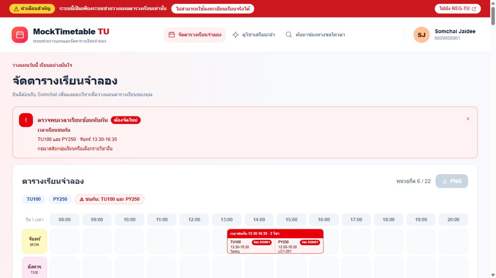
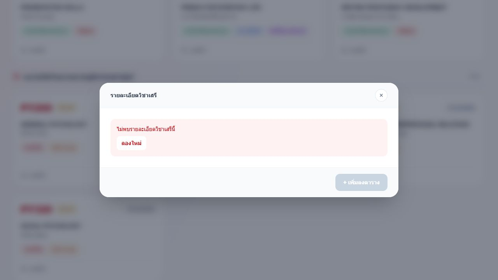

# US6-T17 — Integration Test UI ↔ API

ทดสอบครบ 37 เคส: **PASS 33 / FAIL 4** บน source `79df2b8` ไม่มีการแก้โค้ดแอป

- [รายงานผลรายเคสและ DoD](./US6-T17-Integration-Test-Result.md)
- [Expected data จาก seed จริง 18 วิชา](./US6-T17-Expected-Data.md)
- [ร่างการ์ด Maintenance 3 เรื่อง](./US6-T17-Fix-Cards.md)
- [ผลแบบ JSON](./evidence/case-results.json)
- [Network evidence ที่ปิดบังข้อมูลลับ](./evidence/network.jsonl)
- [Regression test log](./evidence/baseline-checks.log)

## หลักฐานตัวอย่าง

## ทำซ้ำ

1. Checkout source ที่ระบุ และเปิดระบบแยกด้วย Dockerfiles เดิม + SQL Server ใหม่ ใช้ profile `stub-tu` และ seed ทั้ง db/migration + db/seed ไม่ต้องแก้ migration เก่า
2. Login บัญชี stub 6609000001 ตามข้อมูล dev ใน T13 จัด timetable ในฐานทดสอบตาม T-EMPTY/T-TU100/T-CS213/T-FR205/T-FULL และทำตาม T13 01–37
3. จับ request/response status พร้อมสิ่งที่ UI แสดง ใช้การดัก timing/network/response เฉพาะเคสที่รายงานระบุว่า injected และคืนข้อมูลหลัง IT-33
4. เทียบรายชื่อจาก Expected Data และบันทึกผลใหม่ ไม่ใช้ unit tests ที่ mock API แทนการรันระบบจริง

ตัวช่วยบันทึก HTTP, credentials ทดสอบ, Docker config ชั่วคราว และ token อยู่เฉพาะ backend/target/us6-t17 ที่ถูก ignore ไม่ใช่ไฟล์ส่งมอบหรือโค้ดแอป
