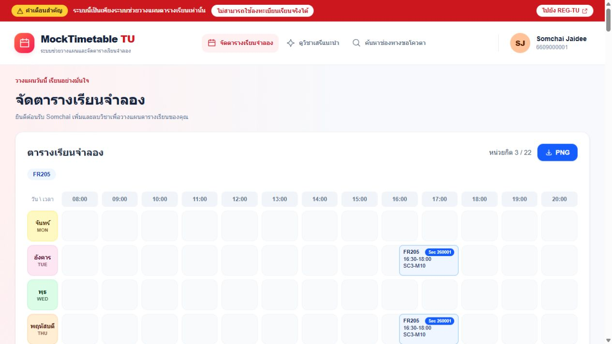

# US6-T19 — System Test ตาม Sequence Diagram

ผลที่บันทึก 16 เคสหลัก: **PASS 12 / FAIL 3 / PARTIAL 1**

- [รายงานผลและความครอบคลุม](./US6-T19-System-Test-Result.md)
- [ร่างการ์ด Maintenance 3 เรื่อง](./US6-T19-Fix-Cards.md)
- [ขั้นตอนตรวจ sessionStorage ที่ยังค้าง](./US6-T19-Manual-Verification.md)
- [ผลรายเคสแบบ JSON](./evidence/case-results.json)
- [ข้อมูล DB ก่อน–หลัง](./evidence/db-before-after.json)
- [Network evidence](./evidence/network.jsonl)
- [SQL probes ตาม Sequence Diagram](./evidence/sequence-probes.json)
- [SHA-256 ของหลักฐาน](./evidence/manifest.json)

Source ที่ทดสอบ: `aea7b980e022e4fee4ffa04daea0499f26ff3821` จาก develop บน branch `test/US6-T19-run-system-test` ไม่มีการแก้โค้ดแอป

FAIL คือ ST-US6-10, 13, 16 ส่วน ST-US6-15 ตรวจ API 401 และ UI กลับ Login ได้แล้ว แต่ยังไม่ได้ทำขั้นตอนลบ token ใน sessionStorage โดยตรง จึงไม่สรุปเป็น PASS ทั้งเคส

## ภาพที่ตรวจแล้ว

เคส 08 เพิ่ม FR205 สำเร็จ ภาพนี้เป็นหลักฐานระหว่างทดสอบ ก่อนคืนตารางบัญชีทดสอบเป็นว่าง

หลักฐานของ modal และข้อผิดพลาดใช้ AX snapshots, response จริง และผล DB ตามรายงาน ภาพที่ไม่ตรงกับสถานะใน AX ไม่ถูกนำมาอ้างผล
