# US7 — API Class Diagram

```mermaid
classDiagram
    direction TB

    class QuotaController {
        <<US7 RestController>>
        -quotaService: QuotaService
        -currentStudentProvider: CurrentStudentProvider
        +searchCourses(academicYear: int, semester: int, q: String, mine: boolean) QuotaSearchResponse
        +getCourseQuota(courseCode: String, academicYear: int, semester: int) QuotaCourseResponse
    }
    class QuotaService {
        <<US7 Service · readOnly>>
        -courseRepository: CourseRepository
        -sectionRepository: SectionRepository
        -timetableRepository: TimetableRepository
        -timetableEntryRepository: TimetableEntryRepository
        -quotaInfoRepository: QuotaInfoRepository
        -quotaRoundRepository: QuotaRoundRepository
        -maxResults: int
        +searchCourses(studentId: String, academicYear: int, semester: int, q: String, mine: boolean) QuotaSearchResponse
        +getCourseQuota(studentId: String, courseCode: String, academicYear: int, semester: int) QuotaCourseResponse
        -findMyCourseCodes(studentId: String, academicYear: int, semester: int) Set~String~
        -buildCourseResponses(courses: List~Course~, academicYear: int, semester: int, myCourseCodes: Set~String~) List~QuotaCourseResponse~
        -resolveStatus(offeredInTerm: boolean, quotaInfo: CourseQuotaInfo) QuotaStatus
    }
    class QuotaInfoRepository {
        <<US7 Repository>>
        +findWithDetailsByCourseCodes(courseCodes: Collection~String~) List~CourseQuotaInfo~
    }
    class QuotaRoundRepository {
        <<US7 Repository>>
        +findByCourseCodesAndTerm(courseCodes: Collection~String~, academicYear: int, semester: int) List~QuotaRound~
    }
    class CourseRepository {
        <<US1 มีอยู่แล้ว + US7 query>>
        +findById(courseCode: String) Optional~Course~
        +searchAllCourses(q: String, courseCodes: Collection~String~) List~Course~
    }
    class SectionRepository {
        <<US1 มีอยู่แล้ว + US7 query>>
        +findOfferedSemestersByCourseCodesAndYear(courseCodes: Collection~String~, academicYear: int) Map~String, List~Integer~~
    }
    class TimetableRepository {
        <<US1 มีอยู่แล้ว>>
        +findByStudentIdAndAcademicYearAndSemester(studentId: String, academicYear: int, semester: int) Optional~Timetable~
    }
    class TimetableEntryRepository {
        <<US1 มีอยู่แล้ว>>
        +findByTimetableId(timetableId: Long) List~TimetableEntry~
    }
    class CurrentStudentProvider {
        <<US1 interface>>
        +currentStudentId() String
    }
    class BusinessRuleException {
        <<มีอยู่แล้ว · status + code>>
        +BusinessRuleException(status: HttpStatus, code: String, detail: String, properties: Map)
    }
    class ResourceNotFoundException {
        <<มีอยู่แล้ว · 404>>
        +ResourceNotFoundException(message: String)
    }
    class GlobalExceptionHandler {
        <<มีอยู่แล้ว ไม่แก้>>
        +handleNotFound(ex: ResourceNotFoundException) ProblemDetail
        +handleBusinessRule(ex: BusinessRuleException) ProblemDetail
    }
    class quotaApi {
        <<US7 frontend module>>
        +searchQuotaCourses(query: QuotaSearchQuery) Promise~QuotaSearchResponse~
        +getCourseQuota(courseCode: string, term: QuotaTerm) Promise~QuotaCourse~
    }
    class apiFetch {
        <<lib/api.ts มีอยู่แล้ว>>
        +apiFetch(path: string, init: RequestInit) Promise~T~
    }

    quotaApi ..> apiFetch : เรียก
    apiFetch ..> QuotaController : GET /api/quota/courses
    apiFetch ..> QuotaController : GET /api/quota/courses/{courseCode}
    QuotaController --> QuotaService
    QuotaController --> CurrentStudentProvider
    QuotaService --> CourseRepository : ค้นหาวิชาทุกวิชา
    QuotaService --> SectionRepository : หาภาคที่เปิดสอนใน academicYear
    QuotaService --> TimetableRepository : หาตารางเรียนของนักศึกษา
    QuotaService --> TimetableEntryRepository : หารายวิชาในแผนของฉัน
    QuotaService --> QuotaInfoRepository : เงื่อนไข / ช่องทาง / ติดต่อ
    QuotaService --> QuotaRoundRepository : รอบยื่นคำร้องของภาคที่ขอ
    QuotaService ..> BusinessRuleException : throws QUOTA_SEARCH_QUERY_REQUIRED
    QuotaService ..> ResourceNotFoundException : throws 404 เมื่อไม่พบวิชา
    GlobalExceptionHandler ..> BusinessRuleException : จัดการ
    GlobalExceptionHandler ..> ResourceNotFoundException : จัดการ
```

US7 เพิ่ม package ใหม่ `quota` ฝั่ง backend (controller 1 ตัว, service 1 ตัว, repository ข้อมูลโควตา) กับโมดูลเรียก API ฝั่ง frontend แผนภาพวาด class ของ US7 (`<<US7>>`) กับจุดที่พึ่ง US1 / US3 และของที่มีอยู่แล้ว โดย**ไม่แก้** `GlobalExceptionHandler`

| ส่วน | หน้าที่ |
| --- | --- |
| `QuotaController` | `@RestController @RequestMapping("/api/quota")` · `searchCourses` = `GET /courses` รับ `@RequestParam int academicYear`, `@RequestParam @Min(1) @Max(2) int semester`, `@RequestParam(required = false) @Size(max = 50) String q`, `@RequestParam(defaultValue = "false") boolean mine` · `getCourseQuota` = `GET /courses/{courseCode}` รับ `@PathVariable String courseCode`, `@RequestParam int academicYear`, `@RequestParam @Min(1) @Max(2) int semester` **ห้ามใส่ `@Validated` ที่ class** (ดูหัวข้อ "Validation ของ query param") |
| `QuotaService` | `@Transactional(readOnly = true)` (อ่านอย่างเดียว ไม่เขียน DB) · `searchCourses`: ตัดช่องว่างหน้า/หลังของ `q` (ว่างถือเป็น `null`) ถ้า `q == null && !mine` โยน `BusinessRuleException(400, "QUOTA_SEARCH_QUERY_REQUIRED")` · ดึงรหัสวิชาในตารางของนักศึกษาจาก `TimetableRepository` + `TimetableEntryRepository` เพื่อใช้ทั้งกรอง `mine=true` และกำหนด `inMyTimetable` · ค้นวิชาจาก `courseRepository.searchAllCourses` เรียงตาม `courseCode`, นับ `total`, ตัดไม่เกิน `maxResults` (`app.quota.max-results`, default `50`) แล้วประกอบ `QuotaCourseResponse` ใน `buildCourseResponses` · `getCourseQuota`: แปลง `courseCode` เป็นตัวพิมพ์ใหญ่ ค้นด้วย `findById` (ไม่พบ → โยน `ResourceNotFoundException`) แล้วเรียก `buildCourseResponses` เช่นเดียวกัน |
| `QuotaService.resolveStatus` | ตัดสิน `QuotaStatus` ตามลำดับใน Spec: (1) ไม่มี `semester` ใน `offeredSemesters` → `NOT_OFFERED`, (2) ไม่มี `CourseQuotaInfo` → `NO_DATA`, (3) `quotaRequired == false` → `NOT_REQUIRED`, (4) `REQUIRED` |
| `QuotaInfoRepository` | repository ใหม่ โหลด `CourseQuotaInfo` พร้อม `conditions`, `channels`, `contacts` ของรายการ `courseCodes` (รายละเอียด entity และ query เป็นงาน US7-T06) |
| `QuotaRoundRepository` | repository ใหม่ โหลด `QuotaRound` ของ `(courseCodes, academicYear, semester)` เรียงตาม `roundNo` (รายละเอียด entity และ query เป็นงาน US7-T06) |
| `CourseRepository` (US1 + US7) | เพิ่มเมธอดค้นจาก**ทุกวิชา**ในตาราง `course` (ไม่จำกัดว่าต้องมี `section` ในภาคที่ขอ) จับคู่รหัสวิชาขึ้นต้นด้วย `q`, คำใน `courseName` ขึ้นต้นด้วย `q` (คั่นด้วยช่องว่างหรือ `-`), หรือ `courseNameTh` มี `q` อยู่ข้างใน พร้อม escape LIKE (`% _ [`) และรองรับกรองด้วย `courseCodes` เมื่อ `mine=true` |
| `SectionRepository` (US1 + US7) | เพิ่มเมธอดหาภาคเรียน (`semester`) ที่เปิดสอนใน `academicYear` สำหรับรายการ `courseCodes` เพื่อประกอบ `offeredSemesters` (เรียงน้อยไปมาก) และใช้ตรวจ `NOT_OFFERED` |
| `quotaApi` | `frontend/features/quota/api.ts` · `searchQuotaCourses` ต่อ `academicYear`, `semester`, `q`, `mine` เป็น query string · `getCourseQuota` เรียก `/api/quota/courses/{encodeURIComponent(courseCode)}` ทั้งคู่เรียกผ่าน `apiFetch` ซึ่งแนบ JWT และจัดการ 401 ให้แล้ว |

**ไม่ต้องเพิ่ม exception class หรือแก้ handler:** `QUOTA_SEARCH_QUERY_REQUIRED` ส่งผ่าน `BusinessRuleException` ที่มีอยู่แล้ว (ได้ 400 พร้อม `code` ใน ProblemDetail) และกรณีไม่พบวิชาใน `GET /api/quota/courses/{courseCode}` โยน `ResourceNotFoundException` (ได้ 404)

### Validation ของ query param

โปรเจกต์ใช้ Spring Boot 4.1 ซึ่งตรวจ `@Min` / `@Max` / `@Size` บน `@RequestParam` ให้เองโดยไม่ต้องใส่ `@Validated` (แนวเดียวกับ US8):

| request | exception | handler | ผล |
| --- | --- | --- | --- |
| ไม่ส่ง `academicYear` / `semester` | `MissingServletRequestParameterException` | `ResponseEntityExceptionHandler` ที่สืบทอดมา | 400 |
| `semester=abc` | `MethodArgumentTypeMismatchException` | 〃 | 400 |
| `semester=3` หรือ `q` เกิน 50 ตัว (ไม่ใส่ `@Validated`) | `HandlerMethodValidationException` | 〃 | 400 |
| `semester=3` หรือ `q` เกิน 50 ตัว (**ใส่** `@Validated` ที่ class) | `ConstraintViolationException` | `handleUnexpected` | **500** ผิด |

Controller ของ US7 จึง**ห้ามใส่ `@Validated`** และใน US7-T08 ควรเขียน test ยิง `semester=3` และ `q` ยาว 51 ตัวอักษร เพื่อตรวจว่าได้ 400

ไม่ได้วาด entity (`Course`, `Section`, `Timetable`, `TimetableEntry`, `CourseQuotaInfo`, `QuotaCondition`, `QuotaRound`, `QuotaChannel`, `QuotaContact`) เพราะเป็นงาน Extended API class diagram และ ER Diagram ของ US7-T06

สัญลักษณ์: `+` = public, `-` = private, `$` = static · field ที่เป็น dependency เป็น `private final` ฉีดผ่าน constructor ด้วย `@RequiredArgsConstructor` ส่วน `QuotaService` ที่มี `@Value` (`maxResults`) เขียน constructor เองแบบ `TimetableService` · เส้นทึบ = เรียกใช้ผ่าน field, เส้นประ = throws, จัดการ exception หรือเรียกผ่าน HTTP

## เอกสารที่เกี่ยวข้อง

- [DTO & API Spec](./US7-DTO-API-Spec.md)
- [DTO Class Diagram](./US7-DTO-Class-Diagram.md)
- [US1 — API Class Diagram](../../US1/T05/US1-API-Class-Diagram.md)
- [US8 — API Class Diagram](../../US8/T05/US8-API-Class-Diagram.md)
