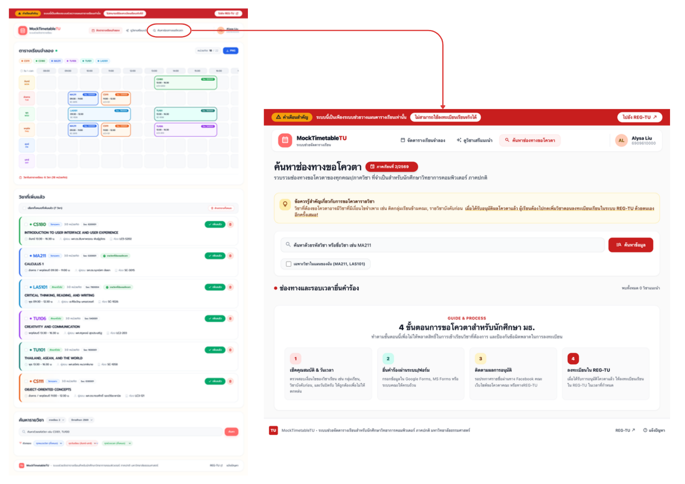
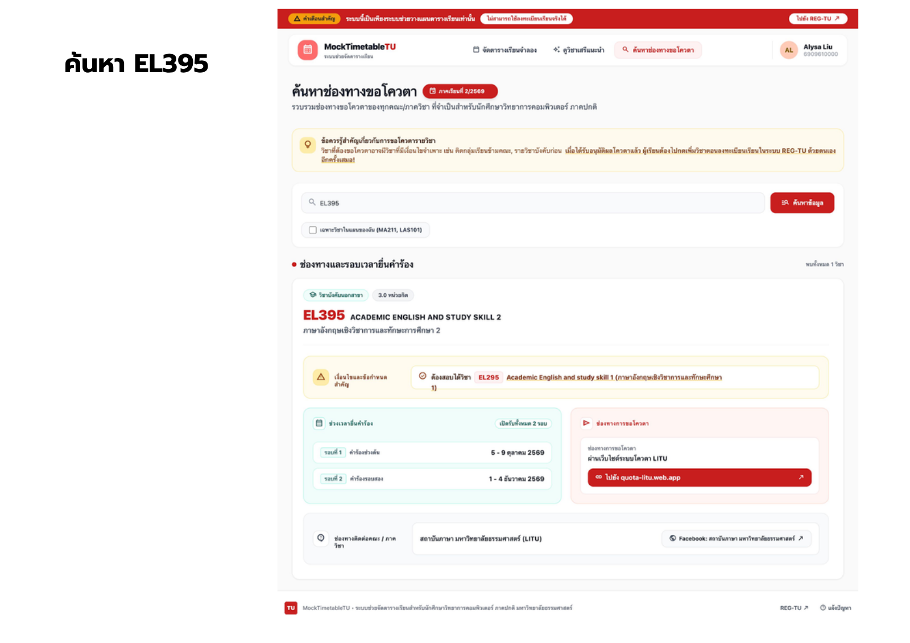
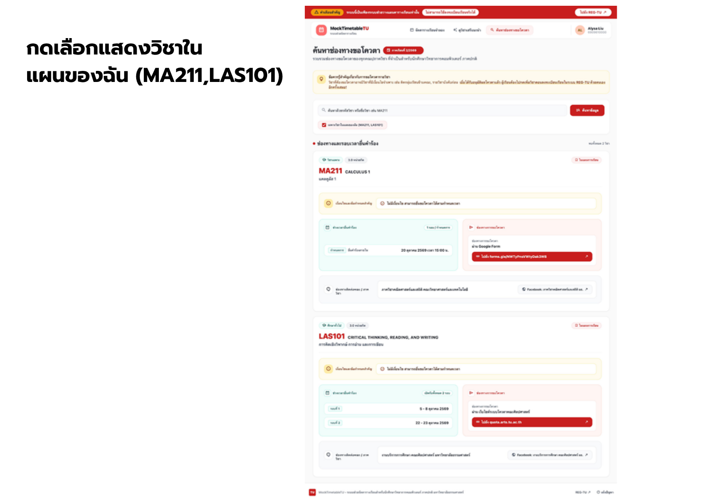
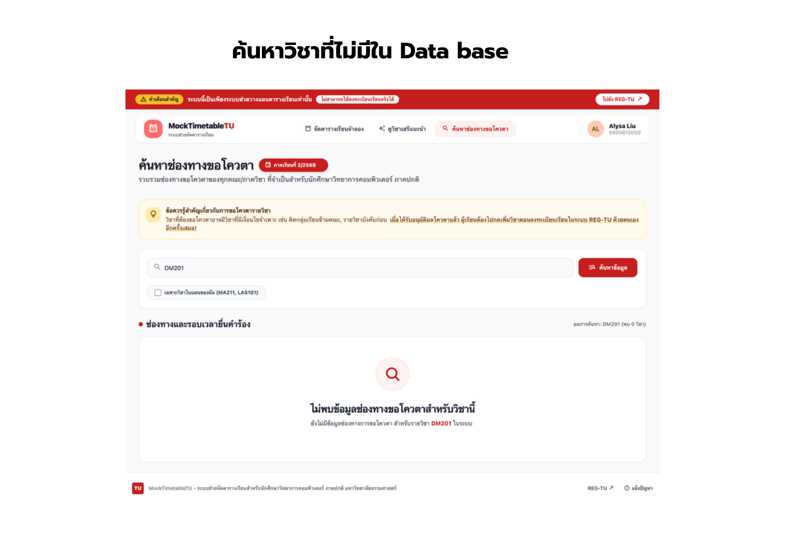
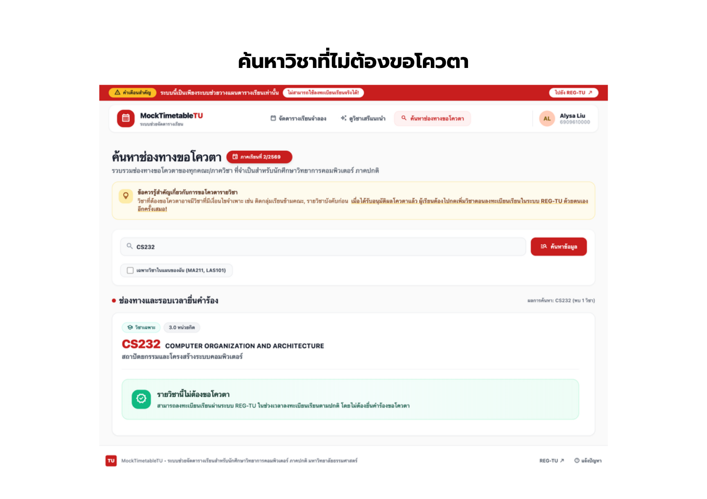
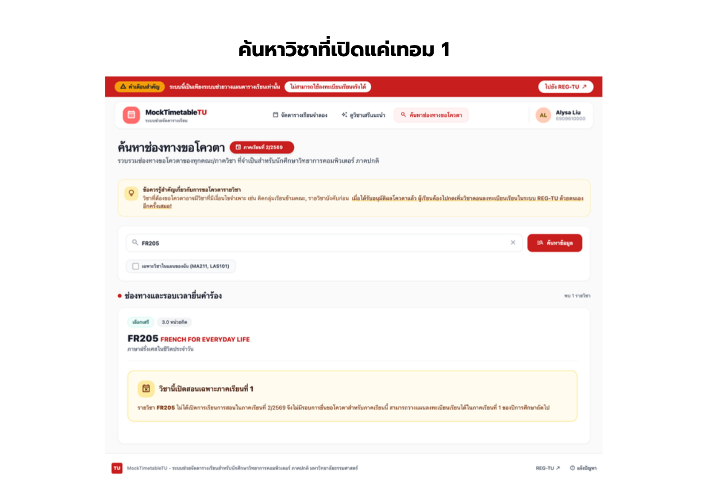

# US7 — DTO & API Spec: ค้นหาช่องทางการขอโควตาในแต่ละรายวิชา

Nov 11, 2026 · @Elle

## ภาพรวม

นักศึกษาค้นหารายวิชาด้วยรหัสหรือชื่อวิชา แล้วดูว่าวิชานั้น**ต้องขอโควตาหรือไม่** ถ้าต้องขอ จะเห็นเงื่อนไขของผู้ขอ ช่วงเวลายื่นคำร้อง ช่องทางยื่นคำร้อง (ลิงก์ฟอร์มเปิดในแท็บใหม่) และช่องทางติดต่อคณะ/ภาควิชา บนหน้า "ค้นหาช่องทางขอโควตา" (เมนูที่ 3 ใน `AppNavigation` ซึ่งมีปุ่มรออยู่แล้ว)

- **UI:** ตาม UI Prototype ใน [Canva](https://canva.link/5kq6qf7wyusk6sl) (ภาพอยู่ใน [`ui/`](./ui) ดูหัวข้อ [UI Prototype](#ui-prototype))
- **ใช้ 2 endpoint** ใน path ใหม่ `/api/quota` ตามการ์ด US7-T08
  1. ค้นหาวิชา พร้อมบอกสถานะโควตาและรายละเอียดช่องทางของทุกวิชาที่ค้นเจอ
  2. ดึงช่องทางขอโควตาของวิชาเดียวด้วยรหัสวิชา (วิชาที่ไม่มีในระบบตอบ 404)
- **ผลค้นหาส่งรายละเอียดมาด้วยเลย** เพราะใน Prototype การ์ดทุกใบกางรายละเอียดตั้งแต่แรก (หน้า 3 แสดง MA211 กับ LAS101 พร้อมกัน) ถ้าส่งแค่สรุปแล้วให้ UI เรียก endpoint ที่ 2 ทีละวิชา จะเกิด N+1 request ทั้งสอง endpoint จึงคืน DTO ตัวเดียวกัน (`QuotaCourseResponse`)
- **สถานะโควตามี 4 แบบ** (`quotaStatus`) ตรงกับการ์ดแต่ละแบบใน Prototype: ต้องขอโควตา, ไม่ต้องขอโควตา, ยังไม่มีข้อมูล และไม่เปิดสอนในภาคนี้ ส่วน "ค้นหาไม่พบวิชา" คือผลค้นหาว่าง ไม่ใช่สถานะ
- **ผูกกับภาคเรียน** (`academicYear` + `semester`) เพราะช่วงเวลายื่นคำร้องเปลี่ยนทุกภาค และต้องรู้ว่าวิชาเปิดสอนในภาคนั้นหรือไม่ (ดูจาก `section` ของ US1) UI ใช้ภาคเดียวกับที่เลือกอยู่ในหน้าจัดตารางเรียน
- **"เฉพาะวิชาในแผนของฉัน"** = วิชาที่อยู่ในตารางเรียนจำลองของภาคนั้น (`timetable_entry` ของ US1) ไม่ใช่ preset ของ US8 ตามตัวอย่าง "(MA211, LAS101)" ใน Prototype ที่ตรงกับวิชาในตาราง
- **อ่านอย่างเดียว** US7 ไม่เขียน DB ข้อมูลโควตา seed ผ่าน Flyway migration (US7-T09)
- **นอกขอบเขต:** การยื่นคำร้องขอโควตาผ่านระบบนี้, การแจ้งเตือนเมื่อใกล้ถึงช่วงยื่นคำร้อง, การแก้ข้อมูลโควตาผ่านหน้าเว็บ, ป้าย "ต้องขอโควตา" บนการ์ดวิชาของหน้าจัดตาราง (US1) และหมวดวิชาใหม่นอกจาก 3 หมวดของ US1

## Endpoints

| Method | Path | ใช้กับส่วนไหนของหน้า |
| --- | --- | --- |
| GET | `/api/quota/courses?academicYear=2568&semester=1&q=EL395&mine=false` | ช่องค้นหา + ปุ่ม "ค้นหาข้อมูล", checkbox "เฉพาะวิชาในแผนของฉัน", รายการการ์ดใต้ "ช่องทางและรอบเวลายื่นคำร้อง" และข้อความ "พบทั้งหมด N วิชา" |
| GET | `/api/quota/courses/{courseCode}?academicYear=2568&semester=1` | กดชิปรหัสวิชาในเงื่อนไข (เช่น `EL295` ในการ์ด EL395) เพื่อดูช่องทางขอโควตาของวิชานั้น |

ทุก endpoint ต้อง login (JWT ผ่าน `Authorization: Bearer <token>` ตาม US3) `studentId` มาจาก `CurrentStudentProvider` เหมือน US1 ใช้หาวิชาในตารางเรียนของนักศึกษา (`mine` และ `inMyTimetable`)

## API Spec

### 1. GET /api/quota/courses — ค้นหาช่องทางขอโควตา

| Param | ชนิด | บังคับ | ตัวอย่าง | หมายเหตุ |
| --- | --- | --- | --- | --- |
| `academicYear` | int (พ.ศ.) | ใช่ | 2568 | ภาคที่เลือกในหน้าจัดตาราง (ป้าย "ภาคเรียนที่ 1/2568") |
| `semester` | int | ใช่ | 1 | 1 หรือ 2 |
| `q` | string | ไม่* | `EL395`, `calculus`, `แคลคูลัส` | ตัดช่องว่างหน้า/หลังก่อนค้น ยาวไม่เกิน 50 ตัวอักษร ไม่สนตัวพิมพ์เล็ก/ใหญ่ |
| `mine` | boolean | ไม่ (default `false`) | `true` | checkbox "เฉพาะวิชาในแผนของฉัน" |

\* ต้องมี `q` ที่ไม่ว่าง **หรือ** `mine=true` อย่างน้อยหนึ่งอย่าง ไม่เช่นนั้นตอบ 400 `QUOTA_SEARCH_QUERY_REQUIRED` (หน้าแรกที่ยังไม่ค้นหาแสดง "4 ขั้นตอนการขอโควตา" ฝั่ง frontend ไม่ต้องเรียก API)

**การจับคู่ `q`:** ค้นจาก**ทุกวิชาในตาราง `course`** ไม่จำกัดเฉพาะวิชาที่เปิดในภาคนั้น (ต่างจาก `GET /api/courses` ของ US1) เพื่อให้แสดงการ์ด "วิชานี้เปิดสอนเฉพาะภาคเรียนที่ 1" ได้ วิชาตรงเมื่อ

- รหัสวิชาขึ้นต้นด้วย `q` เช่น `EL3` → EL395
- ชื่อวิชาภาษาอังกฤษมีคำที่ขึ้นต้นด้วย `q` (คำคั่นด้วยช่องว่างหรือ `-`) กติกาเดียวกับ US1 เช่น `calc` → CALCULUS 1
- ชื่อวิชาภาษาไทยมี `q` อยู่ในชื่อ (ภาษาไทยไม่เว้นวรรคระหว่างคำ จึงใช้ "มีอยู่ใน" แทน "ขึ้นต้นคำ") เช่น `แคลคูลัส` → แคลคูลัส 1
- อักขระพิเศษของ LIKE (`% _ [`) ถูกค้นตามตัวอักษร

**`mine=true`:** กรองเหลือวิชาที่อยู่ในตารางเรียนจำลองของนักศึกษาใน `academicYear` + `semester` นั้น (ไม่ว่ากลุ่มเรียนไหน) ถ้ามี `q` ด้วยจะใช้ทั้งสองเงื่อนไข (AND) ยังไม่มีตารางหรือตารางว่าง → `courses: []`

ผลเรียงตาม `courseCode` และส่งไม่เกิน 50 วิชา (`app.quota.max-results`) `total` คือจำนวนที่ตรงทั้งหมดก่อนตัด ตอบ `200` เป็น `QuotaSearchResponse` เช่น `GET /api/quota/courses?academicYear=2568&semester=1&q=EL395` (ตรงกับ [Prototype หน้า 2](./ui/US7-UI-02-search-EL395.png)):

```json
{
  "academicYear": 2568,
  "semester": 1,
  "query": "EL395",
  "mine": false,
  "total": 1,
  "courses": [
    {
      "courseCode": "EL395",
      "courseName": "ACADEMIC ENGLISH AND STUDY SKILL 2",
      "courseNameTh": "ภาษาอังกฤษเชิงวิชาการและทักษะการศึกษา 2",
      "category": "GENERAL_EDUCATION",
      "credits": 3,
      "inMyTimetable": false,
      "quotaStatus": "REQUIRED",
      "offeredSemesters": [1, 2],
      "conditions": [
        {
          "text": "ต้องสอบได้วิชา EL295 Academic English and Study Skill 1 (ภาษาอังกฤษเชิงวิชาการและทักษะการศึกษา 1)",
          "relatedCourseCode": "EL295"
        }
      ],
      "rounds": [
        { "roundNo": 1, "label": "คำร้องช่วงต้น", "startDate": "2025-08-04", "endDate": "2025-08-08", "endTime": null },
        { "roundNo": 2, "label": "คำร้องรอบสอง", "startDate": "2025-08-18", "endDate": "2025-08-21", "endTime": null }
      ],
      "channels": [
        {
          "channelType": "QUOTA_SYSTEM",
          "label": "ผ่านเว็บไซต์ระบบโควตา LITU",
          "url": "https://quota-litu.web.app/login",
          "note": null
        }
      ],
      "contacts": [
        {
          "organizationName": "สถาบันภาษา มหาวิทยาลัยธรรมศาสตร์ (LITU)",
          "label": "Facebook: สถาบันภาษา มหาวิทยาลัยธรรมศาสตร์",
          "url": "https://www.facebook.com/litu.thammasat"
        }
      ]
    }
  ]
}
```

ตัวอย่าง `mine=true` ([Prototype หน้า 3](./ui/US7-UI-03-my-timetable.png)) — การ์ด MA211 ที่ยื่นผ่าน Google Form ภายในวันเดียว และไม่มีเงื่อนไข:

```json
{
  "academicYear": 2568,
  "semester": 1,
  "query": null,
  "mine": true,
  "total": 2,
  "courses": [
    {
      "courseCode": "LAS101",
      "courseName": "CRITICAL THINKING, READING, AND WRITING",
      "courseNameTh": "การคิดเชิงวิพากษ์ การอ่าน และการเขียน",
      "category": "GENERAL_EDUCATION",
      "credits": 3,
      "inMyTimetable": true,
      "quotaStatus": "REQUIRED",
      "offeredSemesters": [1, 2],
      "conditions": [],
      "rounds": [
        { "roundNo": 1, "label": null, "startDate": "2025-08-05", "endDate": "2025-08-08", "endTime": null },
        { "roundNo": 2, "label": null, "startDate": "2025-08-22", "endDate": "2025-08-23", "endTime": null }
      ],
      "channels": [
        { "channelType": "QUOTA_SYSTEM", "label": "ผ่านเว็บไซต์ระบบโควตาคณะศิลปศาสตร์", "url": "https://quota.arts.tu.ac.th/", "note": null }
      ],
      "contacts": [
        { "organizationName": "งานบริการการศึกษา คณะศิลปศาสตร์ มหาวิทยาลัยธรรมศาสตร์", "label": "Facebook: งานบริการการศึกษา คณะศิลปศาสตร์ มธ.", "url": "https://www.facebook.com/Academic.LartsTU" }
      ]
    },
    {
      "courseCode": "MA211",
      "courseName": "CALCULUS 1",
      "courseNameTh": "แคลคูลัส 1",
      "category": "MAJOR",
      "credits": 3,
      "inMyTimetable": true,
      "quotaStatus": "REQUIRED",
      "offeredSemesters": [1, 2],
      "conditions": [],
      "rounds": [
        { "roundNo": 1, "label": null, "startDate": null, "endDate": "2025-08-20", "endTime": "15:00" }
      ],
      "channels": [
        { "channelType": "ONLINE_FORM", "label": "ผ่าน Google Form", "url": "https://forms.gle/NWTyPnsVWtyDak3W8", "note": null }
      ],
      "contacts": [
        { "organizationName": "ภาควิชาคณิตศาสตร์และสถิติ คณะวิทยาศาสตร์และเทคโนโลยี", "label": "Facebook: ภาควิชาคณิตศาสตร์และสถิติ มธ.", "url": "https://www.facebook.com/mathstat.thammasat" }
      ]
    }
  ]
}
```

ตัวอย่างสถานะอื่น (แสดงเฉพาะ field ที่ต่างกัน field แบบ list ที่ไม่ได้แสดงเป็น `[]`):

```json
{ "courseCode": "CS232", "quotaStatus": "NOT_REQUIRED", "offeredSemesters": [1], "conditions": [], "rounds": [], "channels": [], "contacts": [] }
{ "courseCode": "FR205", "quotaStatus": "NOT_OFFERED",  "offeredSemesters": [1], "conditions": [], "rounds": [], "channels": [], "contacts": [] }
{ "courseCode": "TU101", "quotaStatus": "NO_DATA",      "offeredSemesters": [1], "conditions": [], "rounds": [], "channels": [], "contacts": [] }
```

ค้นหาวิชาที่ไม่มีในระบบ เช่น `q=DM201` ([Prototype หน้า 4](./ui/US7-UI-04-not-found.png)) → `200` กับ `"total": 0, "courses": []` **ไม่ใช่ 404** UI แสดง "ไม่พบข้อมูลช่องทางขอโควตาสำหรับวิชานี้"

### 2. GET /api/quota/courses/{courseCode} — ช่องทางขอโควตาของวิชาเดียว

| Param | ที่อยู่ | ชนิด | บังคับ | หมายเหตุ |
| --- | --- | --- | --- | --- |
| `courseCode` | path | string | ใช่ | ไม่สนตัวพิมพ์ (`el295` = `EL295`) backend แปลงเป็นตัวพิมพ์ใหญ่ก่อนค้น |
| `academicYear` | query | int (พ.ศ.) | ใช่ | เหมือนข้อ 1 |
| `semester` | query | int | ใช่ | เหมือนข้อ 1 |

ตอบ `200` เป็น `QuotaCourseResponse` ตัวเดียว (โครงเดียวกับสมาชิกใน `courses` ของข้อ 1)

- วิชาไม่มีในตาราง `course` → `404` ProblemDetail `"detail": "ไม่พบรายวิชา DM201"`
- วิชามีอยู่แต่ยังไม่มีข้อมูลโควตา → `200` กับ `quotaStatus: "NO_DATA"` และ list ว่างทั้งหมด (ไม่ใช่ 404) ตามการ์ด US7-T08 "วิชาที่ไม่มีข้อมูลโควตาตอบรายการว่าง"
- UI ใช้ตอนกดชิปรหัสวิชาในเงื่อนไข (`relatedCourseCode`) แล้วแทนผลค้นหาด้วยการ์ดของวิชานั้น พร้อมใส่รหัสวิชาลงช่องค้นหา ได้ 404 → แสดงข้อความแบบเดียวกับค้นหาไม่พบ

## สถานะโควตา (`quotaStatus`)

backend ตัดสินตามลำดับนี้ ข้อแรกที่ตรงเป็นคำตอบ:

| ลำดับ | `quotaStatus` | เกิดเมื่อ | การ์ดใน UI | field ที่มีค่า |
| --- | --- | --- | --- | --- |
| 1 | `NOT_OFFERED` | วิชาไม่มี `section` ใน `academicYear` + `semester` ที่ขอ | กล่องเหลือง "วิชานี้เปิดสอนเฉพาะภาคเรียนที่ 1" ([หน้า 6](./ui/US7-UI-06-not-offered.png)) | `offeredSemesters` |
| 2 | `NO_DATA` | ยังไม่มีข้อมูลโควตาของวิชานี้ใน DB | กล่องเทา "ยังไม่มีข้อมูลช่องทางขอโควตาของรายวิชานี้ กรุณาติดต่อคณะ/ภาควิชาเจ้าของวิชา" | — |
| 3 | `NOT_REQUIRED` | มีข้อมูลและระบุว่าไม่ต้องขอโควตา | กล่องเขียว "รายวิชานี้ไม่ต้องขอโควตา" ([หน้า 5](./ui/US7-UI-05-not-required.png)) | — |
| 4 | `REQUIRED` | มีข้อมูลและระบุว่าต้องขอโควตา | เงื่อนไข, ช่วงเวลายื่นคำร้อง, ช่องทางขอโควตา, ช่องทางติดต่อ ([หน้า 2](./ui/US7-UI-02-search-EL395.png)) | `conditions`, `rounds`, `channels`, `contacts` |

- `NOT_OFFERED` มาก่อนเพราะถ้าภาคนี้ไม่เปิดสอนก็ไม่มีรอบยื่นคำร้อง แม้วิชาจะต้องขอโควตาในภาคอื่น
- `offeredSemesters` มีค่า**ทุกสถานะ** = ภาคเรียนใน `academicYear` เดียวกันที่วิชามี section เรียงจากน้อยไปมาก UI ใช้เฉพาะตอน `NOT_OFFERED` ถ้าเป็น `[]` (ไม่เปิดเลยทั้งปี) UI แสดง "วิชานี้ไม่เปิดสอนในปีการศึกษา 2568"
- field แบบ list **ไม่เป็น `null`** ทุกสถานะ สถานะที่ไม่ใช้ field นั้นได้ `[]` frontend จึงไม่ต้องเช็ก `null`

### รายละเอียดเมื่อ `REQUIRED`

| ส่วนใน UI | field | กติกา |
| --- | --- | --- |
| "เงื่อนไขและข้อกำหนดสำคัญ" | `conditions[]` | `text` คือข้อความเต็ม `relatedCourseCode` (ไม่บังคับ) คือรหัสวิชาที่อ้างถึงใน `text` UI ทำเป็นชิปสีแดงกดได้ · ว่าง → แสดง "ไม่มีเงื่อนไข สามารถยื่นขอโควตาได้ตามกำหนดเวลา" |
| "ช่วงเวลายื่นคำร้อง" | `rounds[]` | เรียงตาม `roundNo` · `startDate` + `endDate` = ช่วงวันที่ ("5 - 9 ตุลาคม 2569") · `startDate: null` = กำหนดส่งวันเดียว ("ยื่นคำร้องภายใน 20 ตุลาคม 2569 เวลา 15:00 น.") และ UI แสดงป้าย "กำหนดการ" แทน "รอบที่ N" · `endTime` ไม่บังคับ รูปแบบ `HH:mm` · ป้ายมุมขวาบน "เปิดรับทั้งหมด N รอบ" = `rounds.length` · ว่าง → "ยังไม่ประกาศช่วงเวลายื่นคำร้องของภาคนี้" |
| "ช่องทางการขอโควตา" | `channels[]` | 1 วิชามีได้หลายช่องทาง (รายละเอียดตารางเป็นงาน US7-T06) · `label` เช่น "ผ่าน Google Form" · มี `url` → ปุ่มสีแดง "ไปยัง {hostname}" เปิดแท็บใหม่ · `url: null` (เช่นยื่นที่คณะ) → แสดง `label` กับ `note` อย่างเดียว |
| "ช่องทางติดต่อคณะ / ภาควิชา" | `contacts[]` | `organizationName` ด้านซ้าย, ปุ่ม `label` ด้านขวาเปิด `url` ในแท็บใหม่ |

`channelType` (ใช้เลือก icon และข้อความสำรองถ้า `label` ว่าง):

| ค่า | ความหมาย | ต้องมี `url` |
| --- | --- | --- |
| `ONLINE_FORM` | ฟอร์มออนไลน์ เช่น Google Forms, MS Forms | ใช่ |
| `QUOTA_SYSTEM` | เว็บไซต์ระบบโควตาของคณะ เช่น quota-litu.web.app, quota.arts.tu.ac.th | ใช่ |
| `FACULTY_OFFICE` | ยื่นเอกสารที่คณะ/ภาควิชา | ไม่ |
| `INSTRUCTOR` | ติดต่ออาจารย์ผู้สอนโดยตรง | ไม่ |
| `OTHER` | ช่องทางอื่น | ไม่ |

**วันที่และเวลา:** `startDate` / `endDate` เป็น ISO-8601 ปี ค.ศ. (`2025-08-04`) UI แปลงเป็นวันที่ภาษาไทยปี พ.ศ. เอง ("4 สิงหาคม 2568") ส่วน `academicYear` ใน query ยังเป็น พ.ศ. ตาม US1

**ความปลอดภัยของลิงก์:** `url` ทุกตัวต้องขึ้นต้นด้วย `https://` (บังคับตอน seed ด้วย CHECK constraint ใน US7-T06) frontend เปิดด้วย `target="_blank" rel="noopener noreferrer"`

## Error

ตอบเป็น ProblemDetail ตาม README

| code | HTTP | เกิดเมื่อ |
| --- | --- | --- |
| — | 400 | ไม่ส่ง `academicYear` / `semester`, ค่าไม่ใช่ตัวเลข หรือ `semester` นอกช่วง 1–2 (`@Min` / `@Max` บน `@RequestParam` แนวเดียวกับ US8) |
| — | 400 | `q` ยาวเกิน 50 ตัวอักษร (`@Size(max = 50)`) |
| `QUOTA_SEARCH_QUERY_REQUIRED` | 400 | ข้อ 1: `q` ว่าง/ไม่ส่ง และ `mine` ไม่ใช่ `true` (ใช้ `BusinessRuleException` เดิม) |
| — | 401 | ไม่มี JWT หรือ JWT หมดอายุ (`JwtAuthenticationFilter` ของ US3) |
| — | 404 | ข้อ 2: ไม่พบ `courseCode` ในตาราง `course` (ใช้ `ResourceNotFoundException` เดิม) |

ผลค้นหาว่าง วิชาไม่มีข้อมูลโควตา และวิชาไม่เปิดสอนในภาคนี้ **ไม่ใช่ HTTP error** ทั้งหมดตอบ `200`

## UI Prototype

ออกแบบใน [Canva](https://canva.link/5kq6qf7wyusk6sl) 6 หน้า ภาพ export เก็บไว้ใน [`ui/`](./ui)

````carousel

<!-- slide -->

<!-- slide -->

<!-- slide -->

<!-- slide -->

<!-- slide -->

````

| หน้า | สถานการณ์ | API ที่เรียก | ผลที่ UI ใช้ |
| --- | --- | --- | --- |
| 1 | เปิดเมนู "ค้นหาช่องทางขอโควตา" | — (ป้าย checkbox ใช้วิชาจาก `GET /api/timetable` ของ US1) | การ์ด "4 ขั้นตอนการขอโควตาสำหรับนักศึกษา มธ." เป็นข้อความคงที่ฝั่ง frontend |
| 2 | ค้นหา `EL395` | `GET /api/quota/courses?q=EL395` | `quotaStatus: REQUIRED` |
| 3 | ติ๊ก "เฉพาะวิชาในแผนของฉัน" ช่องค้นหาว่าง | `GET /api/quota/courses?mine=true` | 2 การ์ด พร้อมป้าย "ในแผนการเรียน" จาก `inMyTimetable` |
| 4 | ค้นหา `DM201` | `GET /api/quota/courses?q=DM201` | `courses: []` → "ไม่พบข้อมูลช่องทางขอโควตาสำหรับวิชานี้ · ยังไม่มีข้อมูลช่องทางการขอโควตา สำหรับรายวิชา DM201 ในระบบ" |
| 5 | ค้นหา `CS232` | `GET /api/quota/courses?q=CS232` | `quotaStatus: NOT_REQUIRED` |
| 6 | ค้นหา `FR205` ในภาค 2 | `GET /api/quota/courses?semester=2&q=FR205` | `quotaStatus: NOT_OFFERED`, `offeredSemesters: [1]` |

**รายละเอียดหน้าจอ:**

- **หัวหน้า:** "ค้นหาช่องทางขอโควตา" + ป้าย "ภาคเรียนที่ {semester}/{academicYear}" ตามภาคที่เลือกในหน้าจัดตาราง + กล่องเหลือง "ข้อควรรู้สำคัญเกี่ยวกับการขอโควตารายวิชา" (ข้อความคงที่)
- **ช่องค้นหา:** placeholder "ค้นหาด้วยรหัสวิชา หรือชื่อวิชา เช่น MA211" กด Enter หรือปุ่ม "ค้นหาข้อมูล" เพื่อค้น ปุ่ม × ล้างคำค้น ถ้าช่องว่างและไม่ได้ติ๊ก checkbox → ไม่เรียก API และกลับไปหน้าแรก
- **checkbox "เฉพาะวิชาในแผนของฉัน (MA211, LAS101)":** รหัสในวงเล็บมาจาก `entries[].courseCode` ของ `GET /api/timetable` (US1) ของภาคเดียวกัน ตารางว่าง → ปิด checkbox และไม่มีวงเล็บ ติ๊ก/เลิกติ๊กแล้วค้นใหม่ทันที
- **หัวผลค้นหา:** "ช่องทางและรอบเวลายื่นคำร้อง" ด้านขวา "พบทั้งหมด {total} วิชา" ถ้า `total > courses.length` เติม "(แสดง {courses.length} วิชาแรก)"
- **การ์ดวิชา:** ป้ายหมวดวิชาจาก `category` (ใช้ข้อความภาษาไทยชุดเดียวกับ US1) + "{credits}.0 หน่วยกิต" + ป้าย "ในแผนการเรียน" เมื่อ `inMyTimetable` · รหัสวิชาตัวใหญ่สีแดง, `courseName`, `courseNameTh` (ไม่มี → ไม่แสดงบรรทัดนั้น) · เนื้อหาตาม `quotaStatus`
- **สถานะ loading / error:** ระหว่างรอแสดง skeleton ของการ์ด · error อื่นที่ไม่ใช่ 400/404 แสดง "ไม่สามารถโหลดข้อมูลโควตาได้ กรุณาลองใหม่อีกครั้ง" พร้อมปุ่มลองใหม่ · 401 ให้ `apiFetch` จัดการตาม US4

**โครงสร้าง component (`frontend/features/quota/`)**

| Component | หน้าที่ |
| --- | --- |
| `QuotaSearchPage` | ประกอบทั้งหน้า รับ `academicYear`, `semester`, `myCourseCodes` จาก `MainMenuPage` เมื่อ `activeSection === "quota"` ถือ state คำค้น/checkbox/ผลลัพธ์ผ่าน hook `useQuotaSearch` |
| `QuotaSearchBar` | ช่องค้นหา ปุ่ม × ปุ่ม "ค้นหาข้อมูล" และ checkbox "เฉพาะวิชาในแผนของฉัน" |
| `QuotaGuide` | การ์ด "4 ขั้นตอนการขอโควตา" (หน้าแรก ข้อความคงที่) |
| `QuotaCourseCard` | หัวการ์ดวิชา แล้วเลือกเนื้อหาตาม `quotaStatus` |
| `QuotaConditionBox`, `QuotaRoundList`, `QuotaChannelBox`, `QuotaContactRow` | 4 ส่วนของสถานะ `REQUIRED` |
| `QuotaStatusNotice` | กล่องข้อความของ `NOT_REQUIRED` / `NOT_OFFERED` / `NO_DATA` |
| `QuotaEmptyState` | "ไม่พบข้อมูลช่องทางขอโควตาสำหรับวิชานี้" (ผลค้นหาว่างหรือข้อ 2 ได้ 404) |
| `formatThaiDate.ts` | แปลง `2025-08-04` → "4 สิงหาคม 2568" และช่วงวันที่ → "4 - 8 สิงหาคม 2568" |

## ข้อมูลตัวอย่าง (ข้อเสนอสำหรับ seed ของ US7-T09)

ให้ครบทุกการ์ดใน Prototype และครบเคสทดสอบของ US7-T11 ถึง T16 ลิงก์มาจากไฟล์แนบในการ์ด US7 บน Trello

| วิชา | ข้อมูล | ใช้ทดสอบ |
| --- | --- | --- |
| EL395 | `REQUIRED` มีเงื่อนไขอ้าง EL295, 2 รอบ, ระบบโควตา LITU, ติดต่อ LITU | ต้องขอโควตา + ชิปรหัสวิชา + หลายรอบ |
| EL295 | `REQUIRED` ไม่มีเงื่อนไข, ระบบโควตา LITU | ข้อ 2 เมื่อกดชิป EL295 |
| MA211 (มีใน seed US1) | `REQUIRED` ไม่มีเงื่อนไข, กำหนดส่งวันเดียวพร้อมเวลา, Google Form, ภาควิชาคณิตศาสตร์และสถิติ | `startDate: null` + `endTime` |
| LAS101 (มีใน seed US1) | `REQUIRED` 2 รอบ, ระบบโควตาคณะศิลปศาสตร์ | `mine=true` ร่วมกับ MA211 |
| วิชาตัวอย่างที่มี 2 ช่องทาง (เช่น วิชาของคณะสังคมวิทยาฯ ที่มีทั้ง quota.socanth.tu.ac.th และยื่นที่คณะ) | `REQUIRED`, `channels` 2 ตัว หนึ่งตัว `url: null` | หลายช่องทาง + ช่องทางไม่มีลิงก์ |
| CS232 | `NOT_REQUIRED` | ไม่ต้องขอโควตา |
| FR205 | มี section เฉพาะภาค 1 ของปีที่ seed | `NOT_OFFERED` เมื่อค้นภาค 2 |
| TU101 (มีใน seed US1) | ไม่มีข้อมูลโควตา | `NO_DATA` |
| DM201 | ไม่ seed | ค้นหาไม่พบ / ข้อ 2 ได้ 404 |

**ข้อเสนอสำหรับ ER Diagram ของ US7-T06** (ตัดสินใจจริงใน T06): ข้อมูลที่ไม่เปลี่ยนตามภาค (ต้องขอหรือไม่, เงื่อนไข, ช่องทาง, ช่องทางติดต่อ) ผูกกับ `course_code` ส่วนรอบยื่นคำร้องผูกกับ (`course_code`, `academic_year`, `semester`) เพราะเปลี่ยนทุกภาค และเพิ่มคอลัมน์ `course_name_th NVARCHAR(200) NULL` ให้ตาราง `course` ด้วย migration ไฟล์ใหม่ (ห้ามแก้ไฟล์ที่ merge แล้ว) เพื่อใช้กับ `courseNameTh`

## TypeScript types (frontend)

```ts
// frontend/features/quota/types.ts — ต้องตรงกับ quota.dto ฝั่ง backend
import type { CourseCategory } from "@/features/courses/types";

export type QuotaStatus = "REQUIRED" | "NOT_REQUIRED" | "NO_DATA" | "NOT_OFFERED";

export type QuotaChannelType = "ONLINE_FORM" | "QUOTA_SYSTEM" | "FACULTY_OFFICE" | "INSTRUCTOR" | "OTHER";

export type QuotaCondition = {
  text: string;
  relatedCourseCode: string | null; // ชิปรหัสวิชาที่กดได้
};

export type QuotaRound = {
  roundNo: number;
  label: string | null;     // เช่น "คำร้องช่วงต้น"
  startDate: string | null; // ISO yyyy-MM-dd (ค.ศ.) null = กำหนดส่งวันเดียว
  endDate: string;          // ISO yyyy-MM-dd (ค.ศ.)
  endTime: string | null;   // HH:mm
};

export type QuotaChannel = {
  channelType: QuotaChannelType;
  label: string;
  url: string | null;       // null = ไม่มีลิงก์ (เช่น ยื่นที่คณะ)
  note: string | null;
};

export type QuotaContact = {
  organizationName: string;
  label: string;
  url: string | null;
};

export type QuotaCourse = {
  courseCode: string;
  courseName: string;
  courseNameTh: string | null;
  category: CourseCategory;
  credits: number;
  inMyTimetable: boolean;
  quotaStatus: QuotaStatus;
  offeredSemesters: number[];
  conditions: QuotaCondition[]; // [] เมื่อไม่ใช่ REQUIRED
  rounds: QuotaRound[];
  channels: QuotaChannel[];
  contacts: QuotaContact[];
};

export type QuotaSearchResponse = {
  academicYear: number;
  semester: number;
  query: string | null;
  mine: boolean;
  total: number;
  courses: QuotaCourse[];
};

export type QuotaTerm = { academicYear: number; semester: 1 | 2 };

export type QuotaSearchQuery = QuotaTerm & { q?: string; mine?: boolean };

export type QuotaErrorCode = "QUOTA_SEARCH_QUERY_REQUIRED";
```

## สิ่งที่ US7 ควรออกแบบเทสต์ (ข้อเสนอ)

- ค้นด้วยรหัสวิชาเต็ม / ขึ้นต้นรหัส / คำในชื่ออังกฤษ / คำในชื่อไทย ได้วิชาที่ถูกต้อง เรียงตาม `courseCode` และไม่สนตัวพิมพ์
- ค้น `%` หรือ `_` ไม่ได้ทุกวิชา (escape LIKE)
- ค้นวิชาที่ไม่มี (`DM201`) → `200`, `total: 0`, `courses: []` และ UI แสดงข้อความค้นหาไม่พบ
- ไม่ส่ง `q` และไม่ส่ง `mine` → 400 `QUOTA_SEARCH_QUERY_REQUIRED`, `q` ยาว 51 ตัว → 400, `semester=3` → 400 (ไม่ใช่ 500)
- `mine=true` → เฉพาะวิชาในตารางของภาคนั้น และ `inMyTimetable: true` ทุกตัว, ตารางว่าง → `courses: []`, `mine=true&q=MA` → เฉพาะ MA211
- วิชาที่อยู่ในตารางแต่ค้นแบบ `mine=false` → `inMyTimetable: true` (ป้าย "ในแผนการเรียน")
- 4 สถานะ: EL395 `REQUIRED` ครบทุกส่วน, CS232 `NOT_REQUIRED` list ว่างทั้งหมด, FR205 ภาค 2 `NOT_OFFERED` + `offeredSemesters: [1]`, TU101 `NO_DATA`
- วิชาต้องขอโควตาแต่ไม่เปิดในภาคนี้ → `NOT_OFFERED` (ลำดับการตัดสินถูก)
- `REQUIRED` แต่ไม่มีรอบของภาคนี้ → `rounds: []` และ UI แสดง "ยังไม่ประกาศช่วงเวลายื่นคำร้องของภาคนี้"
- รอบที่ `startDate: null` แสดงเป็น "ยื่นคำร้องภายใน … เวลา … น." และป้าย "กำหนดการ"
- วิชาที่มีหลายช่องทาง → `channels` ครบทุกตัว, ช่องทาง `url: null` ไม่มีปุ่มลิงก์
- ลิงก์ฟอร์มและลิงก์ติดต่อเปิดในแท็บใหม่ (`target="_blank"`, `rel="noopener noreferrer"`)
- ข้อ 2: `EL295` → `200`, `el295` → ผลเดียวกัน, `DM201` → 404, วิชาที่ไม่มีข้อมูลโควตา → `200` + `NO_DATA`
- เกิน 50 วิชา (เช่น `q=C` เมื่อ seed เยอะ) → `courses.length` = 50 และ `total` = จำนวนจริง
- ไม่มี JWT → 401
- US7 ไม่เขียน DB (เรียกซ้ำกี่ครั้งข้อมูลเหมือนเดิม)

## เอกสารที่เกี่ยวข้อง

- [DTO Class Diagram](./US7-DTO-Class-Diagram.md)
- [API Class Diagram](./US7-API-Class-Diagram.md)
- [US1 — DTO & API Spec](../../US1/T05/US1-DTO%20&%20API%20Spec.md) (`course`, `section`, `GET /api/timetable`, `CourseCategory`)
- [US3 — DTO & API Spec](../../US3/T05/US3-DTO-API-Spec.md) (JWT และ `CurrentStudentProvider`)
- [US8 — API Class Diagram](../../US8/T05/US8-API-Class-Diagram.md) (validation ของ `@RequestParam` โดยไม่ใส่ `@Validated`)
