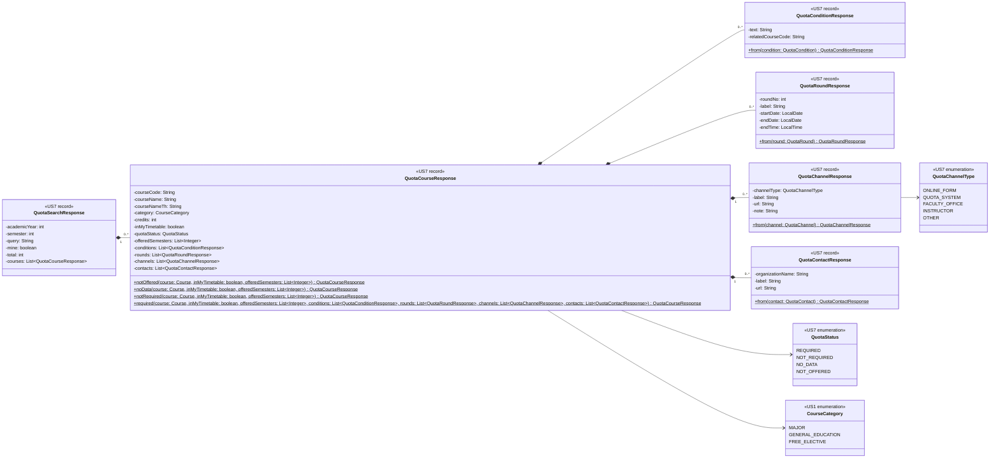

# US7 — DTO Class Diagram

US7 เพิ่ม DTO ใหม่ใน package `quota.dto` (`<<US7>>`) สำหรับ 2 endpoint ใน [DTO & API Spec](./US7-DTO-API-Spec.md) และใช้ `CourseCategory` ของ US1 (`<<US1>>`) ซ้ำ

| Type | Endpoint | หน้าที่ |
| --- | --- | --- |
| `QuotaSearchResponse` | `GET /api/quota/courses` | ผลการค้นหารายวิชาสำหรับขอโควตา พร้อม `total` (จำนวนที่ตรงทั้งหมดก่อนตัดตาม `app.quota.max-results`) และ `query` (`null` เมื่อไม่ได้ส่ง `q` เช่น `mine=true`) |
| `QuotaCourseResponse` | ทั้ง 2 endpoint | ข้อมูลวิชา สถานะโควตา (`quotaStatus`) และรายละเอียดช่องทางขอโควตา ใช้ร่วมกันทั้งผลค้นหา (เพื่อไม่เกิด N+1 request) และ endpoint วิชาเดียว |
| `QuotaStatus` | 〃 | สถานะ 4 แบบ: `NOT_OFFERED` (ไม่เปิดสอนในภาคที่ขอ), `NO_DATA` (ยังไม่มีข้อมูลโควตา), `NOT_REQUIRED` (ไม่ต้องขอโควตา), `REQUIRED` (ต้องขอโควตา) |
| `QuotaConditionResponse` | 〃 | เงื่อนไขของผู้ขอโควตา 1 ข้อ พร้อม `relatedCourseCode` (ไม่บังคับ) สำหรับทำชิปรหัสวิชาที่กดเปิดดูวิชาที่อ้างถึงได้ |
| `QuotaRoundResponse` | 〃 | รอบยื่นคำร้อง 1 รอบ (`roundNo` เรียงจากน้อยไปมาก) · `startDate` เป็น `null` เมื่อเป็นกำหนดส่งวันเดียว · `endTime` ใส่ `@JsonFormat(pattern = "HH:mm")` เหมือน `ScheduleSlotResponse` ของ US1 |
| `QuotaChannelResponse` | 〃 | ช่องทางการขอโควตา 1 ช่องทาง (1 วิชามีได้หลายช่องทาง) · `url` เป็น `null` ได้สำหรับช่องทางที่ไม่ใช่เว็บ เช่น ยื่นที่คณะ |
| `QuotaChannelType` | 〃 | ประเภทช่องทาง (`ONLINE_FORM`, `QUOTA_SYSTEM`, `FACULTY_OFFICE`, `INSTRUCTOR`, `OTHER`) ใช้เลือก icon และข้อความสำรองฝั่ง UI |
| `QuotaContactResponse` | 〃 | ช่องทางติดต่อคณะ/ภาควิชาเจ้าของวิชา (`organizationName`, `label`, `url`) |

| Static method | หน้าที่ |
| --- | --- |
| `QuotaCourseResponse.notOffered(...)` | สร้าง DTO สถานะ `NOT_OFFERED` พร้อม `offeredSemesters` และใส่ `List.of()` ให้ `conditions`, `rounds`, `channels`, `contacts` |
| `QuotaCourseResponse.noData(...)` | สร้าง DTO สถานะ `NO_DATA` พร้อม `offeredSemesters` และ list ว่างทั้งหมด |
| `QuotaCourseResponse.notRequired(...)` | สร้าง DTO สถานะ `NOT_REQUIRED` พร้อม `offeredSemesters` และ list ว่างทั้งหมด |
| `QuotaCourseResponse.required(...)` | สร้าง DTO สถานะ `REQUIRED` พร้อมรายละเอียดทั้ง 4 ส่วน (`conditions`, `rounds`, `channels`, `contacts`) |
| `QuotaConditionResponse.from(...)` ฯลฯ | แปลง entity ของแต่ละตารางโควตาเป็น response record |

**รายละเอียดที่ต้องทำให้ตรงกับ Spec:**

- **ไม่ใส่** `@JsonInclude(JsonInclude.Include.NON_NULL)` บน DTO ของ US7 เพราะ Spec กำหนดให้ส่ง field ที่เป็น `null` ออกมาใน JSON (เช่น `"query": null`, `"courseNameTh": null`, `"startDate": null`, `"endTime": null`, `"url": null`, `"note": null`)
- field แบบ list ใน `QuotaCourseResponse` (`offeredSemesters`, `conditions`, `rounds`, `channels`, `contacts`) ต้อง**ไม่เป็น `null`** ทุกสถานะ สถานะที่ไม่ใช้ field นั้นส่ง `List.of()` (`[]` ใน JSON)
- `GET /api/quota/courses` และ `GET /api/quota/courses/{courseCode}` ไม่มี request DTO — รับ `academicYear`, `semester`, `q`, `mine` เป็น `@RequestParam` และ `courseCode` เป็น `@PathVariable` ตรง ๆ ใน controller (ดู [API Class Diagram](./US7-API-Class-Diagram.md))
- entity ของข้อมูลโควตา (`CourseQuotaInfo`, `QuotaCondition`, `QuotaRound`, `QuotaChannel`, `QuotaContact`) ไม่ได้วาดในแผนภาพนี้ เพราะเป็นงาน ER Diagram ของ US7-T06

ฝั่ง frontend ใช้ type ใน `frontend/features/quota/types.ts` ตาม Spec ซึ่งตรงกับ record/enum ด้านบนทีละ field (`QuotaSearchResponse`, `QuotaCourse`, `QuotaStatus`, `QuotaCondition`, `QuotaRound`, `QuotaChannel`, `QuotaChannelType`, `QuotaContact`, `QuotaTerm`, `QuotaSearchQuery`, `QuotaErrorCode`) ส่วน `CourseCategory` ใช้ของ US1

สัญลักษณ์: field ของ record เป็น `private final` (`-`) ส่วน accessor และ constructor ที่ record สร้างให้อัตโนมัติไม่ได้วาด static method (`$`) คือที่ออกแบบเอง ไม่มี `#` เพราะ record สืบทอดไม่ได้ · `*--` = เป็นส่วนหนึ่งของ response

## เอกสารที่เกี่ยวข้อง

- [DTO & API Spec](./US7-DTO-API-Spec.md)
- [API Class Diagram](./US7-API-Class-Diagram.md)
- [US1 — DTO Class Diagram](../../US1/T05/US1-DTO-Class-Diagram.md)
