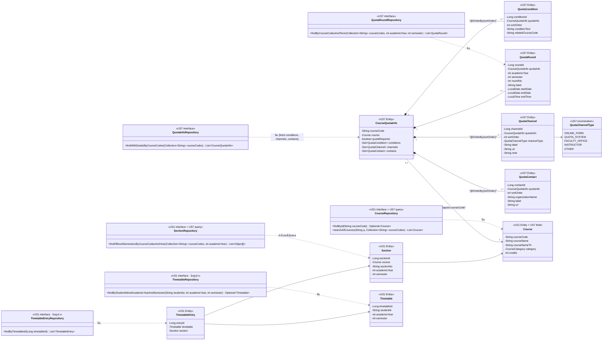

# US7-T06 — DAO Class Diagram

Entity และ Repository (DAO) ที่ `QuotaService` ใช้ ดูลำดับการทำงานใน Sequence Diagram ทั้ง 2 ไฟล์ และโครงสร้างตารางใน [ER Diagram](./US7-T06-ER-Diagram.md)

US7 เพิ่ม entity `CourseQuotaInfo`, `QuotaCondition`, `QuotaRound`, `QuotaChannel`, `QuotaContact`, enum `QuotaChannelType` และ repository `QuotaInfoRepository`, `QuotaRoundRepository` ใน package `quota` (`<<US7>>`) ส่วน `Course` (US1) เพิ่ม field `courseNameTh` และ `CourseRepository`, `SectionRepository` เพิ่มเมธอด query ของ US7 โดยไม่กระทบการทำงานเดิมของ US1

---

## รายละเอียด Query และเหตุผลการออกแบบ DAO

| Repository / Entity | รายละเอียดการทำงาน |
| --- | --- |
| `CourseRepository.searchAllCourses` | ค้นจาก**ทุกวิชาในตาราง `course`** (ไม่กรอง `EXISTS Section` แบบ `CourseRepository.search` ของ US1 เพื่อให้เจอวิชา `NOT_OFFERED` ด้วย) จับคู่ `upper(courseCode) like :prefix%`, คำใน `upper(courseName)` ขึ้นต้นด้วย `:prefix` (คั่นด้วยช่องว่างหรือ `-`), หรือ `courseNameTh like %:q%` (escape `!`, `%`, `_`, `[` เหมือน US1) · เมื่อ `mine=true` ส่ง `courseCodes` ของนักศึกษาเข้าไปกรอง `c.courseCode in :courseCodes` (ถ้า `courseCodes` ว่างคืน `List.of()` ทันทีใน default method) เรียง `ORDER BY c.courseCode` |
| `SectionRepository.findOfferedSemestersByCourseCodesAndYear` | คิวรี `SELECT DISTINCT s.course.courseCode, s.semester FROM Section s WHERE s.course.courseCode IN :courseCodes AND s.academicYear = :academicYear ORDER BY s.course.courseCode, s.semester` คืนรายการ `(courseCode, semester)` เพื่อสร้าง `offeredSemesters` และตัดสิน `NOT_OFFERED` ใน query เดียว (ไม่เกิด N+1) |
| `QuotaInfoRepository.findWithDetailsByCourseCodes` | คิวรี `SELECT DISTINCT q FROM CourseQuotaInfo q LEFT JOIN FETCH q.conditions LEFT JOIN FETCH q.channels LEFT JOIN FETCH q.contacts WHERE q.courseCode IN :courseCodes` ใช้ `Set` (หรือ `LinkedHashSet` + `@OrderBy("sortOrder ASC")`) บน entity เพื่อหลีกเลี่ยง `MultipleBagFetchException` ของ Hibernate เมื่อ fetch 3 collection พร้อมกัน และรองรับ `open-in-view: false` |
| `QuotaRoundRepository.findByCourseCodesAndTerm` | คิวรี `SELECT r FROM QuotaRound r WHERE r.quotaInfo.courseCode IN :courseCodes AND r.academicYear = :academicYear AND r.semester = :semester ORDER BY r.quotaInfo.courseCode, r.roundNo` โหลดรอบของภาคที่ขอมาใน query เดียว |

## เอกสารที่เกี่ยวข้อง

- [ER Diagram](./US7-T06-ER-Diagram.md)
- [Extended API Class Diagram](./US7-T06-Extended-API-Class-Diagram.md)
- [Sequence Diagram — Search](./US7-T06-Sequence-Diagram-Search.md)
- [Sequence Diagram — Detail](./US7-T06-Sequence-Diagram-Detail.md)
