# US7-T06 — ER Diagram (DB)

โครงสร้างฐานข้อมูลสำหรับฟีเจอร์ค้นหาช่องทางการขอโควตา (US7) ต่อยอดจากตาราง `course`, `section`, `timetable`, `timetable_entry` ของ US1 โดยเพิ่มคอลัมน์ `course_name_th` ใน `course` และเพิ่มตารางใหม่ 5 ตาราง (`course_quota_info`, `quota_condition`, `quota_round`, `quota_channel`, `quota_contact`) ด้วย **Flyway migration ไฟล์ใหม่** (ห้ามแก้ไข migration เดิมของ US1/US3 ที่ merge แล้ว)

```mermaid
erDiagram
    COURSE ||--o| COURSE_QUOTA_INFO : "มีข้อมูลโควตา (0..1)"
    COURSE ||--o{ SECTION : "เปิดสอนในภาคเรียน"
    TIMETABLE ||--o{ TIMETABLE_ENTRY : "มีรายการวิชา"
    SECTION ||--o{ TIMETABLE_ENTRY : "ถูกเลือก"

    COURSE_QUOTA_INFO ||--o{ QUOTA_CONDITION : "มีเงื่อนไข"
    COURSE ||--o{ QUOTA_CONDITION : "ถูกอ้างถึง (related_course_code)"
    COURSE_QUOTA_INFO ||--o{ QUOTA_ROUND : "มีรอบยื่นคำร้อง"
    COURSE_QUOTA_INFO ||--o{ QUOTA_CHANNEL : "มีช่องทางขอโควตา (1:N)"
    COURSE_QUOTA_INFO ||--o{ QUOTA_CONTACT : "มีช่องทางติดต่อ"

    COURSE {
        NVARCHAR(10) course_code PK "US1 มีอยู่แล้ว"
        NVARCHAR(200) course_name "US1 มีอยู่แล้ว"
        NVARCHAR(200) course_name_th "US7 เพิ่ม (NULL ได้)"
        NVARCHAR(20) category "MAJOR, GENERAL_EDUCATION, FREE_ELECTIVE"
        int credits
    }
    SECTION {
        bigint section_id PK "US1 มีอยู่แล้ว"
        NVARCHAR(10) course_code FK
        NVARCHAR(10) section_no
        int academic_year "พ.ศ. ใช้หา offeredSemesters"
        int semester "1, 2"
    }
    TIMETABLE {
        bigint timetable_id PK "US1 มีอยู่แล้ว"
        NVARCHAR(20) student_id
        int academic_year
        int semester
    }
    TIMETABLE_ENTRY {
        bigint entry_id PK "US1 มีอยู่แล้ว"
        bigint timetable_id FK
        bigint section_id FK
    }
    COURSE_QUOTA_INFO {
        NVARCHAR(10) course_code PK, FK "US7 ใหม่ · 1:0..1 กับ course"
        bit quota_required "1 = REQUIRED, 0 = NOT_REQUIRED"
    }
    QUOTA_CONDITION {
        bigint condition_id PK "US7 ใหม่"
        NVARCHAR(10) course_code FK
        int sort_order
        NVARCHAR(500) condition_text "เช่น สอบได้ EL295"
        NVARCHAR(10) related_course_code FK "NULL ได้ · ใช้ทำชิปที่กดได้"
    }
    QUOTA_ROUND {
        bigint round_id PK "US7 ใหม่"
        NVARCHAR(10) course_code FK
        int academic_year "พ.ศ. เช่น 2569"
        int semester "1, 2"
        int round_no "1, 2, ..."
        NVARCHAR(100) label "NULL ได้ · เช่น รหัส 65-66"
        date start_date "NULL ได้เมื่อเป็นกำหนดส่งวันเดียว"
        date end_date "ISO ค.ศ."
        time end_time "NULL ได้ · เช่น 15:00"
    }
    QUOTA_CHANNEL {
        bigint channel_id PK "US7 ใหม่"
        NVARCHAR(10) course_code FK
        int sort_order
        NVARCHAR(20) channel_type "ONLINE_FORM, QUOTA_SYSTEM, FACULTY_OFFICE, INSTRUCTOR, OTHER"
        NVARCHAR(200) label "เช่น ผ่านเว็บไซต์ระบบโควตา LITU"
        NVARCHAR(500) url "NULL ได้ · ต้องขึ้นต้น https://"
        NVARCHAR(300) note "NULL ได้"
    }
    QUOTA_CONTACT {
        bigint contact_id PK "US7 ใหม่"
        NVARCHAR(10) course_code FK
        int sort_order
        NVARCHAR(200) organization_name "เช่น สถาบันภาษา, สาขาวิชาฟิสิกส์"
        NVARCHAR(200) label "เช่น Facebook หรือ MS Teams wchumpon@tu.ac.th"
        NVARCHAR(500) url "NULL ได้ · ต้องขึ้นต้น https://"
    }
```

---

## 1. คำถามออกแบบ: 1 วิชามีได้หลายช่องทางหรือไม่?

**คำตอบ: 1 วิชามีได้หลายช่องทาง (ความสัมพันธ์ `1 : N` ระหว่าง `course_quota_info` กับ `quota_channel`)**

**เหตุผล:**
1. **สอดคล้องกับขั้นตอนการขอโควตาจริงของมหาวิทยาลัย:** รายวิชาหรือคณะบางแห่งเปิดให้ยื่นคำร้องได้มากกว่า 1 ช่องทาง (เช่น กรอกระบบโควตาออนไลน์ `QUOTA_SYSTEM` หรือฟอร์มออนไลน์ `ONLINE_FORM` ควบคู่กับการยื่นเอกสารที่คณะ `FACULTY_OFFICE` หรือติดต่ออาจารย์ผู้สอน `INSTRUCTOR`)
2. **รองรับข้อมูลต่างประเภทโดยไม่ปะปนกัน:** ช่องทางออนไลน์มี `url` สำหรับสร้างปุ่มเปิดแท็บใหม่ ส่วนช่องทางออฟไลน์ (`FACULTY_OFFICE` / `INSTRUCTOR`) มี `url = NULL` และแสดง `note` แทน การแยกแถวใน `quota_channel` ทำให้ `channel_type`, `label`, `url`, `note` ของแต่ละช่องทางเป็นโครงสร้างเดียวกัน
3. **ตรงกับ API Contract ของ US7-T05:** `QuotaCourseResponse.channels` เป็น `List<QuotaChannelResponse>` ไม่ใช่ object เดี่ยว

---

## 2. เหตุผลการออกแบบตารางและคอลัมน์

- **แยก `course_quota_info` ออกจาก `course`:** ตาราง `course` เป็นตารางกลางของ US1 ซึ่งมีรายวิชาที่ยังไม่มีข้อมูลโควตาอยู่ด้วย หากเพิ่ม `quota_required` ลงใน `course` จะแยกไม่ออกระหว่าง "ไม่ต้องขอโควตา" กับ "ยังไม่มีข้อมูลโควตา (`NO_DATA`)" การแยก `course_quota_info` ทำให้:
  - ไม่มีแถวใน `course_quota_info` → `NO_DATA`
  - มีแถวและ `quota_required = 0` → `NOT_REQUIRED`
  - มีแถวและ `quota_required = 1` → `REQUIRED`
- **เพิ่ม `course_name_th` ใน `course` ด้วย migration ไฟล์ใหม่:** รองรับการแสดงชื่อวิชาภาษาไทยและการค้นหาด้วยคำภาษาไทย (เช่น `แคลคูลัส` → `MA211`, `ดาราศาสตร์เบื้องต้น` → `PC280`) โดยไม่แก้ไข `V20261014_1940__create_timetable_tables.sql` ที่ merge แล้ว
- **ผูก `quota_round` กับ `(course_code, academic_year, semester)`:** ช่วงเวลายื่นคำร้องเปลี่ยนทุกภาคเรียน (เช่น ในข้อมูลจริงภาค 2/2569 ของ `EL105`, `MA211`, `AN347`, `IS313`) ส่วนเงื่อนไข ช่องทาง และช่องทางติดต่อไม่เปลี่ยนบ่อยจึงผูกกับ `course_code` ใน `course_quota_info`
- **`quota_round.label` และ `start_date`:** รองรับทั้งรอบปกติที่มีช่วงวันที่ (`EL105` รอบที่ 1: 5–9 ต.ค. 69), กำหนดส่งวันเดียวพร้อมเวลา (`MA211` `start_date = NULL`, `end_date = 2026-10-20`, `end_time = 15:00`), และรอบที่แบ่งตามรหัสนักศึกษา (`AN347` 4 รอบ ใช้ `label` เก็บ `"รหัส 65-66"`, `"รหัส 67"`, `"รหัส 68"`, `"รหัส 69"`)
- **`quota_contact.url` เป็น `NULL` ได้:** รองรับช่องทางติดต่อที่ไม่ใช่ลิงก์เว็บ เช่น `PC280` ที่ติดต่อผ่าน `MS Teams wchumpon@tu.ac.th` (ใส่ใน `label` โดย `url IS NULL`)

---

## 3. ข้อกำหนดของตาราง (Constraints) และแนวทาง Flyway Migration

> **หมายเหตุ:** เอกสารนี้ออกแบบโครงสร้างสำหรับสร้างเป็น Flyway migration ไฟล์ใหม่ในขั้นตอนพัฒนา/seed (US7-T09) เช่น `V20261114_1800__add_quota_tables.sql` **ห้ามแก้ไข** ไฟล์ migration เดิมที่ merge เข้า `develop` แล้ว

| ตาราง | Constraint | เหตุผล |
| --- | --- | --- |
| `course` | `ALTER TABLE course ADD course_name_th NVARCHAR(200) NULL` | เพิ่มชื่อวิชาภาษาไทยโดยไม่กระทบข้อมูลเดิมของ US1 |
| `course_quota_info` | `PK (course_code)`, `FK (course_code) -> course` | 1 วิชามีข้อมูลโควตาหลักได้ 1 แถว |
| `quota_condition` | `FK (course_code) -> course_quota_info ON DELETE CASCADE`, `FK (related_course_code) -> course`, `UQ (course_code, sort_order)` | ลำดับเงื่อนไขคงที่และอ้างรหัสวิชาที่มีอยู่จริง (เช่น `EL395` → `EL295`) |
| `quota_round` | `FK (course_code) -> course_quota_info ON DELETE CASCADE`, `UQ (course_code, academic_year, semester, round_no)`, `CHECK (semester IN (1, 2))`, `CHECK (start_date IS NULL OR end_date >= start_date)` | รอบไม่ซ้ำในภาคเดียวกัน และวันสิ้นสุดต้องไม่ก่อนวันเริ่มต้น |
| `quota_channel` | `FK (course_code) -> course_quota_info ON DELETE CASCADE`, `UQ (course_code, sort_order)`, `CHECK (channel_type IN (...))`, `CHECK (url IS NULL OR url LIKE 'https://%')` | ลำดับช่องทางคงที่ และป้องกันลิงก์ที่ไม่ใช่ `https://` |
| `quota_contact` | `FK (course_code) -> course_quota_info ON DELETE CASCADE`, `UQ (course_code, sort_order)`, `CHECK (url IS NULL OR url LIKE 'https://%')` | ลำดับช่องทางติดต่อคงที่ และอนุญาต `url IS NULL` สำหรับช่องทางที่ไม่ใช่เว็บ (เช่น MS Teams ของ `PC280`) |

## เอกสารที่เกี่ยวข้อง

- [DAO Class Diagram](./US7-T06-DAO-Class-Diagram.md)
- [Extended API Class Diagram](./US7-T06-Extended-API-Class-Diagram.md)
- [Sequence Diagram — Search](./US7-T06-Sequence-Diagram-Search.md)
- [Sequence Diagram — Detail](./US7-T06-Sequence-Diagram-Detail.md)
- [US7 — DTO & API Spec](../T05/US7-DTO-API-Spec.md)
