# US7-T06 — Extended API Class Diagram

ขยายจาก [API Class Diagram](../T05/US7-API-Class-Diagram.md) ของ US7-T05 โดยเชื่อม `QuotaController` และ `QuotaService` เข้ากับ Repository และ Entity ใน [DAO Class Diagram](./US7-T06-DAO-Class-Diagram.md) พร้อมระบุ `@Transactional(readOnly = true)` และเมธอดที่เรียกใช้ ส่วน `CurrentStudentProvider`, `GlobalExceptionHandler`, DTO และโมดูลฝั่ง frontend ไม่เปลี่ยนจาก T05 จึงไม่วาดซ้ำ

```mermaid
classDiagram
    direction LR

    class QuotaController {
        <<US7 RestController>>
        -quotaService: QuotaService
        -currentStudentProvider: CurrentStudentProvider
        +searchCourses(academicYear: int, semester: int, q: String, mine: boolean) QuotaSearchResponse
        +getCourseQuota(courseCode: String, academicYear: int, semester: int) QuotaCourseResponse
    }
    class QuotaService {
        <<US7 Service · readOnly>>
        -maxResults: int
        -courseRepository: CourseRepository
        -sectionRepository: SectionRepository
        -timetableRepository: TimetableRepository
        -timetableEntryRepository: TimetableEntryRepository
        -quotaInfoRepository: QuotaInfoRepository
        -quotaRoundRepository: QuotaRoundRepository
        +searchCourses(studentId: String, academicYear: int, semester: int, q: String, mine: boolean) QuotaSearchResponse
        +getCourseQuota(studentId: String, courseCode: String, academicYear: int, semester: int) QuotaCourseResponse
        -findMyCourseCodes(studentId: String, academicYear: int, semester: int) Set~String~
        -buildCourseResponses(courses: List~Course~, academicYear: int, semester: int, myCourseCodes: Set~String~) List~QuotaCourseResponse~
        -resolveStatus(offeredInTerm: boolean, quotaInfo: CourseQuotaInfo) QuotaStatus
    }

    class CourseRepository {
        <<US1 interface + US7 query>>
        +findById(courseCode: String) Optional~Course~
        +searchAllCourses(q: String, courseCodes: Collection~String~) List~Course~
    }
    class SectionRepository {
        <<US1 interface + US7 query>>
        +findOfferedSemestersByCourseCodesAndYear(courseCodes: Collection~String~, academicYear: int) List~Object[]~
    }
    class TimetableRepository {
        <<US1 interface>>
        +findByStudentIdAndAcademicYearAndSemester(studentId: String, academicYear: int, semester: int) Optional~Timetable~
    }
    class TimetableEntryRepository {
        <<US1 interface>>
        +findByTimetableId(timetableId: Long) List~TimetableEntry~
    }
    class QuotaInfoRepository {
        <<US7 interface>>
        +findWithDetailsByCourseCodes(courseCodes: Collection~String~) List~CourseQuotaInfo~
    }
    class QuotaRoundRepository {
        <<US7 interface>>
        +findByCourseCodesAndTerm(courseCodes: Collection~String~, academicYear: int, semester: int) List~QuotaRound~
    }

    class Course {
        <<US1 Entity + US7 field>>
    }
    class CourseQuotaInfo {
        <<US7 Entity>>
    }
    class QuotaCondition {
        <<US7 Entity>>
    }
    class QuotaRound {
        <<US7 Entity>>
    }
    class QuotaChannel {
        <<US7 Entity>>
    }
    class QuotaContact {
        <<US7 Entity>>
    }

    QuotaController --> QuotaService
    QuotaService --> CourseRepository : searchAllCourses / findById
    QuotaService --> SectionRepository : findOfferedSemestersByCourseCodesAndYear
    QuotaService --> TimetableRepository : findByStudentIdAndAcademicYearAndSemester
    QuotaService --> TimetableEntryRepository : findByTimetableId
    QuotaService --> QuotaInfoRepository : findWithDetailsByCourseCodes
    QuotaService --> QuotaRoundRepository : findByCourseCodesAndTerm

    CourseRepository ..> Course : คืน
    QuotaInfoRepository ..> CourseQuotaInfo : คืนพร้อม details
    QuotaRoundRepository ..> QuotaRound : คืน
    CourseQuotaInfo *-- QuotaCondition
    CourseQuotaInfo *-- QuotaChannel
    CourseQuotaInfo *-- QuotaContact
```

---

## การจัดการ Transaction และ Query

- **`QuotaService` ใช้ `@Transactional(readOnly = true)` ระดับคลาส:** US7 เป็นฟีเจอร์อ่านอย่างเดียว ไม่มีการแก้ไขข้อมูลใน DB
- **Batch loading แทน N+1:** ใน `buildCourseResponses` หลังได้รายชื่อ `courses` (ตัดตาม `maxResults` สูงสุด 50 วิชาแล้ว) service จะดึงข้อมูลเสริมทั้งหมดด้วย batch query ตามรายการ `courseCodes`:
  1. `sectionRepository.findOfferedSemestersByCourseCodesAndYear(courseCodes, academicYear)` → สร้าง `Map<String, List<Integer>>`
  2. `quotaInfoRepository.findWithDetailsByCourseCodes(courseCodes)` → สร้าง `Map<String, CourseQuotaInfo>` (พร้อม `conditions`, `channels`, `contacts`)
  3. `quotaRoundRepository.findByCourseCodesAndTerm(courseCodes, academicYear, semester)` → สร้าง `Map<String, List<QuotaRound>>`
- **ลำดับการตัดสิน `resolveStatus`:**
  1. `!offeredSemesters.contains(semester)` → `NOT_OFFERED`
  2. `quotaInfo == null` → `NO_DATA`
  3. `!quotaInfo.isQuotaRequired()` → `NOT_REQUIRED`
  4. `REQUIRED`

## เอกสารที่เกี่ยวข้อง

- [ER Diagram](./US7-T06-ER-Diagram.md)
- [DAO Class Diagram](./US7-T06-DAO-Class-Diagram.md)
- [Sequence Diagram — Search](./US7-T06-Sequence-Diagram-Search.md)
- [Sequence Diagram — Detail](./US7-T06-Sequence-Diagram-Detail.md)
- [US7 — API Class Diagram](../T05/US7-API-Class-Diagram.md)
