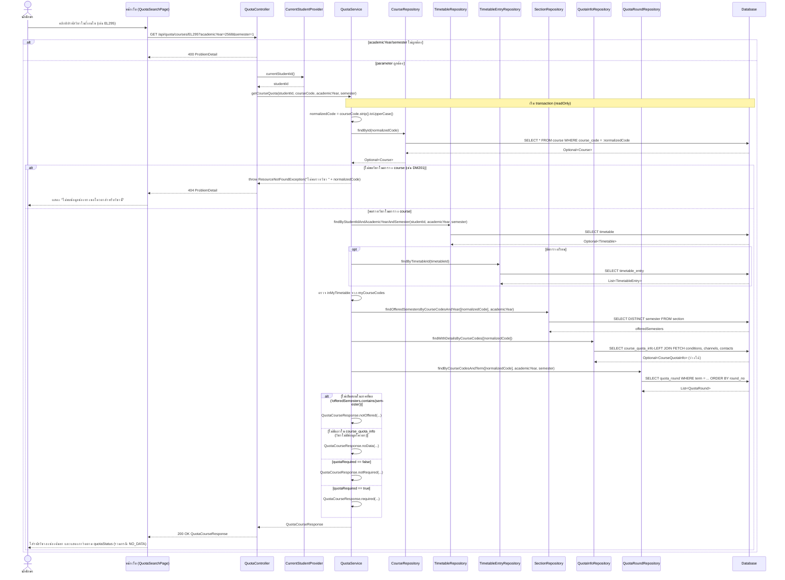

# US7-T06 — Sequence Diagram: ดึงช่องทางขอโควตาของวิชาที่เลือก

ลำดับการทำงานระหว่างหน้าเว็บ (UI), Controller, Service, Repository (DAO) และ Database สำหรับ `GET /api/quota/courses/{courseCode}?academicYear=&semester=` รวมกรณีที่วิชาไม่มีข้อมูลโควตา (`NO_DATA`) และกรณีไม่พบรายวิชาในระบบ (`404`)

## หมายเหตุสำคัญ

- **วิชาที่ไม่มีข้อมูลโควตา (`NO_DATA`) ตอบ `200` ไม่ใช่ `404`:** กรณีวิชามีอยู่ในตาราง `course` (เช่น `TU101`) แต่ยังไม่มีแถวใน `course_quota_info` backend จะสร้าง `QuotaCourseResponse.noData(...)` ที่มี `quotaStatus = "NO_DATA"` และ list ว่างทั้งหมดกลับไป
- **ตอบ `404` เฉพาะเมื่อไม่มี `courseCode` ในตาราง `course`:** เช่น `DM201` โดย `QuotaService` โยน `ResourceNotFoundException` ให้ `GlobalExceptionHandler` แปลงเป็น `404 ProblemDetail`

## เอกสารที่เกี่ยวข้อง

- [ER Diagram](./US7-T06-ER-Diagram.md)
- [DAO Class Diagram](./US7-T06-DAO-Class-Diagram.md)
- [Extended API Class Diagram](./US7-T06-Extended-API-Class-Diagram.md)
- [Sequence Diagram — Search](./US7-T06-Sequence-Diagram-Search.md)
